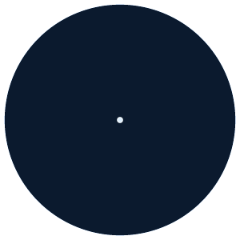
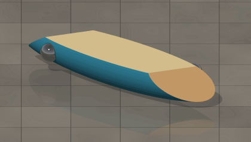

# numga

Geometric algebra with extensors in NumPy, JAX, PyTorch and WebGPU.

Extensors generalize matrices and tensors from vectors to multivectors, and from the inner and tensor products to every product of geometric algebra.

<table>
<tr>
  <td width="50%"><a href="https://numga.org/#gravitational-waves" title="Gravitational waves in a closed universe"></a></td>
  <td width="50%"><a href="https://numga.org/#snowflake" title="Snowflake thermodynamics"></a></td>
</tr>
<tr>
  <td width="50%"><a href="docs/extensors.md#12-a-scenegraph-a-robot-arm-and-a-camera-as-one-map" title="Scenegraph and camera optics"></a></td>
  <td width="50%"><a href="https://numga.org/#rattleback" title="Spin reversal by rolling contact"></a></td>
</tr>
<tr>
  <td width="50%"><a href="docs/extensors.md#1-multi-view-reconstruction-and-camera-alignment" title="Multi-view reconstruction and camera alignment"></a></td>
  <td width="50%"><a href="https://numga.org/#condensate" title="Quantized vortices in a Bose–Einstein condensate"></a></td>
</tr>
</table>

More simulations at [numga.org](https://numga.org/) · Live in WebGPU: [rotating black hole](https://eelcohoogendoorn.github.io/numga/examples/relativity/kerr/kerr_webgpu.html) · [gravitational wave](https://eelcohoogendoorn.github.io/numga/examples/relativity/gravitational_waves/gravitational_waves_webgpu.html)

## Example

Vibration modes of four point masses on springs ([notebook](examples/mechanics/modes/modes.ipynb), [Colab](https://colab.research.google.com/github/EelcoHoogendoorn/numga/blob/main/examples/mechanics/modes/modes.ipynb)):

```python
points = mv.point([[0, 0, 0], [1, 0, 0], [0, 1, 0], [0, 0, 1]])  # four unit masses
inertia = (points & points.commutator(Bivector)).sum(axis=0)
springs = points[:, None] & points[None, :]                     # a line through each pair
stiffness = (springs * (springs & Bivector)).sum(axis=(0, 1)) / 2
values, modes = (Bivector & stiffness).eigh(Bivector & inertia)
```

## Documentation

- [Video gallery (numga.org)](https://numga.org/): 18 simulations paired with the code that computes each one, live WebGPU scenes and Colab links.
- [Extensor gallery](docs/extensors.md): 36 illustrated examples introducing extensors across geometry, mechanics, fluids, optics, electromagnetism, relativity, quantum physics and thermodynamics.
- [Examples](examples/README.md): over 200 runnable notebooks.
- [Tutorials and reference](docs/README.md): primers on [geometric algebra](docs/tutorial/geometric-algebra/00-introduction.md) and [extensors](docs/tutorial/extensors/00-introduction.md), and guides on [syntax](docs/extensor_syntax.md), [orientation](docs/orientation.md), [fields](docs/fields.md), [simplicial topologies](docs/topology.md), [WebGPU rendering](docs/rendering.md), [conventions](docs/conventions.md) and [internals](docs/internals.md).
- [Articles](articles/README.md): conceptual documents on extensors, orientation, the regressive product, complementarity, discrete differential geometric algebra and coupled thermodynamics.

## Installation

```sh
pip install numga
```

To install with the examples package from GitHub:

```sh
pip install "numga[examples] @ https://github.com/EelcoHoogendoorn/numga/archive/HEAD.tar.gz"
python -m examples.mechanics.modes.scenarios
```
