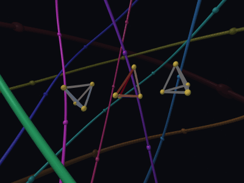
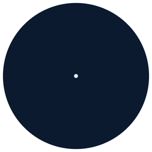
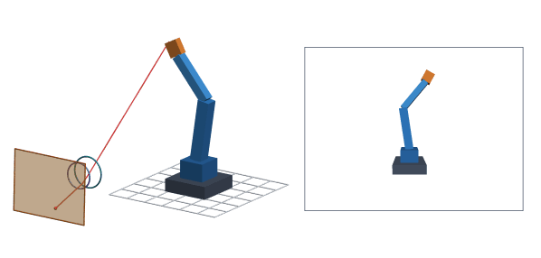
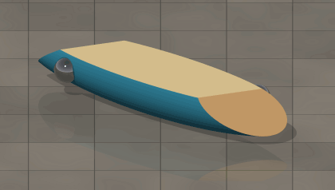
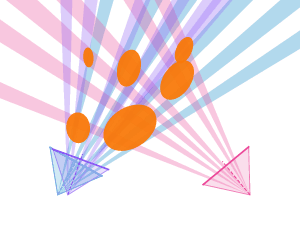
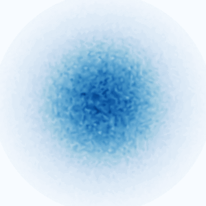

# numga

[](https://github.com/EelcoHoogendoorn/numga/actions/workflows/ci.yml)

Geometric algebra with Extensors in NumPy, JAX and PyTorch.

Extensors generalize matrices and tensors from vectors to multivectors, and from the inner and tensor products to every product of geometric algebra.

<table>
<tr><td width="50%" align="center"><a href="examples/relativity/closed_universe/"><b>Gravitational waves</b></a> <a href="https://colab.research.google.com/github/EelcoHoogendoorn/numga/blob/main/examples/relativity/closed_universe/waves.ipynb"></a><br></td><td width="50%" align="center"><a href="examples/thermodynamics/snowflake/"><b>Snowflake thermodynamics</b></a> <a href="https://colab.research.google.com/github/EelcoHoogendoorn/numga/blob/main/examples/thermodynamics/snowflake/snowflake.ipynb"></a><br></td></tr>
<tr><td width="50%" align="center"><a href="examples/geometry/scenegraph/"><b>Scenegraph and camera optics</b></a> <a href="https://colab.research.google.com/github/EelcoHoogendoorn/numga/blob/main/examples/geometry/scenegraph/scenegraph.ipynb"></a><br></td><td width="50%" align="center"><a href="examples/mechanics/rattleback/"><b>Spin reversal by rolling contact</b></a> <a href="https://colab.research.google.com/github/EelcoHoogendoorn/numga/blob/main/examples/mechanics/rattleback/rattleback.ipynb"></a><br></td></tr>
<tr><td width="50%" align="center"><a href="examples/estimation/multiview/"><b>Summing cones into splats</b></a> <a href="https://colab.research.google.com/github/EelcoHoogendoorn/numga/blob/main/examples/estimation/multiview/multiview_reconstruction.ipynb"></a><br></td><td width="50%" align="center"><a href="examples/quantum/condensate/"><b>Quantized vortices in a Bose–Einstein condensate</b></a> <a href="https://colab.research.google.com/github/EelcoHoogendoorn/numga/blob/main/examples/quantum/condensate/condensate.ipynb"></a><br></td></tr>
</table>

## Extensors

**[An introduction to extensors, and a gallery of what they do](docs/extensors.md)**: from a robot arm and its camera to a snowflake, a dynamo and a closed universe, each example a picture and the few lines of extensor code that compute it.

A short example of the extensor syntax: building unary maps and bilinear forms, and solving for the vibration modes of four point masses on springs:

```python
points = mv.vector([[0, 0, 0, 1], [1, 0, 0, 1], [0, 1, 0, 1], [0, 0, 1, 1]]).dual()   # four unit masses
inertia = (points & points.commutator(Bivector)).sum(axis=0)   # Antibivector <- Bivector

springs = points[:, None] & points[None, :]                    # [points, points] Antibivector: a line through each pair
stiffness = (springs * (springs & Bivector)).sum(axis=(0, 1)) / 2   # Antibivector <- Bivector
# the vibration modes, between two bilinear energy forms
values, modes = (Bivector & stiffness).eigh(Bivector & inertia)
```

The full example: [vibration modes](examples/mechanics/modes/modes.ipynb) [](https://colab.research.google.com/github/EelcoHoogendoorn/numga/blob/main/examples/mechanics/modes/modes.ipynb)

## Tutorials

* [Geometric algebra](docs/tutorial/geometric-algebra/00-introduction.md): a primer for readers new to geometric algebra.
* [Extensors](docs/tutorial/extensors/00-introduction.md): a primer for readers new to extensors.

## Install and run

Install directly from GitHub with Python 3.11+ and Git:

```sh
python -m pip install "numga[examples] @ git+https://github.com/EelcoHoogendoorn/numga.git@main"
python -m examples.mechanics.modes.scenarios
```

The core library depends only on NumPy; omit `[examples]` to install it. Use `[examples,jax]` or `[examples,torch]` to include those backends.

The API is under active development and may change. Replace `@main` with a commit hash to keep a particular version.
