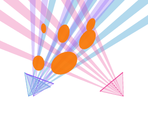
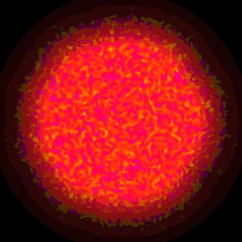

<h1 align="center">numga</h1>

<p align="center">
  Geometric algebra with extensors.<br>
  <b><a href="https://numga.org/">Watch 18 simulations at numga.org →</a></b>
  &nbsp;·&nbsp;
  <b><a href="docs/extensors.md">Extensors in 36 illustrated examples →</a></b>
  &nbsp;·&nbsp;
  <b><a href="https://www.youtube.com/@tensecondgeometry">YouTube →</a></b>
</p>

<table>
<tr>
  <td width="50%" align="center"><a href="examples/relativity/gravitational_waves/"><b>Gravitational waves</b></a> <a href="https://colab.research.google.com/github/EelcoHoogendoorn/numga/blob/main/examples/relativity/gravitational_waves/waves.ipynb"></a><br><a href="examples/relativity/gravitational_waves/"></a></td>
  <td width="50%" align="center"><a href="examples/thermodynamics/snowflake/"><b>Snowflake thermodynamics</b></a> <a href="https://colab.research.google.com/github/EelcoHoogendoorn/numga/blob/main/examples/thermodynamics/snowflake/snowflake.ipynb"></a><br><a href="examples/thermodynamics/snowflake/"></a></td>
</tr>
<tr>
  <td width="50%" align="center"><a href="examples/geometry/scenegraph/"><b>Scenegraph and camera optics</b></a> <a href="https://colab.research.google.com/github/EelcoHoogendoorn/numga/blob/main/examples/geometry/scenegraph/scenegraph.ipynb"></a><br><a href="examples/geometry/scenegraph/"></a></td>
  <td width="50%" align="center"><a href="examples/mechanics/rattleback/"><b>Spin reversal by rolling contact</b></a> <a href="https://colab.research.google.com/github/EelcoHoogendoorn/numga/blob/main/examples/mechanics/rattleback/rattleback.ipynb"></a><br><a href="examples/mechanics/rattleback/"></a></td>
</tr>
<tr>
  <td width="50%" align="center"><a href="examples/estimation/multiview/"><b>Summing cones into splats</b></a> <a href="https://colab.research.google.com/github/EelcoHoogendoorn/numga/blob/main/examples/estimation/multiview/multiview_reconstruction.ipynb"></a><br><a href="examples/estimation/multiview/"></a></td>
  <td width="50%" align="center"><a href="examples/quantum/condensate/"><b>Quantized vortices in a Bose–Einstein condensate</b></a> <a href="https://colab.research.google.com/github/EelcoHoogendoorn/numga/blob/main/examples/quantum/condensate/condensate.ipynb"></a><br><a href="examples/quantum/condensate/"></a></td>
</tr>
</table>

<p align="center">
  <b>Explore live in your browser:</b>
  &nbsp;<a href="https://eelcohoogendoorn.github.io/numga/examples/relativity/kerr/kerr_webgpu.html"><b>a rotating black hole →</b></a>
  &nbsp;·&nbsp;
  <a href="https://eelcohoogendoorn.github.io/numga/examples/relativity/gravitational_waves/gravitational_waves_webgpu.html"><b>a gravitational wave →</b></a>
</p>

<table>
<tr>
  <td width="50%" valign="top">
    <h3><a href="https://numga.org/">Video Gallery at numga.org →</a></h3>
    Watch 18 full-resolution 60 fps simulations paired with the lines of code that compute each one, live browser scenes and one-click Colab links. Compilations and shorts are on <a href="https://www.youtube.com/@tensecondgeometry"><b>YouTube</b></a>.
  </td>
  <td width="50%" valign="top">
    <h3><a href="docs/extensors.md">Extensors in 36 Examples →</a></h3>
    Walk through 36 examples from camera alignment, robot arms and rattlebacks to dynamos, skyrmions and superconductors, each a picture and the few lines of extensor code that compute it.
  </td>
</tr>
</table>

Vibration modes of four masses on springs ([notebook](examples/mechanics/modes/modes.ipynb), [Colab](https://colab.research.google.com/github/EelcoHoogendoorn/numga/blob/main/examples/mechanics/modes/modes.ipynb)):

```python
points = mv.point([[0, 0, 0], [1, 0, 0], [0, 1, 0], [0, 0, 1]])  # four unit masses
inertia = (points & points.commutator(Bivector)).sum(axis=0)
springs = points[:, None] & points[None, :]                     # a line through each pair
stiffness = (springs * (springs & Bivector)).sum(axis=(0, 1)) / 2
values, modes = (Bivector & stiffness).eigh(Bivector & inertia)
```

---

```sh
pip install numga
# or with examples:
pip install "numga[examples] @ https://github.com/EelcoHoogendoorn/numga/archive/HEAD.tar.gz"
python -m examples.mechanics.modes.scenarios
```

* **[Over 200 runnable examples](examples/README.md)** across geometry, estimation, surfaces, mechanics, fluids, optics, electromagnetism, relativity, quantum physics and thermodynamics.
* **[Tutorials and reference](docs/README.md)** covering [geometric algebra](docs/tutorial/geometric-algebra/00-introduction.md) and [extensors](docs/tutorial/extensors/00-introduction.md) primers, [syntax](docs/extensor_syntax.md), [orientation](docs/orientation.md), [fields](docs/fields.md), [simplicial topologies](docs/topology.md), [WebGPU rendering](docs/rendering.md), [conventions](docs/conventions.md) and [internals](docs/internals.md).
* **[Conceptual articles](articles/README.md)** on extensors, orientation, the regressive product, complementarity, discrete differential geometric algebra and coupled thermodynamics.

NumPy, JAX, PyTorch and WebGPU · [](https://github.com/EelcoHoogendoorn/numga/actions/workflows/ci.yml)
