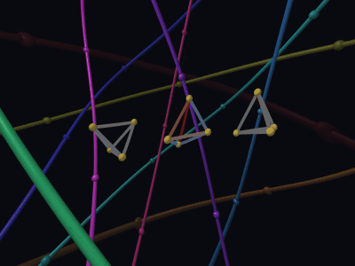
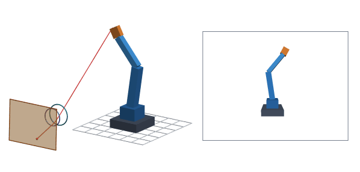

# numga

[](https://github.com/EelcoHoogendoorn/numga/actions/workflows/ci.yml)

Geometric algebra with extensors in NumPy, JAX, PyTorch and WebGPU.

Extensors generalize matrices and tensors from vectors to multivectors, and from the inner and tensor products to every product of geometric algebra.

<table>
<tr><td width="50%" align="center"><a href="examples/relativity/gravitational_waves/"><b>Gravitational waves</b></a> <a href="https://colab.research.google.com/github/EelcoHoogendoorn/numga/blob/main/examples/relativity/gravitational_waves/waves.ipynb"></a><br></td><td width="50%" align="center"><a href="examples/thermodynamics/snowflake/"><b>Snowflake thermodynamics</b></a> <a href="https://colab.research.google.com/github/EelcoHoogendoorn/numga/blob/main/examples/thermodynamics/snowflake/snowflake.ipynb"></a><br></td></tr>
<tr><td width="50%" align="center"><a href="examples/geometry/scenegraph/"><b>Scenegraph and camera optics</b></a> <a href="https://colab.research.google.com/github/EelcoHoogendoorn/numga/blob/main/examples/geometry/scenegraph/scenegraph.ipynb"></a><br></td><td width="50%" align="center"><a href="examples/mechanics/rattleback/"><b>Spin reversal by rolling contact</b></a> <a href="https://colab.research.google.com/github/EelcoHoogendoorn/numga/blob/main/examples/mechanics/rattleback/rattleback.ipynb"></a><br></td></tr>
<tr><td width="50%" align="center"><a href="examples/estimation/multiview/"><b>Summing cones into splats</b></a> <a href="https://colab.research.google.com/github/EelcoHoogendoorn/numga/blob/main/examples/estimation/multiview/multiview_reconstruction.ipynb"></a><br></td><td width="50%" align="center"><a href="examples/quantum/condensate/"><b>Quantized vortices in a Bose–Einstein condensate</b></a> <a href="https://colab.research.google.com/github/EelcoHoogendoorn/numga/blob/main/examples/quantum/condensate/condensate.ipynb"></a><br></td></tr>
</table>

**Explore live:** [a rotating black hole](https://eelcohoogendoorn.github.io/numga/examples/relativity/kerr/kerr_webgpu.html) · [a gravitational wave](https://eelcohoogendoorn.github.io/numga/examples/relativity/gravitational_waves/gravitational_waves_webgpu.html)

## Extensors

**[An introduction to extensors, and a gallery of what they do](docs/extensors.md)**: from a robot arm and its camera to a snowflake, a dynamo and a closed universe, each example a picture and the few lines of extensor code that compute it.

A short example of the extensor syntax: building unary maps and bilinear forms, and solving for the vibration modes of four point masses on springs:

```python
points = mv.point([[0, 0, 0], [1, 0, 0], [0, 1, 0], [0, 0, 1]])   # four unit masses
inertia = (points & points.commutator(Bivector)).sum(axis=0)   # Antibivector <- Bivector

springs = points[:, None] & points[None, :]                    # [points, points] Antibivector: a line through each pair
stiffness = (springs * (springs & Bivector)).sum(axis=(0, 1)) / 2   # Antibivector <- Bivector
# the vibration modes, between two bilinear energy forms
values, modes = (Bivector & stiffness).eigh(Bivector & inertia)
```

The full example: [vibration modes](examples/mechanics/modes/modes.ipynb) [](https://colab.research.google.com/github/EelcoHoogendoorn/numga/blob/main/examples/mechanics/modes/modes.ipynb)

## Documentation

* [Tutorials](docs/README.md#overview-and-tutorials): step-by-step primers on [geometric algebra](docs/tutorial/geometric-algebra/00-introduction.md) and [extensors](docs/tutorial/extensors/00-introduction.md).
* [Guides and reference](docs/README.md#guides-and-reference): [extensor syntax](docs/extensor_syntax.md), [orientation](docs/orientation.md), [fields](docs/fields.md), [simplicial topologies](docs/topology.md), [WebGPU shaders and rendering](docs/rendering.md), [conventions](docs/conventions.md) and [internals](docs/internals.md).
* [Examples](examples/README.md): over 200 runnable notebooks across geometry, estimation, surfaces, mechanics, fluids, optics, electromagnetism, relativity, quantum physics and thermodynamics.

## Articles

[Conceptual articles](articles/README.md) on extensors, orientation, the regressive product, complementarity, discrete differential geometric algebra and coupled thermodynamics, and how extensors relate to linear algebra, tensors and forms.

## Install and run

Install from PyPI:

```sh
pip install numga
```

To install `numga` with the `examples` package from GitHub and run an example:

```sh
pip install "numga[examples] @ https://github.com/EelcoHoogendoorn/numga/archive/HEAD.tar.gz"
python -m examples.mechanics.modes.scenarios
```
