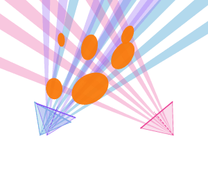
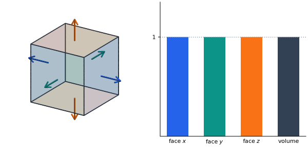
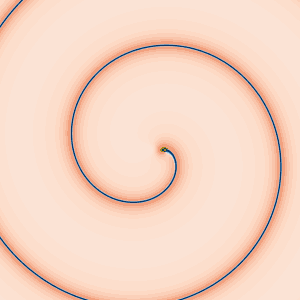

# Extensors and common practice

This document compares common approaches to applied problems with the constructions that arise in geometric algebra and extensors. Each case describes how a problem is usually formulated, sets out the geometric construction in a runnable `numga` example, and examines the practical consequences for modelling and computation, including what becomes shorter, which choices become explicit, and where extra sign or factor rules disappear.

## Maps and numerical methods

These cases concern linear and multilinear maps in estimation, mechanics and geometry, where typing inputs, outputs and pairings removes auxiliary coordinate conventions.

### Scene reconstruction and camera alignment

Scene reconstruction estimates landmark positions and camera poses from image measurements. Standard photogrammetry and computer-vision treatments minimize weighted squared image errors, form Gauss–Newton normal equations for the update, and eliminate the landmark steps by a Schur complement into a reduced camera system [[1, §§4.3, 6.1]](#references).

A [multiview reconstruction](../examples/estimation/multiview/multiview_reconstruction.ipynb) example represents each image measurement by a quadratic cost on the sensor and pulls that cost back through the camera's adjugate into a sight cone. Because the cone's polar plane vanishes on the sight line, treating that plane as a residual vector and forming normal equations from its coefficients would square a cost that is already quadratic. Instead, camera motion enters the cone's quadratic cost directly:

```python
motion = -Twist.commutator(seen)                                  # [landmarks, cameras] Antivector- <- Bivector+
curvature = (cones(motion) & motion).sum(axis=0)                  # [cameras] Scalar+ <- (Bivector+, Bivector+)
slope = (cones(seen) & motion).sum(axis=0)                        # [cameras] Scalar+ <- Bivector+
step = curvature.lstsq(-slope, rcond=1e-4)                        # [cameras] Bivector+
```

Evaluating the cone directly keeps its measurement weighting intact instead of squaring it or imposing a coordinate norm on planes, and leaves the local curvature and slope ready for the linear solve. In the joint problem, stepping cameras by extrinsic twists and landmarks by intrinsic spatial directions keeps each landmark block three-dimensional and nonsingular, so eliminating the landmarks in the Schur complement uses a direct solve rather than a pseudoinverse over homogeneous coordinates.

<p align="center"><a href="../docs/extensors.md#1-multi-view-reconstruction-and-camera-alignment"></a></p>

*Figure: three cameras aligning step by step from image measurements, showing their back-projected sight cones and the orange landmark ellipsoids formed by summing those cones across views ([extensor gallery](../docs/extensors.md#1-multi-view-reconstruction-and-camera-alignment), [notebook](../examples/estimation/multiview/multiview_reconstruction.ipynb)).*

In matrix notation, a cone cost $x^{\mathsf T}Qx$ composed with a point-motion Jacobian $M$ gives the Gauss–Newton Hessian $M^{\mathsf T}QM$, whereas treating the polar plane $Qx$ as a Euclidean residual gives $M^{\mathsf T}Q^{\mathsf T}QM$ with a squared copy of $Q$.

### Motion and force in robot control

A robot arm often moves freely in some directions while pressing against a constraint in others. Splitting those tasks by Euclidean orthogonality of six motion coordinates mixes angular and linear units and changes with the chosen origin and length scale. In robotics literature, motion and force instead inhabit dual spaces paired into mechanical power, where zero-power reciprocity relates compatible motions and constraints [[2, Ch. 2, §5]](#references) and spatial-vector tutorials emphasize that no inner product is defined on motion coordinates alone [[3]](#references).

In projective geometric algebra, a motion rate is an extrinsic twist and a force system is an intrinsic forque, paired into power by `twist & forque`. In an [odometry](../examples/estimation/odometry/odometry.ipynb) example, the same type split separates a pose correction from the differential of its cost. Information maps twists to forques (`Antibivector- <- Bivector+`), covariance maps forques back to twists (`Bivector+ <- Antibivector-`), and preconditioned conjugate gradients pairs those two spaces while preconditioning by solving the information map, so no coordinate dot product weights angles against lengths.

### Surface normals under deformation

A surface normal can record a chosen outward side of a plane or encode the area and vertex winding of a patch, and computer graphics often stores both as three-component vectors. In rendering texts, preserving tangent orthogonality under an invertible linear transformation carries a surface normal by the inverse transpose [[4, §3.10.3]](#references). In continuum elasticity, transporting an oriented area element under a regular orientation-preserving deformation multiplies that inverse transpose by the Jacobian determinant [[5, §1.7]](#references).

A [surface normals](../examples/orientation/normals/normals.ipynb) example separates the two by orientation, modelling a cutting plane as extrinsic and a triangle's joined patch as intrinsic. Reflecting the scene then carries both the outward side and the corner winding consistently even when their coefficients change with opposite signs. Under any linear deformation between intrinsic point spaces, the outermorphism carries patches forward while the [adjugate](complementarity.md#claims) pulls plane conditions backward across the regressive pairing:

```python
input_plane = deformation.adjugate()(output_plane)                # [] Vector+
```

This pullback stays defined even when the deformation is singular. Carrying an input plane forward while preserving its readings requires solving through the adjugate, which recovers the inverse transpose when the deformation is invertible. Separating the two maps prevents a backward plane pullback from being applied as a forward normal transform, and keeps cofactor area transport available when volume collapses while surface patches survive.

### Area elements and stress measures

Deforming a continuum changes both the area patch on which a traction acts and the directions in which the resulting force is expressed. Continuum mechanics records those choices in the Cauchy, first Piola–Kirchhoff and second Piola–Kirchhoff stress tensors, whose component formulas combine the deformation gradient, its inverse and its Jacobian determinant.

An [area transport](../examples/mechanics/area_transport/area_transport.ipynb) example transports an oriented patch forward by applying the deformation's outermorphism to its joined edges, and pulls a flux bivector backward through the adjugate of that area map so both read the same scalar flux:

```python
areas = deformation.outermorphism(Patch)                          # [] Antibivector- <- Antibivector-
flux_pullback = areas.adjugate()                                  # [] Bivector+ <- Bivector+
```

As algebraic maps, both `areas` and `flux_pullback` stay defined when a deformation becomes singular, extending cofactor area transport beyond the regular regime where a physical Cauchy stress is defined. For a regular deformation, stress conversions follow by composition. Composing a Cauchy traction map from current patches to current forces with `areas` gives the first Piola–Kirchhoff map on reference patches, and pulling the force output back through the inverse deformation gives the second Piola–Kirchhoff map, with each factor's domain and codomain explicit.

<p align="center"><a href="../docs/extensors.md#35-area-transport-through-a-collapse"></a></p>

*Figure: a cube sheared and flattened onto a horizontal plane on the left, while the bars on the right track its three face areas and its volume through the collapse to zero volume ([extensor gallery](../docs/extensors.md#35-area-transport-through-a-collapse), [notebook](../examples/mechanics/area_transport/area_transport.ipynb)).*

In the matrix notation of continuum mechanics, for a regular orientation-preserving deformation $F$ with Jacobian determinant $J$, deformed and reference area vectors satisfy $n\,da=J F^{-\mathsf T}N\,dA$ [[5, §1.7]](#references), and for Cauchy traction $t=\sigma n$ the first and second Piola–Kirchhoff stresses read $P=J\sigma F^{-\mathsf T}$ and $S=F^{-1}P$ [[6, §2.2]](#references).

### Vibration modes

In numerical mechanics, a stiffness or inertia matrix written between dual coordinate conventions can fail to look symmetric on its raw array entries. Averaging such a matrix with its transpose changes the operator, while forming normal equations squares its singular values and condition number. When symmetry belongs to an energy pairing between complementary spaces, pairing the map exposes that symmetry directly.

A vibration mode is a motion rate for which elastic and inertial loads stay proportional. A [normal modes](../examples/mechanics/modes/modes.ipynb) example sums spring stiffnesses and point-mass inertias as maps from twists to forques, and pairs both with a second twist to form symmetric quadratic energy maps ([extensor gallery](../docs/extensors.md#33-vibration-modes-of-a-suspended-plate)):

```python
pe_form = Twist & stiffness                                       # [] Scalar+ <- (Bivector+, Bivector+)
ke_form = Twist & inertia                                         # [] Scalar+ <- (Bivector+, Bivector+)
values, modes = pe_form.eigh(ke_form)                             # [modes] Scalar+, [modes] Bivector+
```

Symmetry follows directly from the spring and mass dyads. Under the assumption of a positive-definite inertia form, `ke_form` supplies the physical inner product between modes without symmetrizing arrays or squaring operators, returning squared angular frequencies in `values` along with zero eigenvalues for unconstrained rigid motions.

In matrix notation, structural modal analysis solves $Ku=\omega^2Mu$ for a real symmetric stiffness matrix $K$ under a symmetric positive-definite mass matrix $M$, giving real eigenvalues and $M$-orthogonal modes [[7, Ch. 9–10, §9.2.6]](#references).

### Fitting a rotation

Fitting a rigid rotation between corresponding vectors by the Kabsch–Umeyama algorithm takes a singular-value decomposition of their cross-covariance matrix and branches on the factor determinants to rule out improper reflections [[8]](#references), as used per cell in as-rigid-as-possible surface deformation [[9, §2.1]](#references).

In a [surface deformation](../examples/surfaces/arap/arap.ipynb) example, each vertex instead maximizes edge alignment directly as a quadratic form on four-component Euclidean rotors (`Scalar+ + Bivector+`). That reproduces the unit-quaternion eigenvector solution of absolute orientation from photogrammetry [[10]](#references) directly from the sandwich product rather than a hand-assembled four-by-four matrix ([extensor gallery](../docs/extensors.md#13-as-rigid-as-possible)):

```python
alignment = (weights * edges.dot(Rotor >> rest_edges)).sum(axis=0)  # [] Scalar+ <- (Rotor+, Rotor+)
values, rotors = alignment.eigh()                                   # [modes] Scalar+, [modes] Rotor+
rotation = rotors[values.argmax()].normalized()                     # [] Rotor+
```

Because every normalized eigenvector in `Rotor+` is a proper rotation, reflections never enter the search space. Extending `Rotor` to projective or spherical motors in a [point-cloud registration](../examples/geometry/registration/registration.ipynb) example removes separate centroid subtraction as well. Because `target * Motor - Motor * source` is linear in the motor, minimizing its summed residual against the motor's bulk norm solves for rotation and translation together without choosing an origin.

### Material laws in moving frames

Moving a dielectric medium mixes the electric and magnetic parts of both the field and the induced excitation, producing coupled three-vector formulas in laboratory coordinates [[11, §5.1, Eq. 22]](#references). Under rest-frame linear response assumptions, the moving medium evaluates its rest-frame law on the field boosted into its rest frame and boosts the resulting excitation back to the laboratory.

A [constitutive media](../examples/electromagnetism/constitutive/constitutive.ipynb) example writes that conjugation directly on the spacetime bivector map:

```python
moving_medium = boost >> rest_medium(boost << Bivector)           # [] Antibivector- <- Bivector+
```

The same conjugation moves a rigid-body inertia between body and world frames, while applying a transformation only on the output or only on the input produces [distinct maps](multiple_lenses.md#2-the-geometric-lens). A Lorentz boost transforms the field gradient (`Bivector+ <- Antivector-`) of a point charge in the same way in a [moving charge](../examples/electromagnetism/moving_charge/moving_charge.ipynb) example.

In matrix notation, transporting a linear map across frames takes the form $A_{\mathrm{out}}TA_{\mathrm{in}}^{-1}$, where $A_{\mathrm{in}}$ and $A_{\mathrm{out}}$ represent the transformation on the input and output spaces.

## Tensor representations

These cases concern quantities that tensor formulations pack into coordinate arrays or compressed matrices ([Extensors, linear algebra, tensors and forms](frameworks.md)).

### Inertia, vorticity and curvature

Three-dimensional vector mechanics represents angular velocity by an axial arrow along its rotation axis so a three-by-three inertia matrix can map it to an angular-momentum arrow, or assembles angular and linear parts into a six-by-six generalized inertia matrix [[2, Ch. 4, §2.2]](#references), relying on grade two and grade one sharing three components. A [spinning top](../examples/mechanics/spinning_top/spinning_top.ipynb) example instead builds inertia directly on motion rates by joining each mass point with its velocity ([tennis racket](https://numga.org/#tennis-racket), [rattleback](https://numga.org/#rattleback)):

```python
inertia = points.regressive(points.commutator(Rate) * masses).sum()  # [] Antibivector- <- Bivector+
```

The same line includes linear momentum alongside angular momentum in projective space and carries over unchanged to the plane with one rotation component and four-space with six. Fluid vorticity and torsion-free spacetime curvature follow the same pattern. A [vortices](../examples/fluids/vortices/vortices.ipynb) example takes the geometric derivative of the velocity field to obtain divergence and the vorticity plane together without a three-dimensional curl. Following spacetime-algebra treatments of general relativity [[12, §5]](#references), a [gravitational-wave curvature](../examples/relativity/curvature/curvature.ipynb) example represents torsion-free Riemann curvature as a map from spacetime area patches to rotation planes, symmetric under the spacetime pairing rather than as a Euclidean six-by-six array.

In three-dimensional vector and tensor notation, rotational inertia reads $I_{ij}=\sum m(r^2\delta_{ij}-r_i r_j)$, fluid vorticity is the axial curl $\boldsymbol{\omega} = \nabla \times \mathbf{v}$ (twice the antisymmetric continuum spin rate $\frac{1}{2}(\partial_i v_j - \partial_j v_i)$), and torsion-free Riemann curvature is the four-index tensor $R^{\mu}{}_{\nu\alpha\beta}$, antisymmetric within each index pair and symmetric under pair exchange once the first index is lowered with the spacetime metric.

### Elasticity and compressed tensor notation

Computational elasticity commonly packs symmetric strain and stress tensors into six-component columns and stiffness into a six-by-six matrix. Engineering Voigt notation doubles shear strains while leaving shear stresses unscaled, whereas Kelvin (or Mandel) notation scales both by square-root-of-two factors, so stress and strain arrays must use compatible shear factors to preserve their elastic-energy pairing [[13, §§2–3]](#references).

A [crystal waves](../examples/mechanics/crystal_waves/crystal_waves.ipynb) example keeps stiffness as a multilinear extensor taking a face normal, a displacement and a wavevector to a traction, and binds the wave propagation heading to both plane arguments to form the acoustic Christoffel operator directly:

```python
christoffel = crystal(heading, Antivector, heading)               # [] Vector+ <- Antivector-
wave_form = christoffel(Antivector) & Antivector                  # [] Scalar+ <- (Antivector-, Antivector-)
length_form = Antivector.dot(Antivector)                          # [] Scalar+ <- (Antivector-, Antivector-)
values, polarizations = wave_form.eigh(length_form)               # [modes] Scalar+, [modes] Antivector-
```

The eigenvalues `values` are density times squared phase speed and `polarizations` are the wave displacement directions, obtained directly from the material law without six-vector packing or shear-factor conventions.

### Stress index conventions

Specifying a component of stress requires two geometric arguments, the plane of the cut face and the direction in which traction is read. Under balance of moment of momentum in continuum mechanics [[6, §2.2]](#references), the Cauchy stress is symmetric while the first Piola–Kirchhoff stress has distinct current and reference arguments and is generally unsymmetric. A transposition mistake hidden by Cauchy symmetry therefore changes the first Piola–Kirchhoff stress as soon as one argument is pulled back to the reference configuration. Typing stress as `Antivector- <- Vector+` in an [elastic stress](../examples/mechanics/stress/stress.ipynb) example declares the cut plane as the input and the traction direction as the output once at construction (whereas the acoustic wave operator above outputs traction as `Vector+` to pair directly with displacement), so application, area pullback and frame changes follow the type rather than a remembered index order.

### Electromagnetic constitutive tensors

Macroscopic electromagnetism commonly relates electric field, magnetic induction, electric displacement and magnetic field strength through separate permittivity, permeability and magnetoelectric matrices. Premetric electrodynamics in the exterior-calculus literature [[14]](#references) instead separates the untwisted field two-form from the twisted excitation two-form and places all metric and material structure into a constitutive law between them.

For a local linear medium, a [constitutive media](../examples/electromagnetism/constitutive/constitutive.ipynb) example types that response as `Antibivector- <- Bivector+` in four-dimensional spacetime. Both spaces have six components, their orientations separate field from excitation, and one linear map composes with boosts, media boundaries and dispersion solves while the exterior Maxwell equations stay untouched.

## Applied geometric-algebra idioms

Even without higher-arity extensors, several recurring engineering headaches in robotics, graphics, relativity and orientation bookkeeping drop out directly from choosing the right element in geometric algebra (for the underlying representation principles, see [Complementarity](complementarity.md#appendix-representations)).

### Blending rigid motions

Linear blend skinning averages bone transformation matrices entry by entry, which ceases to be rigid and pinches twisting joints. Dual-quaternion skinning in computer graphics instead forms a weighted sum of unit dual quaternions representing finite rigid transformations and normalizes the result after choosing compatible antipodal signs [[15, §§3.2–3.3]](#references); unit dual quaternions represent rigid transformations only, so non-rigid scale and shear require a separate treatment. A [skeletal skinning](../examples/surfaces/skinning/skinning.ipynb) example writes the same motor blend alongside matrix skinning in projective three-space:

```python
motor_skin = (root + weight * (tip - root)).normalized() >> vertices                  # [vertices] Antivector-
matrix_skin = ((root >> Point) + weight * ((tip >> Point) - (root >> Point)))(vertices)  # [vertices] Antivector-
```

With the double-cover sign of `tip` aligned to `root` beforehand so antipodal representatives of the same pose do not cancel, the first line applies a normalized rigid motor at every vertex, while the second averages the induced point maps and reproduces linear blend skinning's joint pinching.

### Spatial vectors and rigid-body mechanics

Spatial-vector dynamics packages rigid-body velocities and forces into dual motion and force spaces of six components, introducing separate six-by-six Plücker transformation matrices and distinct motion and force cross-product matrices so power stays a scalar pairing [[3]](#references). In projective geometric algebra, twists and forques live inside the same algebra as points, planes and lines, so one motor sandwich transforms both, one `.commutator()` differentiates both, and the regressive product pairs them into power [[16, §§2.2, 6]](#references), [[17, Ch. 9]](#references), [[18, §2.7]](#references).

### Boosting fields and composing boosts

Vector electrodynamics transforms electric and magnetic fields under a Lorentz boost through separate parallel and transverse three-vector formulas [[19, §26-3, Table 26-4]](#references), whereas spacetime algebra boosts a single spacetime bivector directly by `boost >> field` [[20, §§III–IV, VI]](#references), as in a [moving charge](../examples/electromagnetism/moving_charge/moving_charge.ipynb) example.

<p align="center"><a href="../docs/extensors.md#28-moving-charges"></a></p>

*Figure: a point charge circling near the speed of light, with its boosted electromagnetic field spiralling outward from the retarded worldline ([extensor gallery](../docs/extensors.md#28-moving-charges), [notebook](../examples/electromagnetism/moving_charge/moving_charge.ipynb)).*

Successive non-collinear boosts compose into a pure boost plus a spatial Wigner rotation whose low-speed accumulation gives the Thomas correction that halves the naive spin–orbit term [[21, §§VII.C–VII.D]](#references). In a [Thomas precession](../examples/relativity/thomas_precession/thomas_precession.ipynb) example, multiplying boost rotors keeps velocity and frame rotation in one product, and factoring out the pure boost back to the laboratory frame reads off the accumulated rotation directly.

### Reflections and sign rules

Three-dimensional vector calculus splits polar from axial vectors under mirror reflection [[22, §52-5]](#references) and multiplies orthogonal transforms by $\det(M)$ for angular momenta, torques and magnetic fields [[23, §2.10]](#references). Carrying intrinsic and extrinsic [orientations](orientation.md) on the algebraic type lets one reflection operator `mirror >> x` negate a rotation about an axis lying in a mirror while preserving a directed momentum line along that same axis, and in a mirror perpendicular to a horizontal triangle reverse the triangle's winding while keeping its cutting plane's upward side.

In three-dimensional Cartesian vector notation, an orthogonal transformation $M$ carries polar vector coordinates by $M$ and axial vector coordinates by $\det(M)\,M$.

### Quaternion conventions

Quaternion implementations differ in standard-versus-flipped multiplication order, scalar-versus-vector component order and active-versus-passive or world-versus-body frame sense, requiring convention-translation recipes across robotics and vision libraries [[24]](#references). In geometric algebra, the geometric product fixes bivector multiplication directly from the basis planes x∧y, y∧z and z∧x without a separate multiplication rule, and `rotor >> value` versus `rotor << value` writes the two sandwich directions explicitly, while frame sense, perturbation side and external interface ordering remain explicit modelling choices.

## Companion documents

* [Extensors through multiple lenses](multiple_lenses.md): how multilinear maps arise from partial products, transform under motions and assemble from dyads.
* [Why orientation](orientation.md): why geometric constructions and positive physical energies require intrinsic and extrinsic orientation.
* [The regressive product](regressive_product.md): how the regressive product pairs orientations, joins points, contracts fields and builds linear maps and their adjugates.
* [Complementarity](complementarity.md): how complementary pairings and physical representations extend across geometry, mechanics, estimation and physics.
* [Extensors, linear algebra, tensors and forms](frameworks.md): how linear algebra, tensors, exterior algebra and specialized calculi sit inside geometric algebra and extensors.

## References

1. [*Bundle Adjustment — A Modern Synthesis*](https://www.cs.jhu.edu/~misha/ReadingSeminar/Papers/Triggs00.pdf) (Bill Triggs, Philip F. McLauchlan, Richard I. Hartley and Andrew W. Fitzgibbon, *Vision Algorithms: Theory and Practice*, 2000).
2. [*A Mathematical Introduction to Robotic Manipulation*](https://www.cds.caltech.edu/~murray/books/MLS/pdf/mls94-complete.pdf) (Richard M. Murray, Zexiang Li and S. Shankar Sastry, 1994).
3. [*A Beginner's Guide to 6-D Vectors (Part 1)*](https://bleyer.org/files/A%20Beginner%27s%20Guide%20to%206-D%20Vectors%20-%20Feathersone%20%28IEEE%2C%202010%29.pdf) (Roy Featherstone, *IEEE Robotics & Automation Magazine*, 2010).
4. [*Physically Based Rendering: From Theory to Implementation*](https://pbr-book.org/4ed/Geometry_and_Transformations/Applying_Transformations) (Matt Pharr, Wenzel Jakob and Greg Humphreys, 4th ed., 2023).
5. [*Mathematical Foundations of Elasticity*, Chapter 1](https://authors.library.caltech.edu/records/s9jhk-sn323/files/MFE_Chapter_1.pdf?download=1) (Jerrold E. Marsden and Thomas J. R. Hughes, 1983; Dover ed., 1994).
6. [*Mathematical Foundations of Elasticity*, Chapter 2](https://authors.library.caltech.edu/records/s9jhk-sn323/files/MFE_Chapter_2.pdf?download=1) (Jerrold E. Marsden and Thomas J. R. Hughes, 1983; Dover ed., 1994).
7. [*Numerical Methods for Large Eigenvalue Problems*](https://www-users.cse.umn.edu/~saad/eig_book_2ndEd.pdf) (Yousef Saad, revised ed., 2011).
8. [*A Purely Algebraic Justification of the Kabsch–Umeyama Algorithm*](https://nvlpubs.nist.gov/nistpubs/jres/124/jres.124.028.pdf) (Jim Lawrence, Javier Bernal and Christoph Witzgall, *Journal of Research of NIST*, 2019).
9. [*As-Rigid-As-Possible Surface Modeling*](https://igl.ethz.ch/projects/ARAP/arap_web.pdf) (Olga Sorkine and Marc Alexa, *Symposium on Geometry Processing*, 2007).
10. [*Closed-form solution of absolute orientation using unit quaternions*](https://people.csail.mit.edu/bkph/papers/Absolute_Orientation.pdf) (Berthold K. P. Horn, *Journal of the Optical Society of America A*, 1987).
11. [*The Constitutive Relations and the Magnetoelectric Effect for Moving Media*](https://arxiv.org/pdf/1204.0114) (Tomislav Ivezić, 2012).
12. [*Gravity, gauge theories and geometric algebra*](https://arxiv.org/pdf/gr-qc/0405033) (Anthony Lasenby, Chris Doran and Stephen Gull, *Philosophical Transactions of the Royal Society A*, 1998; arXiv, 2004).
13. [*On VOIGT and KELVIN Matrix Notations of Second-Order Tensors*](https://d-nb.info/1263215041/34) (Ralf Schlebusch, *PAMM*, 2019).
14. [*Recent developments in premetric classical electrodynamics*](https://arxiv.org/pdf/physics/0610221) (Friedrich W. Hehl, Yakov Itin and Yuri N. Obukhov, 2006).
15. [*Skinning with Dual Quaternions*](https://users.cs.utah.edu/~ladislav/kavan07skinning/kavan07skinning.pdf) (Ladislav Kavan, Steven Collins, Jiří Žára and Carol O'Sullivan, *Symposium on Interactive 3D Graphics and Games*, 2007).
16. [*On the Homogeneous Model of Euclidean Geometry*](https://arxiv.org/pdf/1101.4542) (Charles Gunn, in *Guide to Geometric Algebra in Practice*, Leo Dorst and Joan Lasenby, eds., Springer, 2011; extended preprint of AGACSE 2010).
17. [*Geometry, Kinematics, and Rigid Body Mechanics in Cayley–Klein Geometries*](https://depositonce.tu-berlin.de/bitstreams/5a02e6fc-d9c3-4e6f-a5ab-f4a970e81209/download) (Charles Gunn, Doctoral Dissertation, Technische Universität Berlin, 2011; DOI `10.14279/depositonce-3058`).
18. [*May the Forque Be with You: Dynamics in PGA*](https://bivector.net/PGAdyn.pdf) (Leo Dorst and Steven De Keninck, 2022).
19. [*The Feynman Lectures on Physics*, Vol. II, Chapter 26: Lorentz Transformations of the Fields](https://www.feynmanlectures.caltech.edu/II_26.html) (Richard P. Feynman, Robert B. Leighton and Matthew Sands, 1964).
20. [*Spacetime Physics with Geometric Algebra*](https://davidhestenes.net/geocalc/pdf/SpacetimePhysics.pdf) (David Hestenes, *American Journal of Physics*, 2003).
21. [*Relativistic velocity space, Wigner rotation and Thomas precession*](https://arxiv.org/pdf/gr-qc/0501070) (John A. Rhodes and Mark D. Semon, *American Journal of Physics*, 2004; arXiv, 2005).
22. [*The Feynman Lectures on Physics*, Vol. I, Chapter 52: Symmetry in Physical Laws](https://www.feynmanlectures.caltech.edu/I_52.html) (Richard P. Feynman, Robert B. Leighton and Matthew Sands, 1963).
23. [*Physics of Continuous Matter*, Chapter 2: Space and time](https://cns.gatech.edu/~predrag/courses/PHYS-4421-04/lautrup/7.7/space.pdf) (Benny Lautrup, rev. 7.7, 2004).
24. [*Why and How to Avoid the Flipped Quaternion Multiplication*](https://arxiv.org/pdf/1801.07478) (Hannes Sommer, Igor Gilitschenski, Michael Bloesch, Stephan Weiss, Roland Siegwart and Juan Nieto, *Aerospace*, 2018).
