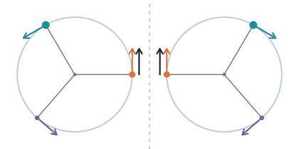
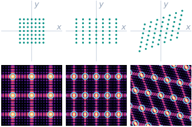

# Complementarity

Quantities that move with a space and quantities that measure or act on them transform in different ways, yet combine into invariant physical readings. This document sets out a single complementary form for that pairing, providing a unifying perspective on dual constructions across a wide range of fields.

## The ansatz

A geometric relationship or a physical measurement that evaluates to an ordinary scalar takes one of two forms, pairing an extrinsic factor first with an intrinsic one directly or through a duality map:

```python
scalar = extrinsic & intrinsic                # [] Scalar+
scalar = extrinsic & duality(extrinsic)       # [] Scalar+
scalar = duality(intrinsic) & intrinsic       # [] Scalar+
```

The first form pairs two quantities of opposite [orientation](orientation.md): an extrinsic element (`+`), oriented in the space around it like the sides of a plane or a turn about a line, and an intrinsic element (`-`), oriented within itself like a weight at a point or a direction along a line. Through [the regressive product](regressive_product.md), an extrinsic quantity pairs with an intrinsic one of complementary grade, k and n − k in a space of n dimensions. A plane tests a point this way, `plane & point`, a wavevector reads the phase a wave gains across a displacement, `wavevector & displacement`, and a motion takes power from a force, `rate & forque`.

The quadratic forms pair a quantity with its own image under a map, keeping the extrinsic factor first on both orientations. The term ***duality map*** here means a [linear extensor](multiple_lenses.md) from one kind of element to the complementary kind, intrinsic to extrinsic or the reverse, taking an input into its complementary space so the two can pair. A body's inertia takes an extrinsic rate of motion to an intrinsic momentum, and `rate & inertia(rate)` is twice the kinetic energy. A medium's susceptibility takes an extrinsic field to the intrinsic response it induces, and `field & susceptibility(field)` pairs the two. A quadric surface takes an intrinsic point to an extrinsic plane, and `quadric(point) & point` tests whether the point lies on the surface. Each is again an extrinsic quantity paired with an intrinsic one.

Which of the two kinds a quantity is follows from how it is built and from what it does ([Appendix: representations](#appendix-representations)). The mirrors of a space, its hyperplanes, are extrinsic, and so are the rates, twists and fields built from them by the outer product, which generate continuous motion. What those transformations carry is intrinsic: points, the lines and patches joined from points by the regressive product, and extensive quantities such as mass and entropy.

## Claims

A reading written in either form has four properties. The first is that the pairing involves no metric. The regressive product of complementary grades depends on the grades and on the unit of volume alone, so one expression serves a Euclidean algebra, a projective algebra, whose metric is degenerate, a spacetime, whose metric is indefinite, and a space of thermodynamic states, which has no metric at all. Where a metric does belong to a problem, it enters explicitly as a duality map of its own, `metric(intrinsic) & intrinsic`: as a constitutive law, as a reference quadric shape, or as the comparison form in an eigenproblem.

The second is that the expression does not depend on the dimension. In a space of another dimension the two factors have other grades, and with the extrinsic factor first the line that pairs them is unchanged, with no sign in it that varies with the dimension.

The third is that a mirror leaves the reading as it is. A reflection commutes with every product, `mirror >> (a & b) == (mirror >> a) & (mirror >> b)`, and an extrinsic factor paired with an intrinsic one gives an extrinsic scalar, which a reflection does not change.

The fourth is that every linear map transfers across the pairing, including a map that has no inverse. Where a map `T` carries the intrinsic factor forward, its adjugate pulls the extrinsic factor back, `measurement & T(variation) == T.adjugate()(measurement) & variation`, whether or not `T` preserves lengths; when `T` is invertible, solving through `T.adjugate()` carries the extrinsic factor forward as well.

The same adjugate governs duality maps themselves. Because a duality map sends an element to its complementary space, `duality.adjugate()` has the same domain and codomain as `duality`, so symmetry (`duality == duality.adjugate()`) and antisymmetry (`duality == -duality.adjugate()`) are metric-free algebraic statements. Any duality map splits into a symmetric part, which models inertias, quadrics, energy Hessians, covariances and dissipative conductances, and an antisymmetric part whose quadratic reading vanishes, which models gyroscopic, Hall, odd-elastic and symplectic couplings. Under any linear map `T`, invertible or not, a duality map transfers across `T` by congruence, preserving symmetry and positivity without a metric or an inverse:

```python
duality == duality.adjugate()                  # [] symmetry without a metric
pulled = T.adjugate()(duality(T))              # [] pullback across T
pushed = T(duality(T.adjugate()))              # [] pushforward across T
```

Camera sight cones, discrete conductance matrices, articulated joint inertias, Kalman covariance updates and Onsager transport responses all take one of these two congruence forms.

## A spinning wheel

A spinning wheel shows two of these properties, independence of dimension and invariance under a mirror, on quantities from a first course in mechanics. In a `numga` [spinning wheel](../examples/orientation/spinning_wheel/spinning_wheel.ipynb) example, three rim masses spin about a hub while a tangential push acts at a handle on the rim. The rate of turning is modelled as the extrinsic plane the wheel turns in, while the mass positions from the hub and the push are intrinsic ([Points, motions and momenta](#points-motions-and-momenta)). Each mass moves with velocity `points.commutator(Rate)` from the spatial metric, while joining positions with velocities and forces and reading kinetic energy and power use the regressive product alone:

```python
inertia = points.regressive(points.commutator(Rate) * masses).sum()   # [] Antibivector- <- Bivector+
momentum = inertia(rate)                                              # [] Antibivector-
energy = (rate & momentum) / 2                                        # [] Scalar+: 13.5
torque = handle & push                                                # [] Antibivector-
power = rate & torque                                                 # [] Scalar+: 4.5
```

The same five lines serve a wheel in the plane and a wheel in space. For three rim masses totaling 3 at unit radius, turning at angular speed 3 under a tangential push of 1.5, the planar momentum is one number, 9, while for the same wheel tilted in space it has three components of magnitude 9; in both algebras the kinetic energy is 13.5 and the power is 4.5. Rebuilding the wheel from its mirrored ingredients `mirror >> points`, `mirror >> rate` and `mirror >> push` reverses the momentum and the torque, since the mirror image turns the other way, while keeping the kinetic energy and the power at 13.5 and 4.5.

<p align="center"></p>

*Figure: a wheel of three masses, left, and its mirror image, right, with the mirror as the dashed line. Coloured arrows are the masses' velocities, and the dark arrow is the push.*

In the vector notation of introductory and classical mechanics, turning planes in three-space are dualized into axle vectors pointed by the right-hand rule, writing rotational kinetic energy and mechanical power with Euclidean dot and cross products as $K = \tfrac{1}{2}\boldsymbol{\omega}\cdot(I\boldsymbol{\omega})$, with $I_{ij} = \sum_a m_a(r_a^2\delta_{ij} - r_{ai}r_{aj})$, and $P = (\mathbf{r}\times\mathbf{F})\cdot\boldsymbol{\omega}$ [[1, §52-5]](#references), [[2, Ch. 4–5]](#references). Because the cross product exists only in three dimensions, planar rotation is treated separately with signed scalars ($L = I\omega$, $P = \tau\omega$), while in space reflecting every vector as $M\mathbf{v}$ negates $(\mathbf{r}\times\mathbf{F})\cdot\boldsymbol{\omega}$ unless $\boldsymbol{\omega}$, $\mathbf{L}$ and $\boldsymbol{\tau}$ carry an extra $\det(M)M$ axial-vector rule [[1, §52-5]](#references). Screw theory recovers a metric-free pairing for rigid motion by separating twists in $\mathfrak{se}(3)$ from wrenches in the dual space $\mathfrak{se}(3)^*$ [[3, Ch. 2 §5, Ch. 4]](#references), though it stays restricted to proper three-dimensional flat motions apart from reflections, points and planes. Projective geometric-algebra mechanics formulates that dual pairing between rate axes and momentum spears across Cayley–Klein spaces, retaining translational kinetic energy where a projective inner product drops it [[4, §§2.2, 6]](#references), [[5, Ch. 9]](#references), [[6, §2.7]](#references), [[7, §8.6.1]](#references).

## Wave phase under a deformation

A plane wave advances its phase from crest to crest, and the phase gained across a displacement counts how many wavefronts that displacement crosses, showing the remaining two properties, freedom from a metric and transport under a linear deformation. In [crystal diffraction](../examples/optics/crystal_diffraction/crystal_diffraction.ipynb) and [graphene](../examples/quantum/graphene/graphene.ipynb) examples, the wavevector is modelled as the extrinsic plane of its wavefronts and the displacement between two atoms as intrinsic, so their regressive pairing reads the phase directly and the deformation's adjugate transports the wavevector:

```python
phase = wavevector & displacement                                        # [] Scalar+
pulled_wavevector = projection.adjugate()(wavevector)                    # [] Vector+ (even if singular)
moved_displacement = deformation(displacement)                           # [] Antivector-
moved_wavevector = deformation.adjugate().solve(wavevector)              # [] Vector+
moved_phase = moved_wavevector & moved_displacement                      # [] Scalar+ (unchanged)
```

The pairing `wavevector & displacement` uses no metric, so the same line counts phase across the three bonds of a honeycomb sheet in the plane, across a crystal in space, and across an event in spacetime, where time squares to minus one. Under any linear map `deformation` on displacements, its adjugate pulls a wavevector back so that `deformation.adjugate()(wavevector) & displacement == wavevector & deformation(displacement)`, even when `deformation` flattens a volume onto a plane and has no inverse. When an invertible stretch, shear and turn deforms a crystal, solving forward through `deformation.adjugate()` carries each reciprocal-lattice wavevector so that its phase at every displaced atom stays unchanged; doubling the spacing along x halves the wavevector component along x.

<p align="center"></p>

*Figure: a square layer of atoms (top left), stretched along x (top centre), and stretched, sheared and turned (top right), above the scattered intensity of each; circles mark the reciprocal wavevectors carried by solving through the deformation's adjugate.*

In the vector notation of wave optics and relativity, plane-wave phase is written as a metric inner product, $\delta\phi = \mathbf{k}\cdot\delta\mathbf{r}$ in space or $\omega t - \mathbf{k}\cdot\mathbf{r}$ in spacetime [[8, §34-7]](#references). Placing $\mathbf{k}$ and $\delta\mathbf{r}$ in one metric vector space means that pushing both forward by a twofold stretch multiplies $\mathbf{k}\cdot\delta\mathbf{r}$ by four instead of preserving the wavefront count, while in spacetime the Minkowski metric's minus sign enters only to undo the sign introduced by raising the wave covector into a four-vector. Solid-state physics restores deformation invariance by introducing a separate reciprocal lattice defined by $\mathbf{a}_i \cdot \mathbf{b}_j = 2\pi\delta_{ij}$ [[9, Ch. 5]](#references), though its standard construction $\mathbf{b}_1 = 2\pi(\mathbf{a}_2\times\mathbf{a}_3)/[\mathbf{a}_1\cdot(\mathbf{a}_2\times\mathbf{a}_3)]$ is three-dimensional only (forcing planar crystals such as graphene to invent an out-of-plane axis) and inserts the Euclidean metric twice only to cancel it. Geometric treatments of relativity separate wave 1-forms $\langle\tilde{\mathbf{k}}, \delta\mathbf{x}\rangle$ counting pierced phase surfaces without a metric [[10, Ch. 2]](#references), in an exterior calculus apart from rotors and spatial geometry.

## One perspective across languages

The vector notation stores the wheel's rates and momenta, and the crystal's displacements and wavevectors, as vectors of one space. In its own setting that gives the right numbers: in orthonormal three-dimensional Euclidean coordinates under proper rotations, the Euclidean metric has the identity matrix, rotations equal their own inverse transpose (`F == F.adjugate().inverse()`), and transformations have determinant +1. In that setting an intrinsic quantity and its extrinsic counterpart transform with identical coordinates, so storing both as vectors of one space and pairing them with the Euclidean inner product produces the same numbers. Leaving that setting separates the transformation laws of the two, whether through a non-rigid stretch, a camera projection that has no inverse, a reflection, an indefinite or degenerate metric, a state space whose variables share no unit, or a change of dimension. With each quantity's grade and orientation chosen from how it is built and how it acts ([Appendix: representations](#appendix-representations)), its type records which side of the pairing it belongs to from the start.

Across geometry, mechanics and physics, mainstream treatments commonly retain the single-space inner-product form and supply coordinate or sign rules where needed, while specialized formulations within each discipline have arrived at parts of the same dual separation under their own names and notations: polarities between $\mathbb{P}^n$ and $(\mathbb{P}^n)^*$, reciprocal lattices, covariant and contravariant tensors, untwisted and twisted differential forms [[11, §28]](#references), finite element exterior calculus, screw theory ($\mathfrak{se}(3)/\mathfrak{se}(3)^*$), Lie–Poisson hydrodynamics ($\mathfrak{g}/\mathfrak{g}^*$), premetric electrodynamics, the canonical symplectic form on state–potential spaces, Fisher information against covariance, and operational state and effect cones. Even those stronger formulations solve one slice at a time (exterior forms omit rotors and projective geometry; screw theory is locked to proper three-dimensional rigid motions; projective vision isolates lines into separate matrix blocks), while in areas such as quantum spin precession, chiral couplings and principal component analysis no single standard formulation supplies the metric-free, reflection-safe pairing at all. In a graded algebra with orientation on every subspace and typed duality maps, all of these constructions drop out of the same ansatz, `extrinsic & intrinsic`, `extrinsic & duality(extrinsic)` and `duality(intrinsic) & intrinsic`. Each row below pairs a domain's established dual construction with its complementary reading here and links to its section in the [domains appendix](#appendix-domains):

| Domain | Established dual pair | Complementary reading |
| --- | --- | --- |
| [Surface normals and area](#surface-normals-and-area-transport) | Cutting plane and area element | `flux & areas(patch)` |
| [Projective cameras](#projective-cameras-and-multiview-geometry) | Projective space and dual space | `cones(point) & point` |
| [Projective quadrics](#projective-quadrics-and-non-euclidean-distance) | Point locus and tangent envelope | `quadric(point) & point` |
| [Rigid-body mechanics](#rigid-body-mechanics-and-inertia) | Twists and wrenches | `rate & inertia(rate)` |
| [Articulated mechanics](#articulated-mechanics-and-virtual-work) | Joint velocities and generalized forces | `speeds & joint_inertia(speeds)` |
| [Continuum elasticity](#continuum-stress-strain-and-fault-slip) | Covariant strain and contravariant stress | `face & stress(face)` |
| [Simplicial topologies](#simplicial-topologies-and-finite-elements) | Primal and dual cochains | `gradient & direction` |
| [Fluid vorticity](#fluid-vorticity-and-circulation) | Vorticity 2-form and surface patch | `vorticity & patch` |
| [Wave phase and diffraction](#wave-phase-and-crystal-diffraction) | Reciprocal and direct lattices | `wavevector & displacement` |
| [Electrodynamics](#electrodynamics-and-crystal-optics) | Faraday 2-form and excitation | `field & excitation` |
| [Spin and chiral media](#spin-precession-and-chiral-media) | Magnetic field and spin moment | `field & spin` |
| [Gravitational waves](#gravitational-waves-and-spacetime-curvature) | Metric strain and arm separation | `strain(arm) & arm` |
| [Symplectic geometry](#state-changes-and-conjugate-potentials) | Conjugate potentials and state variations | `potential & change` |
| [Optimal control](#optimal-control-and-costates) | State trajectories and costates | `value(error, error)` |
| [Information geometry](#uncertainty-principal-components-and-gradient-descent) | Readout differential and covariance | `readout & covariance(readout)` |
| [Thermodynamics](#thermodynamics-and-heat-transport) | Intensive affinities and state variations | `entropy_gradient & mobility(entropy_gradient)` |
| [Quantum measurements](#quantum-states-and-measurements) | POVM effects and density operators | `effect & state` |

## Conclusion

Within geometric algebra, projective geometric algebra made this complementary structure common practice, and it did so out of necessity, because its pseudoscalar squares to zero. Gunn's axes and spears [[7]](#references), Dorst's projective dual algebras with intrinsic and extrinsic orientations [[12]](#references) and the antiproduct of Lengyel's Projective Geometric Algebra [[13]](#references) agree, where the argument of this document is concerned, that a degenerate algebra needs elements of complementary grades side by side, and the regressive product `&` that pairs them beside the outer product `^`. The form set out here carries that shared structure from projective geometry into physics, continuum mechanics and estimation, in Euclidean and spacetime algebras as much as in degenerate ones: scalar observables are complementary pairings, `extrinsic & intrinsic`, and physical laws, uncertainties and metrics are duality maps between complementary types, `extrinsic & duality(extrinsic)` and `duality(intrinsic) & intrinsic`.

Outside geometric algebra, different fields have arrived at pieces of this separation under their own names (projective polarities, screw theory, reciprocal lattices, symplectic and contact manifolds, Fisher metrics, operational cones, and, closest on continuum fields, untwisted and twisted differential forms [[11, §28]](#references)), while leaving areas such as spin precession, chiral couplings and principal component analysis without one metric-free, reflection-safe formulation. Representing duality maps and geometric operators as extensors places all of those pairings, motions, reflections and congruence pullbacks (`T.adjugate()(duality(T))` and `T(duality(T.adjugate()))`) inside one algebra, carrying directly into coupled equilibrium and transport when null directions for extensive thermodynamic quantities are adjoined ([Geometry and quantities](thermodynamics.md)).

## Companion documents

- [Extensors through multiple lenses](multiple_lenses.md): multilinear maps between multivector spaces, constructed from geometric-algebra products.
- [Why orientation](orientation.md): the mirror test and how intrinsic and extrinsic orientations arise from joins and meets.
- [The regressive product](regressive_product.md): the regressive product from its metric-free volume definition to geometric joins, partial contractions and linear maps.
- [Extensors, linear algebra, tensors and forms](frameworks.md): how linear algebra, tensors, exterior forms and specialized algebras sit inside geometric algebra and extensors.
- [Extensors and common practice](common_practice.md): comparisons with conventional matrix and tensor formulations in applied problems.
- [Discrete differential geometric algebra](ddga.md): calculus and material pullbacks on a simplicial topology from the simplex gradient.
- [Geometry and quantities](thermodynamics.md): extensive material quantities joined to spacetime in one algebra, and the coupled transport that follows.
- `numga` documentation: [Orientation](../docs/orientation.md), the type constructors and propagation rules for `+` and `-`.

## Appendix: domains

This appendix applies the ansatz across geometry, mechanics, fields and state spaces. Each entry gives the complementary reading alongside runnable `numga` examples, sets it beside the inner-product or single-space form common in mainstream practice, and connects it to the dual construction developed within that field:

- Geometry
  - [Surface normals and area transport](#surface-normals-and-area-transport)
  - [Projective cameras and multiview geometry](#projective-cameras-and-multiview-geometry)
  - [Projective quadrics and non-Euclidean distance](#projective-quadrics-and-non-euclidean-distance)
- Mechanics
  - [Rigid-body mechanics and inertia](#rigid-body-mechanics-and-inertia)
  - [Articulated mechanics and virtual work](#articulated-mechanics-and-virtual-work)
  - [Continuum stress, strain and fault slip](#continuum-stress-strain-and-fault-slip)
  - [Simplicial topologies and finite elements](#simplicial-topologies-and-finite-elements)
  - [Fluid vorticity and circulation](#fluid-vorticity-and-circulation)
- Fields
  - [Wave phase and crystal diffraction](#wave-phase-and-crystal-diffraction)
  - [Electrodynamics and crystal optics](#electrodynamics-and-crystal-optics)
  - [Spin precession and chiral media](#spin-precession-and-chiral-media)
  - [Gravitational waves and spacetime curvature](#gravitational-waves-and-spacetime-curvature)
- State spaces
  - [State changes and conjugate potentials](#state-changes-and-conjugate-potentials)
  - [Optimal control and costates](#optimal-control-and-costates)
  - [Uncertainty, principal components and gradient descent](#uncertainty-principal-components-and-gradient-descent)
  - [Thermodynamics and heat transport](#thermodynamics-and-heat-transport)
  - [Quantum states and measurements](#quantum-states-and-measurements)

### Geometry

#### Surface normals and area transport

A surface's positive side, oriented across the surface, and a surface patch joined from edges, oriented within the surface, respond differently to reflections and deformations, as [surface normals](../examples/orientation/normals/normals.ipynb), [area transport](../examples/mechanics/area_transport/area_transport.ipynb) and [freeform elasticity](../examples/mechanics/freeform/freeform.ipynb) examples develop. Under a linear deformation, an intrinsic patch is carried forward by the deformation's outermorphism while an extrinsic flux density pulls back by its adjugate, remaining defined even when `deformation` flattens a volume onto a plane:

```python
areas = deformation.outermorphism(Antibivector)  # [] Antibivector- <- Antibivector-
preserved_flux = flux & areas(patch)             # [] Scalar+ (equals areas.adjugate()(flux) & patch)
```

In three-dimensional vector calculus and computer graphics, both a cutting plane and an area patch are commonly represented by one cross-product normal $\mathbf{n}$ paired with the Euclidean dot product, $\mathbf{q}\cdot\mathbf{n}\,\mathrm{d}A$, which breaks under non-uniform scaling unless normals transform by $F^{-\mathsf T}$ [[14, §3.10.3]](#references) and fails altogether when $\det F = 0$. Continuum mechanics separates area transport through Nanson's formula $\mathbf{n}\,\mathrm{d}a = J F^{-\mathsf T}\mathbf{N}\,\mathrm{d}A$ alongside covector pullback $F^{\mathsf T}$ [[15, §1.7]](#references), which remains three-dimensional and breaks at $\det F = 0$ unless rewritten with the polynomial cofactor $\operatorname{cof}(F)$. Exterior calculus separates untwisted 1-forms from twisted $(n-1)$-forms in any dimension [[11, §28]](#references), though outside an algebra containing projective points and rotors.

#### Projective cameras and multiview geometry

A pinhole camera is a projective map from scene points to sensor points that collapses depth onto the sensor plane, and each pixel's measurement uncertainty is a polarity on that sensor. Although the camera has no inverse, its adjugate pulls each pixel polarity back through the pinhole into a sight cone on scene points in any dimension and signature, without dividing by homogeneous coordinates, in [multiview reconstruction](../examples/estimation/multiview/multiview_reconstruction.ipynb), [projective cameras and shadows](../examples/geometry/projection/projection.ipynb), [lens camera](../examples/optics/lens_camera/lens_camera.ipynb) and [rendering on the three-sphere](../examples/quadrics/s3_raytracer/s3_raytracer.ipynb) examples:

```python
cones = camera.adjugate()(discs(camera))         # [] Vector+ <- Antivector-
scene_cost = cones(Point) & Point                # [] Scalar+ <- (Antivector-, Antivector-)
```

In standard camera-calibration pipelines, scene coordinates are divided by depth and compared on the sensor through a weighted Euclidean inner product $(\mathbf{u} - \pi(\mathbf{X}))^{\mathsf T}\Sigma^{-1}(\mathbf{u} - \pi(\mathbf{X}))$ [[16, §4.3]](#references), which fails on points at infinity. Projective computer vision separates $\mathbb{P}^3$ from $(\mathbb{P}^3)^*$ and pulls dual quadrics back through singular camera matrices as $P^{\mathsf T}DP$ [[17, Ch. 2–3, 8–9]](#references), though lines require separate $4\times 4$ Plücker matrices and unoriented $\mathbb{P}^3$ drops front-versus-back sign until oriented projective geometry is bolted back on.

#### Projective quadrics and non-Euclidean distance

A quadric locus is a symmetric duality map from points to hyperplanes, with `quadric(point) & point == 0` on the surface; when nondegenerate it is a polarity whose inverse describes the tangent envelope, and choosing one as the absolute supplies elliptic, Euclidean, hyperbolic and relativistic metrics to projective space in [projective quadrics](../examples/quadrics/quadrics/quadrics.ipynb), [Cayley–Klein geometry](../examples/quadrics/cayley_klein/cayley_klein.ipynb), [quadric collision](../examples/quadrics/quadric_collision/quadric_collision.ipynb), [Poncelet's porism](../examples/math/poncelet/poncelet.ipynb) and [Pascal's theorem](../examples/math/pascal/pascal.ipynb) examples:

```python
locus_test = quadric(point) & point              # [] Scalar+: 0 on the surface
tangent_test = plane & envelope(plane)           # [] Scalar+: 0 when tangent
```

Under a projective transformation `T` on points, loci pull back as `T.adjugate()(quadric(T))` while envelopes push forward as `T(envelope(T.adjugate()))`.

In analytic geometry and linear algebra, an ellipsoid or quadratic form is commonly written with the Euclidean inner product $\langle \mathbf{x}, A\mathbf{x}\rangle = 1$ [[18, §§3F, 7A]](#references), identifying $A$ with a self-map so that loci and envelopes share one type and eigenvalues are taken without an explicit comparison metric. Classical projective geometry defines a quadric as a polarity between $\mathbb{P}^n$ and $(\mathbb{P}^n)^*$ ($x^{\mathsf T}Ax = 0$ and $u^{\mathsf T}Bu = 0$) and derives non-Euclidean metrics from an absolute conic [[19, Ch. 3, 8, 20]](#references), while constructing reflections and isometries outside the projective pairing as separate matrix groups.

### Mechanics

#### Rigid-body mechanics and inertia

A rigid body's rate of motion is an extrinsic bivector carrying turns and slides together in projective space, inducing the velocity `points.commutator(Rate)` at each mass point. Joining each mass point with its mass-weighted velocity sums the inertia, and pairing the rate with the momentum gives the kinetic energy in [energy in a mirror](../examples/orientation/mirror_energy/mirror_energy.ipynb), [mechanical work in a mirror](../examples/orientation/mechanical_work/mechanical_work.ipynb), [spinning top](../examples/mechanics/spinning_top/spinning_top.ipynb), [robot arm kinematics](../examples/mechanics/robot_arm/robot_arm.ipynb), [stiffness and normal modes](../examples/mechanics/modes/modes.ipynb) and [flexible bodies, rigidly joined](../examples/mechanics/modal_xpbd/modal_xpbd.ipynb) examples:

```python
inertia = points.regressive(points.commutator(Rate) * masses).sum()  # [] Antibivector- <- Bivector+
kinetic_energy = (rate & inertia(rate)) / 2                          # [] Scalar+
```

The same two lines hold in the projective plane, in projective three-space and in curved elliptic space, and preserve positive energy under `mirror >>`, whereas `(rate | momentum.dual()) / 2` drops translational energy in projective space and an unoriented reflection sandwich negates the energy.

In three-dimensional vector mechanics, rotational kinetic energy is written as the Euclidean dot product $\frac{1}{2}\boldsymbol{\omega}\cdot(I\boldsymbol{\omega})$, separating translation from rotation and attaching axial-vector reflection signs $\det(M)M$ [[1, §52-5]](#references), [[2, Ch. 4–5]](#references). Screw theory pairs twists in $\mathfrak{se}(3)$ with wrenches in $\mathfrak{se}(3)^*$ without a metric [[3, Ch. 2 §5, Ch. 4]](#references), but locks the construction to proper three-dimensional flat motions, excludes reflections and isolates screws from points and planes. Projective geometric-algebra formulations without orientation types reverse kinetic energy under a uniform reflection sandwich; only double-algebra or orientation-typed projective treatments handle all four properties across Cayley–Klein spaces [[4, §6]](#references), [[5, Ch. 9]](#references), [[6, §2.7]](#references), [[7, §8.6.1]](#references), [[12]](#references).

#### Articulated mechanics and virtual work

In a branching robot or constrained linkage, summing joint axes along each tree path gives a linear map `joint_rates` from scalar joint speeds to link rates, and its adjugate pulls link forques back into generalized joint forces by virtual work while congruence pulls each link's inertia back into the reduced-coordinate joint mass matrix in [articulated robot dynamics](../examples/mechanics/articulated/articulated.ipynb), [robot arm kinematics](../examples/mechanics/robot_arm/robot_arm.ipynb), [arm manipulability](../examples/mechanics/manipulability/manipulability.ipynb) and [flexible bodies, rigidly joined](../examples/mechanics/modal_xpbd/modal_xpbd.ipynb) examples:

```python
joint_forces = joint_rates.adjugate()(forques)                        # Antiscalar-[joints]
joint_inertia = joint_rates.adjugate()(link_inertias(joint_rates))    # (Antiscalar- <- Scalar+)[joints <- joints]
```

Mixed rotational and sliding joints share one pairing without converting angles and lengths into common units, and the pulled-back mass matrix stays symmetric and positive definite without inverting the kinematics.

In classical analytical mechanics and robotics, virtual work and reduced inertia are written through coordinate Jacobians and matrix transposes, $\boldsymbol{\tau} = J^{\mathsf T}\mathbf{F}$ and $M(\theta) = J(\theta)^{\mathsf T}\mathcal{I}J(\theta)$ [[2, Ch. 1–2]](#references), [[3, Ch. 4]](#references). Geometric mechanics separates joint velocities in $T_q Q$ from generalized forces in $T_q^* Q$ via the dual pullback $J^* : \mathfrak{se}(3)^* \to T_q^* Q$ [[3, Ch. 4]](#references), though still inside proper three-dimensional $\mathrm{SE}(3)$ kinematics apart from reflections and projective geometry.

#### Continuum stress, strain and fault slip

In a deformable solid, linear strain is a duality map from displacements to planes while Cauchy stress maps a cut plane to the traction force across it, with normal traction `faces & stress(faces)` and principal stress planes solving an explicit metric pencil in [stress in an elastic cube](../examples/mechanics/stress/stress.ipynb), [earthquake beachballs](../examples/mechanics/earthquake/earthquake.ipynb), [crystal waves](../examples/mechanics/crystal_waves/crystal_waves.ipynb) and [photoelasticity](../examples/optics/photoelasticity/photoelasticity.ipynb) examples:

```python
normal_traction = faces & stress(faces)                                     # [faces] Scalar+
values, principal_planes = (Vector & stress(Vector)).eigh(Vector | Vector)  # [3] Scalar+, [3] Vector+
```

Reading `normal_traction` or P-wave first motion `moment(directions) & directions` uses no metric; the metric enters in Hooke's law and as the comparison form `.eigh(Vector | Vector)`, while active bonds in an [odd elasticity](../examples/mechanics/odd_elasticity/odd_elasticity.ipynb) example produce a non-symmetric duality map (`response != response.adjugate()`) that delivers net work around closed deformation cycles.

In Cartesian engineering elasticity and seismology, all indices are lowered and principal stresses are taken from $\det(\sigma_{ij} - \lambda\delta_{ij}) = 0$ [[20, Ch. 3–4]](#references), which fails in skew crystal axes where $\delta_{ij}$ is no longer the metric; seismology in particular has no widespread metric-free dual formulation. Covariant continuum mechanics separates covariant strain $\varepsilon_{ij}$ [[15, §1.3]](#references) from contravariant stress $\sigma^{ij}$ [[21, §2.3]](#references) and solves $\det(\sigma^{ij} - \lambda g^{ij}) = 0$, though under reflections Cauchy stress must be treated as a covector-valued twisted $(n-1)$-form (a tensor density) rather than a plain untwisted tensor [[11, §28]](#references).

#### Simplicial topologies and finite elements

On a simplicial topology, dividing each corner's opposing boundary facet by its pairing with that corner gives the potential's simplex gradient ([Discrete differential geometric algebra](ddga.md)) directly from `&` and scalar division, without a metric inverse, and pulling conductivity back through the assembled `gradient` via `.adjugate()` forms the discrete conductance operator in [Whitney forms](../examples/surfaces/whitney_forms/whitney_forms.ipynb), [eddy-current braking](../examples/electromagnetism/eddy_brake/eddy_brake.ipynb), [projective sphere flow](../examples/fluids/projective_sphere_flow/projective_sphere_flow.ipynb), [Stokes flow on a triangulated surface](../examples/fluids/dec_stokes/dec_stokes.ipynb) and [force-free Beltrami fields](../examples/electromagnetism/beltrami_fields/beltrami_fields.ipynb) examples:

```python
gradient_a = (b & c) / (a & b & c)                                   # [] Vector+
conductance = gradient.adjugate()((areas * conductivity)(gradient))  # Antiscalar-[vertices] <- Scalar+[vertices]
```

Restricting a projective gradient to an embedded surface's tangent hyperplane or choosing isotropic `conductivity = Vector.dual()` is where a metric enters; on a one-dimensional network of edges and nodes, the same adjugate identity `gradient(potentials) & currents == potentials & gradient.adjugate()(currents)` gives Tellegen's theorem independent of circuit elements.

In standard finite-element formulations, shape-function gradients are computed through coordinate Jacobian inverses and paired with the Euclidean inner product in $\int_{\Omega_e} \nabla N_a \cdot (\kappa\nabla N_b)\,\mathrm{d}\Omega$ [[22, Ch. 1–3]](#references), [[23, Ch. 1–3]](#references). Finite element exterior calculus [[24, §§1.3, 5]](#references) and discrete exterior calculus [[25, §6]](#references) separate the metric-free coboundary $\mathrm{d}$ from the constitutive mass matrix or dual-cell Hodge star $\star_k$, while computational electromagnetism pairs untwisted primal forms with twisted dual forms so conservation laws stay reflection-invariant without fixing an ambient handedness [[26, Ch. 5]](#references). All three still construct element forms through coordinate pullbacks apart from the ambient geometric algebra.

#### Fluid vorticity and circulation

In an ideal fluid, velocity is an intrinsic tangent rate while vorticity is an extrinsic bivector whose pairing with an intrinsic patch reads Kelvin's circulation, and meeting each mode's simplex gradient with a triangle patch gives metric-free Lie–Poisson advection couplings on curved surfaces in [Laplacian eigenfunction fluids](../examples/fluids/eigen_fluids/eigen_fluids.ipynb), [leapfrogging vortices](../examples/fluids/vortices/vortices.ipynb), [smoke rings](../examples/fluids/smoke_rings/smoke_rings.ipynb) and [Kirchhoff's equations](../examples/fluids/kirchhoff/kirchhoff.ipynb) examples:

```python
circulation = vorticity & patch                                           # [] Scalar+
jacobians = face_gradients[:, None] & (face_gradients ^ patches)[None, :]  # [modes, modes] Scalar+[faces]
```

The metric enters only in the Laplace–Beltrami eigenproblem linking vorticity to its streamfunction.

In three-dimensional vector fluid mechanics, surface advection and circulation use metric gradients and a unit normal, $\{\psi, \zeta\} = (\nabla\psi \times \nabla\zeta)\cdot\mathbf{n}$ [[27, §5.3]](#references), introducing metric factors that cancel against area. Geometric hydrodynamics writes vorticity as an exact 2-form $\omega = \mathrm{d}u^\flat$ integrated directly over advected patches, $\Gamma = \int_\Sigma \omega$ [[28, §6]](#references).

### Fields

#### Wave phase and crystal diffraction

As developed in [Wave phase under a deformation](#wave-phase-under-a-deformation), an extrinsic wavevector reads an intrinsic displacement or spacetime step into a phase change without a metric, and solving through a deformation's adjugate transports reciprocal wavevectors in [crystal diffraction](../examples/optics/crystal_diffraction/crystal_diffraction.ipynb), [graphene](../examples/quantum/graphene/graphene.ipynb) and [specular caustics](../examples/optics/specular_caustics/specular_caustics.ipynb) examples:

```python
phase = wavevector & displacement                        # [] Scalar+
moved_wavevector = stretch.adjugate().solve(wavevector)  # [] Vector+
```

In introductory wave physics and relativity, plane-wave phase is written as a metric inner product, $\delta\phi = \mathbf{k}\cdot\delta\mathbf{r}$ [[8, §34-7]](#references). Crystallography separates the two spaces through the reciprocal lattice $\mathbf{a}_i \cdot \mathbf{b}_j = 2\pi\delta_{ij}$ [[9, Ch. 5]](#references), and geometric relativity pairs wave 1-forms with displacements as $\langle\tilde{\mathbf{k}}, \delta\mathbf{x}\rangle$ [[10, Ch. 2]](#references).

#### Electrodynamics and crystal optics

In spacetime (`x+ y+ z+ t-`), the electromagnetic field is an extrinsic bivector read across a swept worldsheet plane `bond & time_direction` ([Electric and magnetic fields](#electric-and-magnetic-fields)), while a vacuum (`Bivector.dual()`) or crystal medium is a constitutive duality map to the intrinsic excitation in [constitutive media](../examples/electromagnetism/constitutive/constitutive.ipynb), [Fresnel wave surfaces](../examples/electromagnetism/fresnel/fresnel.ipynb), [second-harmonic generation](../examples/electromagnetism/second_harmonic/second_harmonic.ipynb) and [piezoelectric bimorph](../examples/electromagnetism/piezoelectric/piezoelectric.ipynb) examples:

```python
reading = field & (bond & time_direction)  # [] Scalar+
lagrangian = (field & medium(field)) / 2   # [] Scalar+
```

In standard three-dimensional electrodynamics, vacuum field energy is written with Euclidean dot products, $\frac{1}{2}(\varepsilon_0 \mathbf{E}\cdot\mathbf{E} + \mu_0^{-1}\mathbf{B}\cdot\mathbf{B})$ [[29, §§2.4, 7.2, 8.1]](#references), [[30]](#references), identifying $\mathbf{D} = \mathbf{E}$ and $\mathbf{H} = \mathbf{B}$ in Gaussian units so the vacuum metric disappears from the equations. Premetric electrodynamics separates the untwisted Faraday 2-form $F$ from the twisted excitation 2-form $H = \kappa(F)$ with $\mathrm{d}F = 0$ and $\mathrm{d}H = J$ [[31, §§2, 6]](#references), [[11, §28]](#references), achieving metric-free reflection invariance across dimensions without rotors or spinors in the same algebra. Unoriented spacetime algebra instead unifies $\mathbf{E}$ and $\mathbf{B}$ under Lorentz rotors while folding vacuum duality into the geometric product without separating field and excitation orientations [[32]](#references).

#### Spin precession and chiral media

A spin or magnetic moment is an intrinsic angular-momentum patch whereas the magnetic field that turns it is an extrinsic rate ([Spin](#spin)), and pairing two intrinsic quantities such as nuclear spin and electron emission direction produces a handed scalar that multiplies a handed coupling constant in [magnetic resonance](../examples/quantum/magnetic_resonance/magnetic_resonance.ipynb), [Wu experiment](../examples/orientation/wu_experiment/wu_experiment.ipynb), [optical rotation](../examples/orientation/optical_rotation/optical_rotation.ipynb), [two spins](../examples/quantum/two_spins/two_spins.ipynb), [material symmetry](../examples/mechanics/symmetry/symmetry.ipynb) and [superconductivity](../examples/quantum/superconductivity/superconductivity.ipynb) examples:

```python
zeeman_energy = field & spin                        # [] Scalar+
emission_rate = 1 + asymmetry * (spin & direction)  # [] Scalar+ (Scalar- * Scalar-)
```

Under a volume-preserving shear, `field & spin` stays unchanged whereas a metric dot product on rates changes, and under a mirror both lines transform without axial-vector sign rules.

In quantum mechanics and magnetic resonance, Zeeman coupling is written as the Euclidean dot product $H = -\boldsymbol{\mu}\cdot\mathbf{B}$ [[33, §4.4]](#references), placing moment and field in one metric space and tracking reflections and beta-decay parity violation through manual axial and pseudoscalar sign tables [[34, Part II]](#references). No established formulation in spin physics matches the full complementary pairing. Relativistic spacetime-algebra treatments place magnetic field and spin in one unoriented bivector space paired by a metric inner product, which changes under a volume-preserving shear [[32, §VII.D]](#references), while premetric electrodynamics models chiral optical couplings as twisted 0-forms [[31, §§2, 6]](#references) without covering quantum spin precession or weak beta decay.

#### Gravitational waves and spacetime curvature

In general relativity, restricting the Riemann duality map by an observer's clock direction gives the spatial tidal map, which in weak-field linearized gravity shares the type of gravitational-wave metric strain without a metric conversion between them, in [gravitational-wave curvature](../examples/relativity/curvature/curvature.ipynb), [LIGO antenna patterns](../examples/relativity/ligo/ligo.ipynb), [gravitational waves of a closed universe](../examples/relativity/gravitational_waves/waves.ipynb), [Hopf-projected gravitational waves](../examples/relativity/gravitational_waves/hopf_projection.ipynb), [Regge calculus](../examples/surfaces/regge_calculus/regge_calculus.ipynb) and [satellite navigation](../examples/relativity/gps/gps.ipynb) examples:

```python
arm_reading = (strain(arm) & arm) / 2           # [] Scalar+
tidal_reading = tidal(separation) & separation  # [] Scalar+
```

On a simplicial topology, symmetric products of corner simplex gradients build each simplex's metric directly from squared edge lengths, and linearized Regge stiffness and inertia act as duality maps on edge perturbations and rates.

In standard general-relativity presentations, geodesic deviation raises an index through the background metric $g^{ik}$ to write $\ddot{\xi}^i = -R^i{}_{0j0}\xi^j$ [[10, Ch. 1, 35]](#references), [[35, §3]](#references). Keeping the unraised covariant $R_{i0j0}$ matches $-\frac{1}{2}\ddot{h}_{ij}^{\mathrm{TT}}$ directly, while Regge calculus concentrates curvature in hinge deficit angles determined from simplicial edge lengths [[36]](#references), [[37, §II]](#references).

### State spaces

#### State changes and conjugate potentials

In [rubber band](../examples/thermodynamics/rubber_band/rubber_band.ipynb) and [constrained heat capacity](../examples/thermodynamics/state_space/state_space.ipynb) examples, an equilibrium state combines intrinsic quantities such as position or volume with entropy while its conjugate potential combines minus force or pressure with temperature (`work = potential & change`). Allowing states and potentials to vary independently doubles the space, and on two variations `(state_a, potential_a)` and `(state_b, potential_b)` the cross-pairing splits into an alternating symplectic two-form `omega` and a split-signature bilinear form `symmetric`:[^symmetric-affine]

```python
omega = (potential_b & state_a) - (potential_a & state_b)            # [] Scalar+
symmetric = ((potential_b & state_a) + (potential_a & state_b)) / 2  # [] Scalar+
curvature = material(state_a) & state_b                              # [] Scalar+
```

Neither ambient form uses a state-space metric, including along the null entropy direction. Along the half-dimensional constitutive graph where potential variations follow the full energy derivative `material(state)` (`material == material.adjugate()`), `omega` vanishes, making the graph a Lagrangian submanifold and giving the Maxwell relation between stretch heating and thermal tension, while `symmetric` restricts to the energy Hessian `curvature`, positive semidefinite for a convex energy up to neutral rigid translations. Adjoining a further null direction `u0` for internal energy lifts that doubled space to an odd-dimensional contact space in a [Legendre transformation](../examples/thermodynamics/contact_geometry/contact_geometry.ipynb) example, where the contact hyperplane `u - temperature * s + pressure * v` pairs to zero with every equilibrium tangent step and pulls back to itself through the adjugate of the Legendre pushforward; [Carnot cycle](../examples/thermodynamics/heat_cycles/heat_cycles.ipynb) and [boiling](../examples/thermodynamics/phase_change/phase_change.ipynb) examples apply the same metric-free pairing to closed cycle work and common-tangent phase coexistence.

In mechanics and engineering thermodynamics, incremental work is commonly written as the dot product $\mathbf{f}\cdot\mathrm{d}\mathbf{x}$ on one coordinate space [[38, Ch. 2, 8]](#references). Symplectic and contact geometry equip $T^*X$ with $\omega = \sum_i \mathrm{d}x^i \wedge \mathrm{d}\xi_i$ ($i^*\omega = 0$ on energy-differential graphs) [[39, §§2.2–2.3, 3.2]](#references) and lift Legendre transforms to contact hyperplanes on $J^1 X$ [[40, Appendix 4]](#references), measuring the same intrinsic state–potential volume though in bundles separate from physical space and its transformations.

[^symmetric-affine]: Extending `symmetric` off the critical points onto a general curved state manifold requires a choice of connection to compare potentials at nearby states, whereas the canonical symplectic two-form is defined without a connection.

#### Optimal control and costates

In linear-quadratic docking control, a vessel's pose error is an extrinsic twist while its thruster action is an intrinsic forque, and optimal feedback is a duality map from errors to forques. Representing state and effort penalties as quadratic forms (`value` on twists and `effort_cost` on forques) pulls the future cost back through `dynamics` and `actuation` without matrix transposes in a [Riccati feedback](../examples/mechanics/riccati/riccati.ipynb) example:

```python
control_cost = effort_cost + value(actuation, actuation)              # [] Scalar+ <- (Antibivector-, Antibivector-)
feedback = -control_cost.solve(value(dynamics, actuation))            # [] Antibivector- <- Bivector+
```

The pose error mixes rotation and translation with incompatible units, yet no background metric on state space enters the cost pullback or the Riccati recursion.

In standard optimal control, linear-quadratic regulators write costs and value functions with Euclidean transposes on one coordinate space, $J = \sum_k (x_k^{\mathsf T}Qx_k + u_k^{\mathsf T}Ru_k)$ and $P_k = Q + A^{\mathsf T}P_{k+1}A - \dots$ [[41, Ch. 2]](#references), hiding distinct state and actuation types behind column vectors. Pontryagin's geometric formulation separates state trajectories in $TM$ from adjoint costates in $T^*M$ paired by $\langle p, \dot{x}\rangle$ [[42, Ch. 4, 6]](#references), though outside the geometric algebra of rigid-body twists and forques.

#### Uncertainty, principal components and gradient descent

In estimation and statistical optics, covariance maps a linear readout to its associated state variation while precision or Fisher information maps a variation back to a readout, pushing forward across any linearized map `shift` with no metric in [Kalman pose filter](../examples/estimation/kalman/kalman.ipynb), [Gaussian fitting](../examples/quadrics/gaussian/gaussian.ipynb), [odometry](../examples/estimation/odometry/odometry.ipynb), [station keeping](../examples/estimation/pose_diffusion/station_keeping.ipynb) and [Kerr black-hole ray tracing](../examples/relativity/kerr/kerr.ipynb) examples:

```python
variance = readout & covariance(readout)                     # [] Scalar+
error_cost = information(variation) & variation              # [] Scalar+
moved_covariance = shift(pose_covariance(shift.adjugate()))  # [] Antivector- <- Vector+
```

In optimization and multivariate statistics, gradient descent $\mathbf{x} - \alpha\nabla f(\mathbf{x})$ and principal component analysis $\operatorname{eig}(\Sigma)$ silently impose the Euclidean identity metric $\delta_{ij}$, so step directions and principal components shift whenever coordinate units are rescaled [[43, Ch. 2–3]](#references). Principal component analysis has no standard metric-free formulation in statistics, since standardizing coordinates on a correlation matrix still breaks under coordinate shear unless an explicit comparison metric is supplied. Information geometry restores coordinate invariance for optimization through the natural gradient $g^{ij}\partial_j f$ [[44, §4.1.2]](#references), and robotics estimation propagates contravariant pose covariance as $F P F^{\mathsf T}$ on $\mathfrak{se}(3)$ apart from reflections and projective geometry [[45, §7.3.5]](#references).

#### Thermodynamics and heat transport

In a thermodynamic state space with null basis squares (`a0 b0` or `t0 v0`), extensive variables such as energy, entropy and volume share no unit and admit no inner product, yet an Onsager mobility (`Antivector- <- Vector+`) and a Ruppeiner fluctuation metric (`Vector+ <- Antivector-`) evaluate entropy production and fluctuation curvature directly, while a magnetic field makes the transport response non-symmetric with field reversal given by `response.adjugate()` (joining spacetime in [magnetotransport](../examples/thermodynamics/magnetotransport/magnetotransport.ipynb); see [Geometry and quantities](thermodynamics.md)) in [entropy production](../examples/thermodynamics/entropy_production/entropy_production.ipynb), [critical fluctuations](../examples/thermodynamics/ruppeiner/ruppeiner.ipynb), [constrained heat capacity](../examples/thermodynamics/state_space/state_space.ipynb) and [damping as heating](../examples/thermodynamics/generic/generic.ipynb) examples:

```python
entropy_production = entropy_gradient & mobility(entropy_gradient)  # [] Scalar+
fluctuation_cost = metric(variation) & variation                    # [] Scalar+
```

In linear irreversible thermodynamics, fluxes and affinities are paired by a dot product, $\dot{S} = \mathbf{J}\cdot\mathbf{X}$ with $\mathbf{J} = L\mathbf{X}$ [[38, Ch. 14]](#references), [[46, §1]](#references), treating $L$ as an operator on one Euclidean space. Fluctuation geometry separates contravariant mobility $L^{ij}$ from the covariant Ruppeiner Hessian $g_{ij} = -\partial^2 S/\partial x^i\partial x^j$ [[47, §3.1]](#references), though in a state manifold separate from physical spacetime and magnetic fields.

#### Quantum states and measurements

Modelling a qubit state as a unit-weight projective point (`w & state == 1`) and a measurement outcome as a plane ([States and effects](#states-and-effects)) writes Born's rule as `effect & state`, while a noisy channel maps states forward and its adjugate pulls effects back in [quantum process tomography in the projective Bloch ball](../examples/quantum/process_tomography/process_tomography.ipynb) and [Bloch-vector companion](../examples/quantum/process_tomography/process_tomography_bloch.ipynb) examples:

```python
probability = effect & device(preparation)  # [] Scalar+
pulled_effect = device.adjugate()(effect)   # [] Vector+
```

In quantum information, Born's rule on the Bloch ball is commonly written with the Euclidean dot product $p = \frac{1}{2}(1 + \mathbf{e}\cdot\mathbf{r})$, where non-unital channels become affine maps $\mathbf{r} \mapsto M\mathbf{r} + \mathbf{c}$ whose $3\times 3$ transpose $M^{\mathsf T}$ omits $\mathbf{e}\cdot\mathbf{c}$ [[48, §§2.2.6, 8.3.2]](#references). Gate-set tomography and operational foundations restore linear duality through $4\times 4$ Pauli transfer matrices on $(1, \mathbf{r})$ [[49, §§2.1.3, 2.2]](#references) and dual state and effect cones [[50, §II.A]](#references).

## Appendix: representations

Modelling a physical or geometric system in an algebra fixes three representation choices for each quantity: which axes the algebra includes, which grade the quantity occupies, and which orientation it carries. Those choices decide whether related parts of a quantity transform together, such as an electric and a magnetic field under a boost, and whether physical laws stay unchanged under reflections, translations and deformations:

- [Space, grade and orientation](#space-grade-and-orientation)
- [Points, motions and momenta](#points-motions-and-momenta)
- [Electric and magnetic fields](#electric-and-magnetic-fields)
- [Spin](#spin)
- [Cutting planes and surface windings](#cutting-planes-and-surface-windings)
- [Handedness in the medium](#handedness-in-the-medium)
- [States and effects](#states-and-effects)
- [Extensive quantities and potentials](#extensive-quantities-and-potentials)
- [Summary](#summary)

### Space, grade and orientation

The first choice is which axes the algebra includes rather than packs away. Including time in spacetime (`x+ y+ z+ t-`) puts electric and magnetic fields in one space so boosts mix them within a single type, including a projective weight (`w0`) puts points and statistical states in homogeneous spaces where translations and state mixing act linearly, and including null quantity axes (`s0`, `v0`, `m0`) places extensive thermodynamic amounts beside geometry without assigning a metric between them. Dropping time or projective weight into three-dimensional Euclidean space and using the spatial pseudoscalar x∧y∧z to pack two vector spaces together conflates a spatial reflection with inversion of the omitted axis, because every mirror negates x∧y∧z.

The second choice is which grade represents each object as the ambient dimension varies. Hyperplanes sit at grade 1 and generators of continuous motion sit at grade 2 in the plane, in three-space and in spacetime alike, whereas points and objects joined from points by the regressive product `&` sit at fixed codimension (grades n − 1, n − 2, n − 3 in an n-dimensional algebra), shifting grade with the ambient space while keeping one geometric role. Dualizing planes or patches into grade-1 normal vectors relies on grade 2 and grade 1 sharing three components in three-dimensional space.

The third choice is [orientation](orientation.md), which separates elements that share both an algebra and a grade, following projective duality treatments [[7]](#references), [[12]](#references): hyperplanes and their outer products are extrinsic (`+`), while points, joins of points, and handed material constants are intrinsic (`-`). Under proper rotations in three-dimensional Euclidean space, packed and unpacked representations have matching component counts and give the same numbers ([One perspective across languages](#one-perspective-across-languages)); reflections, boosts, translations, planar slices and non-rigid deformations separate them:

```python
mirror >> f(a, b) == f(mirror >> a, mirror >> b)                  # [] same output type
```

### Points, motions and momenta

A point is where hyperplanes meet, a velocity is how a point moves, and a momentum is the line a mass moves along, weighted by its mass and speed. All three live in projective space and are built from points, so points and velocities are intrinsic antivectors, at grade n − 1, and the join of a point with its velocity is an intrinsic antibivector, at grade n − 2. A rigid motion rate combines turns and translations as an extrinsic bivector, at grade 2, and pairing the rate with the momentum reads twice the kinetic energy in [energy in a mirror](../examples/orientation/mirror_energy/mirror_energy.ipynb) and [mechanical work in a mirror](../examples/orientation/mechanical_work/mechanical_work.ipynb) examples:

```python
point = mv.point([2, 0, 0])                                       # [] Antivector-
rate = mv.xy                                                      # [] Bivector+
momentum = point & point.commutator(rate)                         # [] Antibivector-: 2*zx + 4*wz
energy = (rate & momentum) / 2                                    # [] Scalar+: 2

mirror = mv.x                                                     # [] Vector+
mirrored = mirror >> momentum                                     # [] Antibivector-: 2*zx - 4*wz
rebuilt = (mirror >> point) & (mirror >> point).commutator(mirror >> rate)  # [] Antibivector-: 2*zx - 4*wz
```

The same lines hold in the projective plane, in projective three-space, on the sphere and in spacetime; only the ambient dimension changes. When positions and velocities are written as grade-1 Euclidean vectors and wedged as `r ^ v`, momentum acquires the type of a rate and energy is read through the metric inner product, which drops translational energy in projective space because `w | w == 0`. Reflecting `rate` and the already-built `momentum` with the single grade-involuted sandwich `mirror * x.involute() * mirror.inverse()`, as if both were extrinsic, flips the sign of `momentum` relative to the mirrored body and yields −2 instead of 2 in that [energy in a mirror](../examples/orientation/mirror_energy/mirror_energy.ipynb) example.

In three-dimensional vector notation, torque $\boldsymbol{\tau} = \mathbf{r} \times \mathbf{F}$ and angular velocity $\boldsymbol{\omega}$ are axial vectors carrying an explicit $\det(M)$ reflection sign [[1, §52-5]](#references). Within projective geometric algebra, unoriented single-algebra treatments reverse mirrored kinetic energy under a uniform reflection sandwich [[6, §2.7]](#references), [[13]](#references), whereas double-algebra models [[4, §§2.2, 6]](#references), [[5, Ch. 9]](#references), [[7, §8.6.1]](#references) and orientation-typed algebras [[12]](#references) keep rate axes and momentum spears distinct across reflections and Cayley–Klein spaces.

### Electric and magnetic fields

An electric field accelerates charges at rest along a spatial direction, sweeping a plane along the observer's time; a magnetic field turns moving charges in a plane of space. Both generate a charge's motion in spacetime (`x+ y+ z+ t-`), so both inhabit one extrinsic bivector space, and a spatial direction swept along the observer's clock, `direction & time`, reads the electric part across that worldsheet patch:

```python
time = -mv.t.dual()                                               # [] Antivector-
field = mv.xt * 2 + mv.xy                                         # [] Bivector+
electric_reading = field & (mv.x.dual() & time)                   # [] Scalar+: 2
horizontal_mirror = mv.z >> field                                 # [] Bivector+: xy + 2*xt
vertical_mirror = mv.x >> field                                   # [] Bivector+: -xy - 2*xt
```

Lorentz boosts mix electric and magnetic components within that one type, and a planar problem drops a spatial axis rather than time: in an [eddy-current braking](../examples/electromagnetism/eddy_brake/eddy_brake.ipynb) example the algebra is `x+ y+ t-`, where the magnetic field sits on x∧y and the motional electric field sits on the temporal planes x∧t and y∧t, whereas two-dimensional space `x+ y+` alone has only one bivector component and leaves nowhere for an in-plane electric field. The same spacetime bivector type carries [induced dipoles](../examples/electromagnetism/induced_dipoles/induced_dipoles.ipynb), [photoelasticity](../examples/optics/photoelasticity/photoelasticity.ipynb), [black polarization sandwiches](../examples/optics/black_sandwich/black_sandwich.ipynb) and [Thomas precession](../examples/relativity/thomas_precession/thomas_precession.ipynb) examples. Packing two spatial vectors into three-space with the spatial pseudoscalar x∧y∧z reverses the magnetic plane relative to the electric vector when rebuilt from inputs mirrored in z, because x∧y∧z negates under the mirror.

In three-dimensional vector notation, $\mathbf{E}$ is a polar vector and $\mathbf{B}$ is an axial vector, each with its own reflection rule [[1, §52-5]](#references) and coupled under boosts by separate component equations [[51, §26-3]](#references). In the paravector notation of the algebra of physical space, the field is written as $F = \mathbf{E} + i c\mathbf{B}$ with the spatial pseudoscalar dualizing the rotation plane [[52, §IV.B]](#references); if a spatial mirror is represented by the ungraded sandwich $\sigma_z F \sigma_z$, its spacetime counterpart $\gamma_z\gamma_0 F \gamma_0\gamma_z$ combines that spatial reflection with time reversal unless parity conjugation is specified separately. Spacetime algebra represents the electromagnetic field as a single spacetime bivector and an observer's relative vectors $\sigma_k = \gamma_k\gamma_0$ as temporal bivectors [[32]](#references).

### Spin

A spin or magnetic moment is an angular momentum, the intrinsic patch of the plane its current or phase circulates in, so like every angular momentum it is an intrinsic antibivector, at grade n − 2: grade 1 in three-dimensional space, and grade 2 in four-dimensional spacetime. An isospin or pseudospin has the same representation in its state space. The magnetic field that turns it is an extrinsic plane of turning, the Zeeman energy is `field & spin`, and Larmor precession is `spin.commutator(field)`, in [magnetic resonance](../examples/quantum/magnetic_resonance/magnetic_resonance.ipynb), [superconductivity](../examples/quantum/superconductivity/superconductivity.ipynb), [neutrino oscillations](../examples/quantum/neutrino_isospin/neutrino_isospin.ipynb), [graphene](../examples/quantum/graphene/graphene.ipynb), [Thomas precession](../examples/relativity/thomas_precession/thomas_precession.ipynb) and [Kerr black-hole ray tracing](../examples/relativity/kerr/kerr.ipynb) examples:

```python
spin = mv.yz.dual() + mv.xy.dual() * 0.5                          # [] Antibivector-: x + 0.5*z
field = mv.xy * 2                                                 # [] Bivector+: 2*xy
energy = field & spin                                             # [] Scalar+: 1
mirrored_rate = mv.z >> spin.commutator(field)                    # [] Antibivector-: -2*y
rebuilt_rate = (mv.z >> spin).commutator(mv.z >> field)           # [] Antibivector-: -2*y

sheared_spin = (mv.x.dual() + 0.5 * mv.z.dual()) & mv.y.dual()    # [] Antibivector-
sheared_rate = (mv.x + 0.5 * mv.z) ^ mv.y                         # [] Bivector+
preserved_energy = mv.xy & sheared_spin                           # [] Scalar+: 1
metric_energy = sheared_rate.dot(sheared_rate)                    # [] Scalar+: 1.25
```

If spin is instead typed as an extrinsic rate in this model, it transforms like the field that turns it: under a volume-preserving shear that tilts x toward z, the directions spanning `sheared_spin` move forward while the field's plane x∧y pulls back unchanged, keeping the pairing equal to 1, whereas the metric dot product `sheared_rate.dot(sheared_rate)` changes to 1.25. When spin and field are represented as grade-1 vectors of an unoriented three-space algebra, reflected by a uniform vector sandwich and coupled through the spatial pseudoscalar x∧y∧z, precession rebuilt in a mirror runs backwards because every mirror negates x∧y∧z; twin notebooks for [magnetic resonance](../examples/quantum/magnetic_resonance/magnetic_resonance_space.ipynb) and [two spins](../examples/quantum/two_spins/two_spins_space.ipynb) run that spatial-vector prescription beside the oriented one.

In three-dimensional vector notation, Larmor precession is written with a cross product, $\dot{\mathbf{s}} = \gamma\,\mathbf{s} \times \mathbf{B}$ [[33, §4.4]](#references), assigning axial-vector parity to both $\mathbf{s}$ and $\mathbf{B}$ so their cross product survives inversion while weak-decay spin–momentum couplings take an explicit parity-violating pseudoscalar sign [[34, Part II]](#references). Spacetime algebra identifies the spin plane directly as a spacetime bivector generator alongside the observer's relative basis $\sigma_k = \gamma_k\gamma_0$ [[32, §VII.D]](#references), whereas an unoriented spatial Pauli algebra that replaces the unit imaginary by the spatial pseudoscalar $I = \sigma_1\sigma_2\sigma_3$ in $(I\mathbf{B})\times\mathbf{s}$ leaves extrinsic rotation rates and intrinsic angular-momentum patches in one unoriented type.

### Cutting planes and surface windings

A plane that cuts space has two sides, oriented across the plane, whereas an ordered triangle has a vertex winding, oriented within the plane. In three-dimensional projective space (`w0 x+ y+ z+`), joining three points produces an intrinsic antitrivector at grade 4 − 3 = 1, the same grade and basis blade z as the horizontal cutting plane, as a [surface normals](../examples/orientation/normals/normals.ipynb) example shows. A vertical mirror keeps the upper side up and reverses the triangle's winding:

```python
corners = mv.point([[0, 0, 0], [1, 0, 0], [0, 1, 0]])             # [3] Antivector-
side = mv.z                                                       # [] Vector+: z
winding = corners[0] & corners[1] & corners[2]                    # [] Antitrivector- (Vector-): z
mirrored_side = mv.x >> side                                      # [] Vector+: z
mirrored_winding = mv.x >> winding                                # [] Antitrivector- (Vector-): -z
```

Grade alone cannot tell `side` and `winding` apart here: the unoriented grade-involuted sandwich `mirror * winding.involute() * mirror.inverse()` treats `winding` as a mirror plane and leaves it at +z, even though the reflected corners run the opposite way round.

In the matrix notation of computer graphics and continuum mechanics, shading normals are carried by the inverse transpose $F^{-\mathsf T}$ [[14, §3.10.3]](#references) while oriented area elements transform by its cofactor multiple $(\det F)F^{-\mathsf T}$ [[15, §1.7]](#references). When both a cutting plane and a triangle's area normal $\mathbf{n} = (\mathbf{p}_1 - \mathbf{p}_0) \times (\mathbf{p}_2 - \mathbf{p}_0)$ are stored as one three-vector, that vector cannot keep the outward side while reversing the corner winding under a reflection, so graphics pipelines transform shading normals by $F^{-\mathsf T}$ and reverse triangle index order under negative-determinant transforms.

### Handedness in the medium

Some physical processes distinguish left from right: cobalt-60 beta decay emits electrons preferentially opposite the nuclear spin, and chiral media rotate a light beam's polarization in one sense around its travel direction. Modelled here as an intrinsic antipseudoscalar (an intrinsic scalar at grade 0), a chiral material constant or weak coupling carries that handedness itself while laboratory fields stay extrinsic. In an [optical rotation, out and back](../examples/orientation/optical_rotation/optical_rotation.ipynb) example's model, light travelling along a spatial direction in spacetime sweeps the intrinsic plane `direction & time`, and multiplying by `rotary_power` yields an extrinsic rotation rate that reverses on the return leg and cancels out and back, whereas a magnetic field turns the light in proportion to its flux `magnetic & cross_section` across the beam's intrinsic cross-section, doubling on the return trip:

```python
sweep = mv.z.dual() & (-mv.t.dual())                              # [] Antibivector-: xy
rotary_power = mv.antipseudoscalar([2])                           # [] Antipseudoscalar- (Scalar-): 2
round_trip_chiral = sweep * rotary_power + (-sweep) * rotary_power  # [] Bivector+: 0

cross_section = mv.xy.dual()                                      # [] Antibivector-: zt
magnetic = mv.xy * 3                                              # [] Bivector+: 3*xy
turn = cross_section.dual_inverse() * (magnetic & cross_section)  # [] Bivector+: 3*xy
round_trip_faraday = turn + turn                                  # [] Bivector+: 6*xy
```

If `rotary_power` were an ordinary extrinsic scalar, `sweep * 2` would stay intrinsic rather than generating a rotation. Averaged over a crystal's point group in a [material symmetry](../examples/mechanics/symmetry/symmetry.ipynb) example, a handed gyration map vanishes in every group containing a mirror or an inversion centre while thermal conductivity survives; in a [Wu experiment](../examples/orientation/wu_experiment/wu_experiment.ipynb) example, pairing two intrinsic quantities `spin & direction` produces an intrinsic scalar that multiplies the weak-decay `asymmetry` into an ordinary scalar emission rate `1 + asymmetry * (spin & direction)`.

In the tensor and vector notations of weak-interaction physics and electrodynamics, weak parity violation in beta decay breaks mirror symmetry on spin–momentum correlations [[34, Part II]](#references), and electromagnetic media enter through constitutive maps between untwisted field 2-forms and twisted excitation 2-forms [[31, §§2, 6]](#references), with parity-odd couplings written as ordinary numbers accompanied by separate reflection sign rules under $\mathbf{x} \mapsto -\mathbf{x}$.

### States and effects

A qubit's state fixes the outcome probabilities of every measurement on it, and a statistical mixture of states mixes those probabilities linearly. Because an affine function on three-dimensional space is a projective plane, including a projective weight w represents a qubit state as an intrinsic point of unit weight and a measurement outcome as an extrinsic plane, paired by `effect & state`, in a [quantum process tomography in the projective Bloch ball](../examples/quantum/process_tomography/process_tomography.ipynb) example:

```python
centre = mv.point([0, 0, 0])                                      # [] Antivector-
north = mv.point([0, 0, 1])                                       # [] Antivector-
state = 0.4 * centre + 0.6 * north                                # [] Antivector-
effect = (mv.w + mv.z) / 2                                        # [] Vector+: spin up along z
probability = effect & state                                      # [] Scalar+: 0.8
trace = mv.w & state                                              # [] Scalar+: 1
relax = Point + 0.1 * (north * (mv.w & Point) - Point)            # [] Antivector- <- Antivector-
```

A quantum channel is then a linear map on points, whether it rotates the Bloch ball coherently or pulls states toward `north` under amplitude damping. When the projective weight is dropped in favour of a three-dimensional Bloch vector, the unit trace sits apart from the vector and relaxation becomes an affine shift alongside a linear map.

In textbook operator notation, a qubit state is written as $\rho = \tfrac12(\mathbb 1 + \mathbf r \cdot \boldsymbol\sigma)$, where dropping the trace coordinate turns a non-unital channel on Bloch vectors into an affine map $\mathbf r \mapsto M\mathbf r + \mathbf c$ [[48, §§2.2.6, 8.3.2]](#references). Gate-set tomography restores a single linear product through $4\times 4$ Pauli transfer matrices on $(1, \mathbf r)$ [[49, §§2.1.3, 2.2]](#references), and generalized probabilistic theories pair convex state vectors with linear effect functionals [[50, §II.A]](#references).

### Extensive quantities and potentials

Extensive thermodynamic amounts such as entropy, volume and mass share no unit with space or with one another, so they are modelled along added null basis vectors (`s0`, `v0`, `m0`) whose squares vanish. An extensive state or carrier parcel is an intrinsic antivector (grade n − 1), while its conjugate potentials, such as temperature and minus pressure, form an extrinsic vector (grade 1). Joining those null directions with space and time places spatial slopes of potentials and the electromagnetic field into one extrinsic bivector `drive`, and pairs a carrier's velocity with its parcel into one intrinsic antibivector `flux` ([Geometry and quantities](thermodynamics.md)):

```python
work = potentials & change                        # [] Scalar+
drive = -gradient ^ potentials                    # [] Bivector+
flux = velocity & parcel                          # [] Antibivector-
power = drive & flux                              # [] Scalar+
```

Where coupled variables sit at different grades, as magnetic moment (`Antibivector-`) and entropy (`Antivector-`) do in a [paramagnetic salt](../examples/thermodynamics/paramagnetic_salt/paramagnetic_salt.ipynb) example, the state and potentials become mixed-grade elements and the same regressive pairing and symmetric material map (`material == material.adjugate()`) still hold without a metric on the state directions.

In textbook thermodynamics, extensive states and intensive potentials are written as Euclidean tuples paired by $\delta W = \mathbf{f}\cdot\mathrm{d}\mathbf{x}$ or $\dot{S} = \mathbf{J}\cdot\mathbf{X}$ [[38, Ch. 2, 14]](#references), while exterior thermodynamics places them in a separate cotangent or contact bundle apart from physical spacetime [[39, §§2.2–2.3]](#references), [[40, Appendix 4]](#references).

### Summary

Each row sets the space, grade and orientation modelled in this document beside the packed or three-dimensional representation commonly used in its place:

| Quantity | Algebra and type | Common alternative |
| --- | --- | --- |
| Position, velocity, force | Projective or spatial `Antivector-` | Euclidean grade-1 vector |
| Rate of motion | Projective or spatial `Bivector+` | Axial three-vector |
| Momentum, forque | Projective or spatial `Antibivector-` | Axial three-vector, or dualized bivector |
| Electromagnetic field | Spacetime `Bivector+` | Polar and axial three-vectors, or spatial paravector |
| Spin, magnetic moment | Space or spacetime `Antibivector-` | Axial three-vector, or unoriented bivector |
| Cutting plane | Projective `Vector+` | Surface normal three-vector |
| Surface patch, triangle winding | Space `Antibivector-`, projective `Antitrivector-` | Cross-product normal three-vector |
| Rotary power, weak asymmetry | Intrinsic `Antipseudoscalar-` | Ordinary scalar with parity sign table |
| Qubit state | Projective `Antivector-` of unit weight | Density matrix, or Bloch vector plus trace |
| Measurement effect | Projective `Vector+` | Positive operator |
| Extensive state, carrier parcel | Null-extended `Antivector-` | Tuple of extensive coordinates |
| Conjugate potential, drive | Null-extended `Vector+`, `Bivector+` | Intensive tuple, or separate gradient vectors |

## References

1. [*The Feynman Lectures on Physics*, Vol. I, Chapter 52: Symmetry in Physical Laws](https://www.feynmanlectures.caltech.edu/I_52.html) (Richard P. Feynman, Robert B. Leighton and Matthew Sands, 1963).
2. *Classical Mechanics*, 3rd ed. (Herbert Goldstein, Charles Poole and John Safko, Addison-Wesley, 2002).
3. [*A Mathematical Introduction to Robotic Manipulation*](https://www.cds.caltech.edu/~murray/books/MLS/pdf/mls94-complete.pdf) (Richard M. Murray, Zexiang Li and S. Shankar Sastry, CRC Press, 1994).
4. [*On the Homogeneous Model of Euclidean Geometry*](https://arxiv.org/pdf/1101.4542) (Charles Gunn, in *Guide to Geometric Algebra in Practice*, Leo Dorst and Joan Lasenby, eds., Springer, 2011; extended preprint of AGACSE 2010).
5. [*Geometry, Kinematics, and Rigid Body Mechanics in Cayley–Klein Geometries*](https://depositonce.tu-berlin.de/bitstreams/5a02e6fc-d9c3-4e6f-a5ab-f4a970e81209/download) (Charles Gunn, Doctoral Dissertation, Technische Universität Berlin, 2011; DOI `10.14279/depositonce-3058`).
6. [*May the Forque Be with You: Dynamics in PGA*](https://bivector.net/PGAdyn.pdf) (Leo Dorst and Steven De Keninck, 2022).
7. [*A Bit Better: Variants of Duality in Geometric Algebras with Degenerate Metrics*](https://arxiv.org/pdf/2206.02459) (Charles Gunn, 2022).
8. [*The Feynman Lectures on Physics*, Vol. I, Chapter 34: Relativistic Effects in Radiation](https://www.feynmanlectures.caltech.edu/I_34.html) (Richard P. Feynman, Robert B. Leighton and Matthew Sands, 1963).
9. *Solid State Physics* (Neil W. Ashcroft and N. David Mermin, Holt, Rinehart and Winston, 1976).
10. *Gravitation* (Charles W. Misner, Kip S. Thorne and John Archibald Wheeler, W. H. Freeman, 1973; Princeton University Press, 2017).
11. [*Applied Differential Geometry*](https://doi.org/10.1017/CBO9781139171786) (William L. Burke, Cambridge University Press, 1985).
12. [*Projective Duality Encodes Complementary Orientations in Geometric Algebras*](https://pure.uva.nl/ws/files/189200508/Projective_duality_encodes_complementary_orientations_in_geometric_algebras.pdf) (Leo Dorst, *Mathematical Methods in the Applied Sciences*, 2024).
13. [*Projective Geometric Algebra*](https://projectivegeometricalgebra.org/) (Eric Lengyel).
14. [*Physically Based Rendering: From Theory to Implementation*, 4th ed.](https://pbr-book.org/4ed/Geometry_and_Transformations/Applying_Transformations) (Matt Pharr, Wenzel Jakob and Greg Humphreys, MIT Press, 2023).
15. [*Mathematical Foundations of Elasticity*, Chapter 1: Geometry and Kinematics of Bodies](https://authors.library.caltech.edu/records/s9jhk-sn323/files/MFE_Chapter_1.pdf) (Jerrold E. Marsden and Thomas J. R. Hughes, 1983; Dover ed., 1994).
16. [*Bundle Adjustment — A Modern Synthesis*](https://www.cs.jhu.edu/~misha/ReadingSeminar/Papers/Triggs00.pdf) (Bill Triggs, Philip F. McLauchlan, Richard I. Hartley and Andrew W. Fitzgibbon, in *Vision Algorithms: Theory and Practice*, Springer, 2000).
17. [*Multiple View Geometry in Computer Vision*, 2nd ed.](https://doi.org/10.1017/CBO9780511811685) (Richard Hartley and Andrew Zisserman, Cambridge University Press, 2004).
18. [*Linear Algebra Done Right*, 4th ed.](https://linear.axler.net/LADR4e.pdf) (Sheldon Axler, Springer, 2024).
19. [*Perspectives on Projective Geometry: A Guided Tour Through Real and Complex Geometry*](https://doi.org/10.1007/978-3-642-17286-1) (Jürgen Richter-Gebert, Springer, 2011).
20. *Quantitative Seismology*, 2nd ed. (Keiiti Aki and Paul G. Richards, University Science Books, 2002).
21. [*Mathematical Foundations of Elasticity*, Chapter 2: Balance Principles](https://authors.library.caltech.edu/records/s9jhk-sn323/files/MFE_Chapter_2.pdf) (Jerrold E. Marsden and Thomas J. R. Hughes, 1983; Dover ed., 1994).
22. *The Finite Element Method: Linear Static and Dynamic Finite Element Analysis* (Thomas J. R. Hughes, Prentice-Hall, 1987; Dover ed., 2000).
23. [*Introduction to Applied Mathematics*](https://math.mit.edu/~gs/iam/) (Gilbert Strang, Wellesley-Cambridge Press, 1986).
24. [*Finite element exterior calculus: from Hodge theory to numerical stability*](https://arxiv.org/pdf/0906.4325) (Douglas N. Arnold, Richard S. Falk and Ragnar Winther, *Bulletin of the American Mathematical Society*, 2010).
25. [*Discrete Exterior Calculus*](https://arxiv.org/pdf/math/0508341) (Mathieu Desbrun, Anil N. Hirani, Melvin Leok and Jerrold E. Marsden, 2005).
26. [*Computational Electromagnetism: Variational Formulations, Complementarity, Edge Elements*](https://www.sciencedirect.com/book/9780121187101/computational-electromagnetism) (Alain Bossavit, Academic Press, 1998).
27. [*An Introduction to Fluid Dynamics*](https://doi.org/10.1017/CBO9780511800955) (G. K. Batchelor, Cambridge University Press, 1967).
28. [*The Euler–Poincaré Equations and Semidirect Products with Applications to Continuum Theories*](https://arxiv.org/pdf/chao-dyn/9801015) (Darryl D. Holm, Jerrold E. Marsden and Tudor S. Ratiu, *Advances in Mathematics*, 1998).
29. [*Introduction to Electrodynamics*, 4th ed.](https://doi.org/10.1017/9781108333511) (David J. Griffiths, Cambridge University Press, 2017).
30. [*The Feynman Lectures on Physics*, Vol. II, Chapter 27: Field Energy and Field Momentum](https://www.feynmanlectures.caltech.edu/II_27.html) (Richard P. Feynman, Robert B. Leighton and Matthew Sands, 1964).
31. [*Recent developments in premetric classical electrodynamics*](https://arxiv.org/pdf/physics/0610221) (Friedrich W. Hehl, Yakov Itin and Yuri N. Obukhov, 2006).
32. [*Spacetime Physics with Geometric Algebra*](https://davidhestenes.net/geocalc/pdf/SpacetimePhysics.pdf) (David Hestenes, *American Journal of Physics*, 2003).
33. [*Introduction to Quantum Mechanics*, 3rd ed.](https://doi.org/10.1017/9781316995433) (David J. Griffiths and Darrell F. Schroeter, Cambridge University Press, 2018).
34. [*The law of parity conservation and other symmetry laws of physics*](https://www.nobelprize.org/uploads/2018/06/yang-lecture.pdf) (Chen Ning Yang, Nobel Lecture, 1957).
35. [*The basics of gravitational wave theory*](https://arxiv.org/pdf/gr-qc/0501041) (Éanna É. Flanagan and Scott A. Hughes, *New Journal of Physics*, 2005).
36. [*General relativity without coordinates*](https://doi.org/10.1007/BF02733251) (Tullio Regge, *Il Nuovo Cimento*, 1961).
37. [*Regge calculus: a unique tool for numerical relativity*](https://arxiv.org/pdf/gr-qc/0408006) (Adrian P. Gentle, *General Relativity and Gravitation*, 2002; arXiv, 2004).
38. *Thermodynamics and an Introduction to Thermostatistics*, 2nd ed. (Herbert B. Callen, John Wiley & Sons, 1985).
39. [*Lectures on Symplectic Geometry*](https://people.math.ethz.ch/~acannas/Papers/lsg.pdf) (Ana Cannas da Silva, Springer, 2001; corrected lecture notes, 2006).
40. [*Mathematical Methods of Classical Mechanics*, 2nd ed.](https://doi.org/10.1007/978-1-4757-2063-1) (V. I. Arnold, Springer, 1989).
41. *Optimal Control: Linear Quadratic Methods* (Brian D. O. Anderson and John B. Moore, Prentice-Hall, 1990; Dover ed., 2007).
42. *Calculus of Variations and Optimal Control Theory: A Concise Introduction* (Daniel Liberzon, Princeton University Press, 2012).
43. [*Principal Component Analysis*, 2nd ed.](https://doi.org/10.1007/b98835) (I. T. Jolliffe, Springer, 2002).
44. [*An elementary introduction to information geometry*](https://arxiv.org/pdf/1808.08271) (Frank Nielsen, *Entropy*, 2020).
45. [*State Estimation for Robotics*](https://asrl.utias.utoronto.ca/~tdb/bib/barfoot_ser17.pdf) (Timothy D. Barfoot, Cambridge University Press, 2017).
46. [*Reciprocal Relations in Irreversible Processes. I.*](https://users.jyu.fi/~veapaja/Statistical_Physics_B/onsager_reciprocal.relations.PhysRev.37.405.1931.pdf) (Lars Onsager, *Physical Review*, 1931).
47. [*Thermodynamic curvature and phase transitions in Kerr–Newman black holes*](https://arxiv.org/pdf/0802.1326) (George Ruppeiner, *Physical Review D*, 2008).
48. [*Quantum Computation and Quantum Information*](https://doi.org/10.1017/CBO9780511976667) (Michael A. Nielsen and Isaac L. Chuang, Cambridge University Press, 2000).
49. [*Introduction to Quantum Gate Set Tomography*](https://arxiv.org/pdf/1509.02921) (Erik Nielsen, John King Gamble, Kenneth Rudinger, Travis Scholten, Kevin Young and Robin Blume-Kohout, *Quantum*, 2021).
50. [*Information processing in generalized probabilistic theories*](https://arxiv.org/pdf/quant-ph/0508211) (Jonathan Barrett, *Physical Review A*, 2007).
51. [*The Feynman Lectures on Physics*, Vol. II, Chapter 26: Lorentz Transformations of the Fields](https://www.feynmanlectures.caltech.edu/II_26.html) (Richard P. Feynman, Robert B. Leighton and Matthew Sands, 1964).
52. [*Relativity in Introductory Physics*](https://arxiv.org/pdf/physics/0406158) (William E. Baylis, *Canadian Journal of Physics*, 2004).
