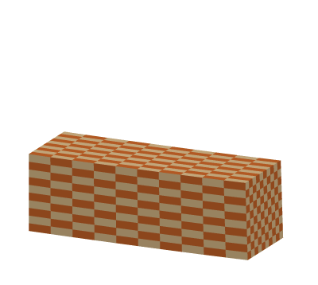
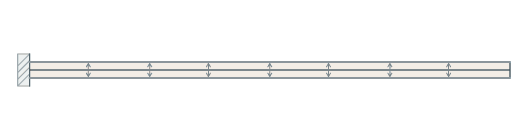
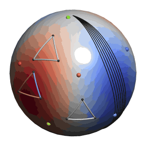

# Discrete differential geometric algebra

This document describes what geometric algebra and extensors bring to a topology: values of every grade on its elements, and operators of any arity between them. The simplex gradient is defined by a discrete statement of the fundamental theorem of geometric calculus, and the calculus and the physics on a topology follow from it.

Geometric algebra gives the values on a topology every grade, rotations and fields of spacetime among them, with every product between them. [Extensors](multiple_lenses.md) give the operators between those values any arity, assembled over the topology as matrices are. The two extend independently and combine freely, and the `numga` examples sit mostly away from the corner of scalars, vectors and matrices, as [the count of the `numga` examples by grade and arity](#appendix-the-numga-examples-by-grade-and-arity) shows.

## The gradient of a simplex

A potential on a simplicial topology can be given by its values at the vertices. The topology's coboundary `simplex.d[0]` is its derivative: it takes a field on the vertices to its derivative on each edge, the value at the edge's head minus its value at the tail, and that is the field read on the edge's boundary, the edge's head less its tail. The derivative on a chain is the field on the chain's boundary, and the definition rests on that duality. Applied to the positions of the corners, `simplex.d[0]` gives the directions along the edges; applied to the potential, its derivative on each edge. The term ***simplex gradient*** here means the element of the algebra whose reading of the direction along every edge of the simplex is the potential's derivative on that edge:

```python
simplex = Topology(3, [[0, 1, 2]])                  # one triangle: its vertices, its edges and itself
positions = mv.vector(coordinates).dual().field()   # Antivector-[vertices]
potential = mv.scalar(values).field()               # Scalar+[vertices]

directions = simplex.d[0] * positions               # Antivector-[edges]
gradient & directions == simplex.d[0] * potential   # Scalar+[edges]
```

This is a discrete statement of the fundamental theorem of geometric calculus, read on edges: the gradient read on a chain is the potential read on the chain's boundary. The boundary of a path of edges is its two ends, so the same holds on every path through the topology. The topology and its coboundaries are those of discrete differential geometry [[1]](#references).

For the potential that is one at a single corner and nothing at the others, the simplex gradient reads one along every edge toward that corner and nothing along the facet across from it, and any potential's simplex gradient is the sum of these, each times the potential at its corner. In the projective plane, where a triangle's corners `a`, `b` and `c` are points of weight one, the regressive quotient writes the gradient at `a` in closed form:

```python
gradient_a = (b & c) / (a & b & c)    # [] Vector+
```

Any element that satisfies the definition is the simplex gradient, and it can be [built in many ways](#appendix-constructions-of-the-simplex-gradient).

The operators that carry geometry are built from these gradients; the topology itself contributes only its coboundaries. Because the simplex gradient is an element of the algebra, every product of the algebra applies to it. Pulling a material back through it gives the usual operators, such as the Laplacian, and since the metric enters only through the material, the same line builds them in space and in a spacetime. The values on a topology need not be numbers or vectors either: a field of rotations is differentiated with the same gradient as a field of temperatures. Nor do the operators need to be matrices: fluid advection, which takes two velocities to an acceleration, is a map of two arguments, assembled over the topology like any other.

## The derivative one degree up

A field can also be given one degree up, on the edges, as each edge reads it by the geometric product: its flux across the edge and its circulation along it. In the plane, for a triangle with corners `a`, `b` and `c`, the fundamental theorem of geometric calculus defines the field's derivative on the face by multiplying by its oriented area and summing the edge readings around the boundary:

```python
area = ((b - a) & (c - a)) / 2                     # [] Scalar-
area * derivative == -(simplex.d[1] * readings)    # readings Even-[edges], derivative Even+[faces]
```

Because the product is geometric, the derivative holds both parts: for an extrinsic vector field (`Vector+`), its scalar part is the divergence and its bivector part is the curl, whereas generalized Stokes gives the curl alone. The minus sign comes from the orientation of the boundary relative to the face.

## The pullback of a material

The Laplacian of a potential is its gradient, weighed by a material, gathered back into the vertices. The material maps each simplex's gradient to the flux on that simplex, and the gathering is the [adjugate](complementarity.md#claims) of the gradient, reading the gradient backwards across the regressive pairing:

```python
laplacian = gradient.adjugate()(material(gradient))    # (Antiscalar- <- Scalar+)[vertices <- vertices]
```

Here `gradient` takes a potential at the vertices to its simplex gradient on each simplex. The same line is the conductance of a triangulated disc in the [Whitney forms](../examples/surfaces/whitney_forms/whitney_forms.ipynb) example, the Laplace–Beltrami operator of a curved surface in the [eigen fluids](../examples/fluids/eigen_fluids/eigen_fluids.ipynb) example, and the wave operator of a Lorentzian spacetime in the [moving mirror](../examples/relativity/moving_mirror/moving_mirror.ipynb) example, with the signature in the material alone.

Every metric quantity enters through the material, so the topology and the simplex gradient are unchanged across Euclidean, Lorentzian and degenerate signatures. Because the dual is taken in the algebra on each simplex rather than across a circumcentric dual, an obtuse triangle's energy stays positive where a circumcentric Hodge star turns negative, and a minimal surface spanned by a wire follows from iterating the same harmonic solve on the free vertices, in the [minimal surfaces](../examples/surfaces/minimal_surfaces/minimal_surfaces.ipynb) example. Physics on the topology takes the same steps with other materials: an anisotropic conductivity, an elasticity, a spacetime's vacuum.

In discrete mechanics and finite elements, stiffness operators assemble as $A^{\mathsf T} C A$, the material $C$ pulled back through the difference or gradient matrix $A$ [[2]](#references). Discrete differential geometry writes the surface's Dirichlet energy and harmonic operator with cotangent weights, which bake the Euclidean metric into the edge weights, and minimizes surface area by iterating discrete harmonic maps [[3]](#references). Discrete exterior calculus constructs the codifferential and Laplacian from the coboundary $d$ and a diagonal Hodge star $\star$ built from the ratio of circumcentric dual to primal cell measures [[4]](#references).

## Up the grade axis

A value on the topology need not be a scalar or a vector. A rotation is a rotor, a field of spacetime a bivector, a rigid motion a motor, and each is an element of the algebra with every product the algebra has, so a field of them is held, transported and differentiated as a field of scalars is.

A connection on a surface is one such field. It carries tangent directions from vertex to vertex along each edge, and the rotor that does so turns the normal at one end of the edge into the normal at the other: the square root of their product. The holonomy around a loop is the product of the rotors along it, and the Laplacian of tangent fields is a material pulled back through the difference those rotors carry, in the [connections](../examples/surfaces/connections/connections.ipynb) example:

```python
turns = (heads * tails).square_root()    # Even+[edges], from the normals at each edge's two ends
```

The same holds for other values. A rotor field blended and differentiated across each triangle gives the frames of the [frame fields](../examples/surfaces/frame_fields/frame_fields.ipynb) example. The rotation that best maps a vertex's rest edges onto its deformed ones is the top eigenvector of a form on rotors, with no reflection to correct afterwards, in the [as-rigid-as-possible deformation](../examples/surfaces/arap/arap.ipynb) example. The electromagnetic field is a bivector of spacetime, read across moving edges and currents, in the [eddy brake](../examples/electromagnetism/eddy_brake/eddy_brake.ipynb) and [Beltrami fields](../examples/electromagnetism/beltrami_fields/beltrami_fields.ipynb) examples.

Every such value carries an extrinsic or intrinsic [orientation](orientation.md) and pairs across `&` with its [complement](complementarity.md) without a metric or a mirror sign change.

<p align="center"></p>

*Figure: a triangulated bar clamped at one end and bent upward through a right angle in as-rigid-as-possible deformation, alternating local rotor eigenvectors at the vertices with a global linear solve.*

Discrete differential geometry represents rotations by angles or by matrices: a connection by transport angles on the edges relative to local tangent frames [[5]](#references), a direction field by complex numbers on those frames, and a local best rotation by the singular value decomposition of a covariance matrix, sign-corrected where the determinant is negative [[6]](#references). The electromagnetic field is held as differential forms on the edges and faces of a complex, Whitney's edge elements, or as vector proxies of them.

## Out along the arity axis

An operator need not be a matrix of numbers between fields of numbers. Its cells can be maps of the algebra, and the operator a map of any arity between fields of any grade, whose type says what each input is and what comes out.

Advection in a fluid is one such map. At each corner of a simplex, `gradients & Point` reads the rate at which a flow velocity crosses that corner's simplex gradient, and multiplying a carried velocity `Point` by that rate gives its convective acceleration, a map of two velocity arguments:

```python
advection = Point * (gradients & Point)    # [corners] (Antivector- <- (Antivector-, Antivector-))[faces]
```

An operator read backwards across the regressive pairing is its adjugate, and a coupling and its adjugate are one map. The piezoelectric coupling that turns a voltage into forces on a body, read backwards, turns the body's motion into charge, in the [piezoelectric bimorph](../examples/electromagnetism/piezoelectric/piezoelectric.ipynb) example. In an electrokinetic channel one coupling turns a pressure drop into a current and an electric field into a flow, so the streaming current and electro-osmosis are reciprocal by construction, in the [electrokinetics](../examples/fluids/electrokinetics/electrokinetics.ipynb) example. Forms of two arguments are as plain: the kinetic energy and the enstrophy of a dynamo's flows, solved against each other as an eigenproblem, in the [dynamo](../examples/electromagnetism/dynamo/dynamo.ipynb) example.

<p align="center"></p>

*Figure: a clamped two-layer piezoelectric strip bent at its free tip, with opposite layer polings marked by grey arrows, interior axial strain shaded in blue and copper, and the induced voltage colouring the outer electrodes.*

In vector calculus and finite elements, fluid advection is written as $(\mathbf{u}\cdot\nabla)\mathbf{u}$, an elastic material is held as a fourth-order tensor $C_{ijkl}$ flattened to a matrix in Voigt's notation or formulated through a variant Hilbert complex for elasticity with weak symmetry [[7, §7]](#references), and a coupled multiphysics problem is assembled as a block matrix whose off-diagonal blocks are wired by numbering the degrees of freedom. Reciprocity across those blocks, such as Maxwell–Betti's in elasticity, Saxén's in electrokinetics, or Onsager's for coupled transport under reversal of time-reversal-breaking fields [[8, §I]](#references), is imposed as a transpose relation between them.

## Waves of the three-sphere's geometry

Small waves of the geometry of a closed universe run on the 600-cell, a tetrahedral topology on the three-sphere, in the [gravitational waves](../examples/relativity/gravitational_waves/waves.ipynb) example. The geometry is given by the squared lengths of the edges, Regge's variables, and the wave step combines higher-grade values with higher-arity maps.

<p align="center"></p>

*Figure: the three-sphere projected along its Hopf circles onto a sphere. A quadrupole gravitational wave travels around it, deforming triangles of spring-coupled test masses and deflecting a fan of light rays.*

The squared lengths enter each tetrahedron as its metric through a map built from its corners' gradients: minus the symmetric product of the simplex gradients at an edge's two corners reads that edge's squared length and no other's, so summed over the edges they map the lengths to the metric. The gradients paired through the inverse metric give the kinetic term between the edges' rates of change, the inertia of space, assembled over each tetrahedron's pairs of edges. The strain of each tetrahedron is read in a frame of the three-sphere, a motor that turns equally in two orthogonal planes, and the simplex gradients, read at a point, blend the corners' values across each tetrahedron.

The values are motors of the ambient space and metrics on the tetrahedra, the maps take squared lengths to metrics and rates to momenta, and pure vertex motions are projected out by pulling the inertia back through the map from vertex displacements to edge-length changes.

Regge calculus writes general relativity on a simplicial complex with the edge lengths as its variables, the curvature concentrated in the deficit angles at the codimension-two hinges, and the field equations obtained by varying the sum of the deficits weighted by the hinges' measures [[9]](#references); its linearized form gives gravitational waves, with each tetrahedron's metric computed from its lengths by the law of cosines in a frame of its own.

## Conclusion

The simplex gradient is an element of the algebra, fixed by a discrete statement of the fundamental theorem of geometric calculus, and the rest is built from it with the algebra's own products: operators by pulling a material back through it, derivatives of fields of any grade by the geometric product, and couplings as maps of any arity, read both ways through the adjugate. The metric enters only through the material, and the topology only through its coboundaries.

## Companion documents

* [Extensors through multiple lenses](multiple_lenses.md): how multilinear maps arise from partial products, transform under motions and assemble from dyads.
* [Why orientation](orientation.md): why geometric constructions and positive physical energies require intrinsic and extrinsic orientation.
* [The regressive product](regressive_product.md): how `&` pairs orientations, joins points, contracts fields and builds linear maps and their adjugates.
* [Complementarity](complementarity.md): how complementary pairings and physical representations extend across geometry, mechanics, estimation and physics.
* [Geometry and quantities](thermodynamics.md): equilibrium and transport thermodynamics in algebras extended with null directions for extensive quantities.

## Appendix: constructions of the simplex gradient

Where a simplex fills its space the definition fixes the simplex gradient; elsewhere each setting supplies what the edges leave unread. The most direct construction solves the definition simultaneously for every corner from the symmetric duality map of the simplex's edge directions, applied directly to the coboundary rather than a single potential:

```python
frame = (directions * (Plane & directions)).sum()            # [] Antivector- <- Vector+
gradients = frame.solve((directions * simplex.d[0]).sum())   # Vector+[vertices]
```

In the projective plane, an edge is the difference of two points of weight one and has no part along w, so the edge readings leave a simplex gradient's w component free. Fixing the gradient to read the potential at the corners themselves supplies that component and gives the regressive quotient in closed form.

For a triangle with corners `a`, `b` and `c` of weight one, the line `b & c` through the facing side reads zero at `b` and `c`, and dividing by `a & b & c` scales it to read one at `a`; at any point `p`, `gradient_a & p` is the area ratio with `a` moved to `p`. Across a topology of simplices of any dimension, joining the corners of each facing facet and dividing by the simplex's join computes every corner's gradient together, as on the tetrahedra of the three-sphere in the [gravitational waves](../examples/relativity/gravitational_waves/waves.ipynb) example:

```python
corners = topology.incidence[-1, 0] * vertices                              # [corners] Antivector-[simplices]
facets = reduce(and_, corners[topology.corners[-1, -2]])                    # [corners] Vector-[simplices]
gradients = facets / (facets & corners)                                     # [corners] Vector+[simplices]
```

The same quotient builds the Whitney m-form of any m-subsimplex in the [Whitney forms](../examples/surfaces/whitney_forms/whitney_forms.ipynb) example, dividing the join of the complementary corners off the subsimplex by the full join closed with the subsimplex's own corners:

```python
complements = reduce(and_, topology.off[3, m] * vertices)                   # [k] (m + 1)-vector-[tets]
spans = reduce(and_, topology.on[3, m] * vertices)                          # [k] (3 - m)-vector-[tets]
forms = complements / (complements & spans)                                 # [k] (m + 1)-vector+[tets]
```

Because the complementary corners appear in the same order in numerator and denominator, their ordering cancels without sign tables or factorial factors, leaving a form that reads one on its own subsimplex's join, zero on every other's, and `forms & p` at any point `p`.

Where the space has directions the field does not vary along off the simplex, the complement names them by joining them in, and where a surface is curved through a larger ambient space with no fixed complement directions, the metric supplies the tangent plane instead. A static field on triangles laid flat in spacetime does not vary along time, so the facing side is joined with time, in the [eddy brake](../examples/electromagnetism/eddy_brake/eddy_brake.ipynb) example. In an algebra with directions for extensive quantities such as mass, entropy and species, a spatial potential does not vary along them either, in the [convection](../examples/fluids/convection/convection.ipynb) example, and because the quantity directions square to zero no metric inverse exists on the joined prism while the regressive quotient needs no metric at all. On a curved surface embedded in three-space, the metric projects onto each face's patch through `patches.inverse()`, in the [minimal surfaces](../examples/surfaces/minimal_surfaces/minimal_surfaces.ipynb) example:

```python
gradients = (time & sides) / double_areas                              # [corners] Vector+[faces]
gradients = (volume & mass & entropy & sides) / double_areas           # [corners] Vector+[faces]
corner_gradients = (sides | patches.inverse()) / 2                     # [corners] Vector+[faces]
```

In every case the gradient's level set contains the facing facet: the regressive join says directly, without a metric, what the textbook's quarter turn of that edge says through one.

In the plane, without a projective weight w, the same quotient follows directly from the vertex differences. Because `c - b = (c - a) - (b - a)`, the facing side `c - b` pairs to zero with itself and to `(b - a) & (c - a) == 2 * area` with `a - b`, so dividing by `2 * area` satisfies the edge definition directly:

```python
area * gradient_a == (c - b) / 2                                  # [] Antivector-
area * (gradients * values).sum() == (sides * values).sum() / 2   # Even+[faces], for values Vector+[vertices]
```

Each corner's value multiplies the boundary side across from it (`sides = simplex.boundary[2, 1] * directions`).

In the notation of finite elements, the simplex gradients read at a point are a simplex's barycentric coordinates, and the quotient is Cramer's rule: with the corners' homogeneous coordinates as the columns of a matrix $A$, the coordinates of a point $x$ solve $A\lambda = x$, so $\lambda_i = \det A_i(x)/\det A$, and the gradients are the rows of $A^{-1} = \operatorname{adj}A/\det A$. Discrete differential geometry writes a triangle's gradient as its facing edge turned a quarter turn in the tangent plane, over twice the area, and finite element exterior calculus builds the higher-degree Whitney forms as alternating sums $\sum_j (-1)^j \lambda_{i_j}\,\mathrm d\lambda_{i_0}\wedge\cdots\wedge\widehat{\mathrm d\lambda_{i_j}}\wedge\cdots\wedge\mathrm d\lambda_{i_m}$ of the barycentric coordinates and their differentials.

## Appendix: identities

The simplex gradient satisfies a handful of identities that the rest of the article leans on, collected here for a triangle in the Euclidean plane with corners at the positions `a`, `b` and `c`, its oriented `area` (`Scalar-`), `areas = area.norm()` (`Scalar+`), and `gradient_a` the simplex gradient of the potential that is one at `a` and nothing at the others.

| identity | reads |
| --- | --- |
| `gradient & directions == simplex.d[0] * potential` | the definition: the derivative on each edge, read off the gradient |
| `simplex.d[1] * (gradient & directions) == 0` | the gradient circulates nothing around a face, since the boundary of a boundary vanishes |
| `gradient_a & (a - b) == 1`, `gradient_a & (c - b) == 0` | it rises by one along the edges toward `a` and not at all along the side facing it |
| `gradient_a + gradient_b + gradient_c == 0` | a constant potential has no gradient |
| `(positions * (gradients & Point)).sum() == Point` | the gradient of position is the identity on directions |
| `area * gradient_a == (c - b) / 2` | the oriented area times the gradient is half the facing side |
| `gradient_a = (b & c) / (a & b & c)` | closed form in the projective plane, for corners of weight one |
| `gradient_a & (areas * Plane.dual())(gradient_b) == -cotangent_c / 2` | the cotangent weight, with `cotangent_c` that of the angle at `c` |
| `curl_ab == 2 * (gradient_a ^ gradient_b)` | the curl of the form on the edge from `a` to `b` |
| `area * derivative == -(simplex.d[1] * readings)` | the theorem with the geometric product, on a face |
| `(gradients * positions).sum() == Scalar.dual()(2)` | the geometric derivative of position is twice the intrinsic pseudoscalar, with no curl |
| `simplex.d[1] * simplex.d[0] == 0` | the curl of a gradient vanishes, and on volumes the divergence of a curl |
| `divergence = gradient.adjugate()` | the divergence is the gradient read backwards, gathering simplex fluxes into the vertices |
| `laplacian = gradient.adjugate()(medium(gradient))` | the Laplacian is a material pulled back through the gradient; with the area for the material, the cotangent Laplacian |
| `(potential & laplacian(potential)).sites.sum() == (gradient(potential) & medium(gradient(potential))).sites.sum()` | Green's identity: the Laplacian's energy equals the material's energy of the gradient |
| `(~topology.d[0] * fluxes).sum() == 0` | what leaves one vertex along an edge enters the other, so exchange along the edges neither creates nor destroys |
| `mean_curvature_normals = laplacian * positions` | area-weighted, the derivative of the surface's area |

The same few products carry the physics the examples compute on a topology, each in a line:

| identity | reads |
| --- | --- |
| `conductance = gradient.adjugate()((areas * conductivity)(gradient))` | a conductivity, isotropic or not, pulled back into the vertices |
| `wave = gradient.adjugate()((volumes * vacuum)(gradient))` | the wave operator of a spacetime, the same line with the signature in the vacuum |
| `drive & response(drive) >= 0` | a positive material dissipates, and its pullback keeps it so |
| `stiffness = curl.adjugate()(vacuum(curl))` | the magnetic energy of a potential on the edges |
| `heating = areas * (electric & (current & time))` | Joule heating, the electric field read on the current swept through time |
| `emf = ((velocity & magnetic) ^ time) & (displacements & time)` | the electromotive force an edge picks up cutting a magnetic plane |
| `advection = Point * (gradients & Point)` | fluid advection, a map of two velocities to convective acceleration at each corner |
| `work = material(gradients, gradients, Point, Point)` | elastic work, a map of four arguments, bound on each triangle to its corners' gradients |
| `mixed = movement.adjugate()(coupling(voltage))` | the converse of a coupling is its adjugate, so piezoelectric reciprocity holds by construction |
| `drive & advection(velocity) == advection.adjugate()(drive) & velocity` | the power a drive delivers to an advected flux equals the force on the flow paired with its velocity |
| `lengths_ab(b - a) & (b - a) == 1`, with `lengths_ab = -(gradient_a * (gradient_b & Point) + gradient_b * (gradient_a & Point)) / 2` | reads one on its own edge and zero on the other two: the metric basis from Regge's variables |

## Appendix: the `numga` examples by grade and arity

Each example notebook is counted by the highest grade or antigrade of the values it holds and the highest arity of the maps it builds. Those that compute on a topology:

| values | arity 0 | arity 1 | arity 2 | arity 3 | arity 4 | total |
| --- | --- | --- | --- | --- | --- | --- |
| grade 1 | 3 | 9 | | | 2 | 14 |
| grade 2 | 1 | 16 | 6 | | 2 | 25 |
| rotors | 4 | 8 | 4 | 1 | | 17 |
| total | 8 | 33 | 10 | 1 | 4 | 56 |

All the example notebooks, those without a topology included; eight declare no types the count can read:

| values | arity 0 | arity 1 | arity 2 | arity 3 | arity 4 | total |
| --- | --- | --- | --- | --- | --- | --- |
| grade 1 | 8 | 34 | 5 | 2 | 2 | 51 |
| grade 2 | 4 | 26 | 15 | 4 | 2 | 51 |
| rotors | 14 | 41 | 22 | 2 | 2 | 81 |
| not read | 7 | | 1 | | | 8 |
| total | 33 | 101 | 43 | 8 | 6 | 191 |

## References

1. [*Discrete Differential Geometry: An Applied Introduction*](https://www.cs.cmu.edu/~kmcrane/Projects/DDG/paper.pdf) (Keenan Crane, CMU lecture notes).
2. [*MIT 18.085 Computational Science and Engineering I, Recitation 10*](https://ocw.mit.edu/courses/18-085-computational-science-and-engineering-i-fall-2008/d7ff56163921cada3982c05b7bb3ee48_fJSSVcFhA0Y.pdf) (MIT OpenCourseWare, Fall 2008).
3. [*Computing Discrete Minimal Surfaces and Their Conjugates*](https://page.mi.fu-berlin.de/polthier/articles/diri/diri_jem.pdf) (Ulrich Pinkall and Konrad Polthier, *Experimental Mathematics*, 1993).
4. [*Discrete Exterior Calculus*](https://arxiv.org/pdf/math/0508341) (Mathieu Desbrun, Anil N. Hirani, Melvin Leok and Jerrold E. Marsden, 2005).
5. [*Trivial Connections on Discrete Surfaces*](https://www.cs.cmu.edu/~kmcrane/Projects/TrivialConnections/paper.pdf) (Keenan Crane, Mathieu Desbrun and Peter Schröder, *Computer Graphics Forum*, 2010).
6. [*As-Rigid-As-Possible Surface Modeling*](https://igl.ethz.ch/projects/ARAP/arap_web.pdf) (Olga Sorkine and Marc Alexa, *Symposium on Geometry Processing*, 2007).
7. [*Finite element exterior calculus: from Hodge theory to numerical stability*](https://arxiv.org/pdf/0906.4325) (Douglas N. Arnold, Richard S. Falk and Ragnar Winther, *Bulletin of the American Mathematical Society*, 2010).
8. [*Onsager Relations in Coupled Electric, Thermoelectric and Spin Transport: The Ten-Fold Way*](https://arxiv.org/pdf/1207.1629) (Philippe Jacquod, Robert S. Whitney, Jonathan Meair and Markus Büttiker, *Physical Review B*, 2012).
9. [*Discrete structures in gravity*](https://arxiv.org/pdf/gr-qc/0012035) (Ruth M. Williams and Philip A. Tuckey, *Classical and Quantum Gravity*, 1992; arXiv, 2000).
