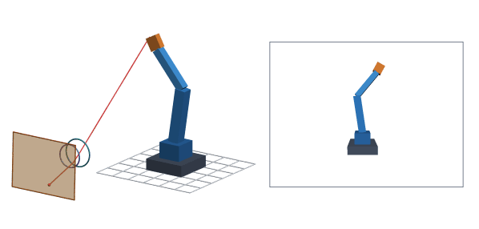

# Extensors through multiple lenses

This document sets out three ways to read an extensor and shows that they describe the same objects.

From computer science, extensors arise through partial application of the products of geometric algebra. Geometrically, an extensor built from elements of the algebra takes its meaning and its transformation behaviour from its construction. Mathematically, extensors are multilinear maps between multivector spaces, and every such map is a sum of expressions built from the algebra's products.

## 1. The computer science lens

Partial application binds some arguments of a function now and takes the rest later. In projective three-space, planes are extrinsic vectors, joined lines are intrinsic antibivectors, and points are intrinsic antivectors, where `+` and `-` record how each transforms in a mirror ([Why orientation](orientation.md)). For a fixed light source, a Python function accepts a point and returns the line joining them:

```python
def ray_fn(point: Point) -> Line:
    return light & point
```

Naming the space of points by its type `Point` builds that same map directly inside the algebra. Because the resulting extensor belongs to the algebra, further products act on its output and composition feeds one map directly into another:

```python
ray = light & Point                                          # [] Antibivector- <- Antivector-
shadow = ray ^ ground                                        # [] Antivector- <- Antivector-
intersection = Line ^ ground                                 # [] Antivector- <- Antibivector-
composed = intersection(ray)                                 # [] Antivector- <- Antivector-
```

`ray_fn` is a Python function, while `ray` is an extensor. Both are first-class Python objects, and `ray_fn(point)` and `ray(point)` return the same line. In the block above, `shadow` meets each ray with the ground plane directly, while `intersection` packages that meet as its own map on lines so `intersection(ray)` constructs the same shadow map by composition.

A Python function hides the arithmetic inside it and supports evaluation alone. An extensor holds that linear action as an algebraic value, so evaluation is only one of the operations available on it. For a linear map `M`, `M.solve(y)` finds an input `x` satisfying `M(x) == y`, and when `M` is invertible, `M.inverse()` builds the inverse map as an extensor that composes and multiplies like any other. Reading `M` backwards across the regressive pairing gives its metric-free adjugate `M.adjugate()` for every linear map, even without a metric or an inverse. When the algebra carries a nondegenerate metric, `M.adjoint()` transfers `M` across the scalar product instead, and when input and output share one space, eigenvalues and trace are available directly on `M`. A Python function exposes none of these operations.

## 2. The geometric lens

An extensor built from geometry transforms as its geometry does. Building the map again from its transformed ingredients gives the same map as transforming the map itself, on its output and on each of its inputs. That holds because a motion or reflection of space is itself an element of the algebra, and its forward action `transformation >> x` and inverse action `transformation << x` preserve every product.

In geometric algebra, versors already act both as geometric objects and as transformations [[1, §§1.2.4–1.2.5]](#references). With extensors, arbitrary geometric maps share that same algebra, so one object can transform what passes through it in one expression and be transformed as an object in another. In a [scenegraph](../examples/geometry/scenegraph/scenegraph.ipynb) example of a robot arm carrying a two-lens camera and its sensor, a thin lens shears each incoming ray radially inward toward the optical axis where the ray crosses the lens plane, focusing parallel rays at distance `focal`. At the same time, the lens is an object in the scene carried by a rigid motion `motor` along with everything else. Moving the lens as a map, by undoing the motion on the incoming ray, applying the lens and carrying the outgoing ray forward, gives the same map as building the lens from its moved centre and plane:

```python
lens = Line - (centre & (Line ^ plane)) / focal                          # [] Antibivector- <- Antibivector-
moved = motor >> lens(motor << Line)                                     # [] Antibivector- <- Antibivector-
rebuilt = Line - ((motor >> centre) & (Line ^ (motor >> plane))) / focal # [] Antibivector- <- Antibivector-
```

Because the sandwich action distributes across every product and its inverse action cancels on `Line`, `moved` and `rebuilt` are the same map, and the same identity holds when a reflection `mirror` replaces `motor`. One action moves the ray, the lens and the motion itself, and nothing in the scene is set apart from the objects it transforms.

<p align="center"></p>

*Figure: an articulated robot arm and a moving two-lens camera in three dimensions on the left, with the image produced on the sensor by composing the body motors, lens maps and sensor meet on the right.*

In tensor algebra the order is the reverse. The transformations come first, given as rotation matrices, and a tensor is defined as an array that responds to them by the tensor transformation law, such as $T' = R T R^{\mathsf T}$ for a two-index tensor, with one factor of the rotation on each of its axes. The rotation is a linear map on vectors and therefore a tensor itself, yet the definition treats it as given beforehand, standing outside as the test the other objects must pass. Here a transformation is an extensor from the start, and no object is defined by testing it against something posited outside the algebra. The tensor transformation law follows as a consequence, where the moved lens `motor >> lens(motor << Line)` reads in tensor notation as $R T R^{\mathsf T}$, the motion applied on the output and undone on the input.

## 3. The mathematical lens

An extensor is a map between multivector spaces, linear in each of its arguments separately. The input and output spaces may contain any grades, including mixtures of grades. Its arity is the number of arguments: a linear map has one, a bilinear map has two, and a multivector itself has none.

The products of geometric algebra are bilinear. Naming the spaces of their arguments by their types builds multilinear maps directly, one argument per type. For example, `Point & Point` is a bilinear map taking two points to their joining line, and multiplying two one-argument maps produces a two-argument map whose factors act on independent inputs. Adding expressions with the same input and output spaces gives another map of that kind, partial application supplies some arguments, composition feeds maps into arguments, and supplying every argument yields a multivector.

The converse holds as well, so every multilinear map between finite-dimensional multivector spaces can be written as a sum of expressions built from the algebra's products. A linear map is determined by its outputs on a basis. Pairing an input with a complementary element of opposite orientation reads one basis coefficient into an ordinary scalar, and multiplying that scalar by a chosen output gives a rank-one dyad.

Given a basis of points and the dual collection of `planes` pairing to one with its own basis point and to zero with the others, the regressive product yields one scalar readout per basis point. Multiplying chosen point outputs by those readouts and summing over the basis constructs any linear map from points to points, and multiplying two independent readouts constructs any bilinear map from pairs of points to points:

```python
readouts = planes & Point                                    # [basis] Scalar+ <- Antivector-
linear = (outputs * readouts).sum(axis=0)                    # [] Antivector- <- Antivector-
bilinear = (
    pair_outputs * readouts[:, None] * readouts[None, :]
).sum(axis=(0, 1))                                           # [] Antivector- <- (Antivector-, Antivector-)
```

Evaluating `linear` on a basis point selects its assigned output, and evaluating `bilinear` on an ordered pair of basis points selects the output assigned to that pair, while linearity and multilinearity fix every other value. Each further argument multiplies in another independent scalar readout and sums over one more basis index.

The same expansion covers arbitrary output types and mixed-grade input spaces, even when the metric is degenerate. On a mixed-grade input, pairing with an element of opposite orientation and complementary grade leaves higher-grade terms alongside the scalar coefficient, so coefficients are extracted from the top grade downward. Pairing with the intrinsic grade-zero unit reads the top-grade coefficient as a pure scalar because all lower grades vanish under that regressive product. Subtracting that top-grade term leaves one grade fewer, and repeating the step down to grade zero recovers every basis coefficient using only the algebra's own products and sums, with no metric and no grade-projection operator. Where the scalar product is nondegenerate, it can supply the readouts directly instead.

The multilinear-map definition and the sum-of-products construction describe the same space of extensors. The extensors of interest in practice are those whose factors carry geometric meaning, such as a motor built from two planes or a lens built from its centre and plane. Which constructions carry geometric meaning depends on the model, while the basis expansion establishes that no multilinear map lies outside the algebra's products.

In linear algebra, pulling linear forms back across the canonical pairing defines the dual map on dual spaces, whereas transferring vectors across an inner product defines the adjoint [[2, §§3F, 7A]](#references); the adjugate across the regressive pairing and the adjoint across the scalar product make the same separation here. Standard presentations of linear algebra within geometric algebra start from linear maps on vectors and extend them over outer products as grade-preserving outermorphisms [[1, §1.2.3]](#references), [[3, §2.3]](#references), whereas the extensors considered here include multilinear maps of any arity between arbitrary oriented and mixed-grade spaces.

## Conclusion

The three lenses describe one set of operations. Naming an argument's space by its type in a product builds a map from geometry, supplying a value evaluates it, and supplying another map composes the two. Moving a map is composition with a transformation's own action, and the tensor transformation law follows because the transformation preserves the products the map was built from. Sums of products reach every multilinear map, so nothing outside the algebra's products is needed to build any extensor, apply it, or move it.

## Companion documents

* [Why orientation](orientation.md): why geometric constructions and positive physical energies require intrinsic and extrinsic orientation.
* [The regressive product](regressive_product.md): how the regressive product pairs orientations, joins points, contracts fields and builds linear maps and their adjugates.
* [Complementarity](complementarity.md), [Extensors, linear algebra, tensors and forms](frameworks.md) and [Extensors and common practice](common_practice.md): how these maps pair complementary quantities, relate to other mathematical frameworks, and apply across geometry and physics.
* `numga` documentation: [Extensor overview](../docs/extensors.md), [Extensor tutorial](../docs/tutorial/extensors/00-introduction.md), [The adjoint](../docs/tutorial/extensors/09-the-adjoint.md) and [the adjugate](../docs/tutorial/extensors/10-the-adjugate.md).

## References

1. [*Geometric Algebra for Computer Science: An Object-Oriented Approach to Geometry*](https://geometricalgebra.org/downloads/ga4cs_chapter1.pdf) (Leo Dorst, Daniel Fontijne and Stephen Mann, Morgan Kaufmann, 2007; open Chapter 1).
2. [*Linear Algebra Done Right*](https://linear.axler.net/LADR4e.pdf) (Sheldon Axler, 4th ed., 2024).
3. [*Gravity, Gauge Theories and Geometric Algebra*](https://arxiv.org/pdf/gr-qc/0405033) (Anthony Lasenby, Chris Doran and Stephen Gull, *Philosophical Transactions of the Royal Society A*, 1998; arXiv, 2004).
