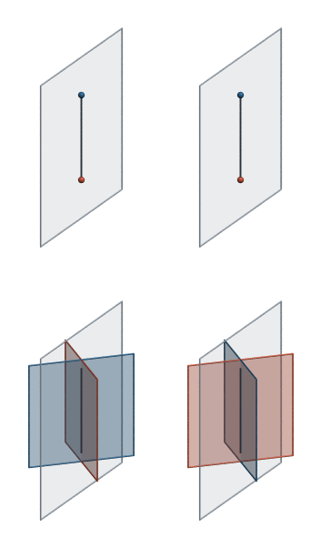
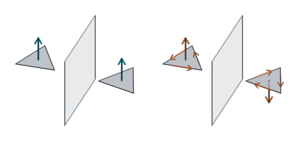

# Why orientation

This article motivates the notion of orientation in geometric algebra from two requirements, one geometric and one physical, and follows what they imply for how the algebra and its types are set up. The motivation is not algebraic: nothing in the products asks for orientation. The geometric requirement is on transformations of space: a transformation should commute with the constructions of the algebra, so that transforming the ingredients of a construction and building from them gives the same result as building first and transforming the result. For a reflection `reflect`, the transformation that produces a mirror image, it applies to every product of the algebra, the geometric, outer, inner and regressive products alike:

```python
reflect(a * b) == reflect(a) * reflect(b)
reflect(a ^ b) == reflect(a) ^ reflect(b)
reflect(a | b) == reflect(a) | reflect(b)
reflect(a & b) == reflect(a) & reflect(b)
```

The physical requirement is on readings: a system and its measuring apparatus, mirrored together, give every reading unchanged, an energy, a power, a count of the sheets an arrow pierces, while a handed quantity, a signed volume or a handed material constant, changes sign, and nothing else does. Meeting the two requires a notion of orientation, a term this article sets out to define, and fixes how each operation treats it; the rules are gathered at the end. Two further aims shape the algebra's conventions beyond orientation, and decide a choice where they meet it: the same lines, with the same signs, in every dimension and signature, and a compact vocabulary, one symbol per operation wherever the requirements allow. The examples are written in numga, whose rules for orientation are listed in [Orientation in numga](../docs/orientation.md).

## What a physical mirror does

Two pictures show what a physical mirror does to a line, and everything after them builds on these two. For these pictures, we choose points oriented by their weights and planes oriented by their positive sides.

<p align="center"></p>

*Figure: a vertical mirror, the pale sheet, and a line lying in it. Top: a red point and a blue point on the line. Bottom: a red plane and a blue plane crossing in the line, each at half a right angle to the mirror. Left: the scene. Right: its mirror image.*

In the top row, the two points lie in the mirror and keep their positions and weights. In the bottom row, each plane's mirror image lies where the other plane was, so the mirror swaps them. In both rows the line stays where it is.

The same line can be built from either pair: as the join of the two points, or as the meet of the two planes. If reflecting is to commute with building, the join of the unmoved points is the join itself, so a reflection must leave the join unchanged. The meet of the swapped planes is the meet built in the opposite order, and the meet is antisymmetric, changing sign when its two planes are exchanged, so a reflection must negate the meet. The same line, built from two points or from two planes, must come out of a reflection unchanged in one case and negated in the other.

## Orientation

The join can be viewed as a direction along the line, from the one point to the other. That direction lies within the line itself, and is called an intrinsic orientation. A mirror that contains the line leaves everything within the line alone, so the direction stays as it was.

The meet can be viewed as a rotation around the line, from the one plane to the other. That rotation lies outside the line, in the space around it, and is called an extrinsic orientation. A mirror that contains the line flips the space around it, side for side, so the rotation is reversed.

An element's orientation is which of the two it carries: a sense within the element itself, or a sense in the space around it. Type comments use `+` for extrinsic and `-` for intrinsic.

## In the algebra

The examples use the projective geometric algebra of space. In it, vectors are planes and `mv.point` builds points. The regressive product `&` of two points is their join, and the outer product `^` of two planes is their meet. The requirement from the opening, for the mirror, says that building from the mirror images gives the mirror image of what was built. The join of the unmoved points is the join itself. The meet of the swapped planes is the meet taken in the opposite order, which the antisymmetry of the outer product makes minus the meet:

```python
# The mirror is the plane x = 0.
mirror = mv.x                                          # Vector+
# Two planes crossing in the z axis, which lies in the mirror.
red, blue = mv.x + mv.y, mv.y - mv.x                     # Vector+, Vector+
# Two points on the z axis.
ends = mv.point([[0.0, 0.0, -0.5], [0.0, 0.0, 0.5]])   # [points] Antivector-

# The z axis, built from the planes.
red ^ blue                                             # Bivector+
# Built from their mirror images: minus the above.
blue ^ red                                             # Bivector+
# The z axis, built from the points, and from their mirror images.
ends[0] & ends[1]                                      # Antibivector-
```

The meet and the join have the same grade and the same coefficients up to scale, and the mirror must negate one and keep the other.

## The plain sandwich

Geometric algebra reflects an element `x` in a mirror plane `m` with the sandwich product `m * x * m.inverse()`, applied to every element in the same way. The sandwich commutes with the geometric product, and with the outer and inner products built from it, so it negates the meet as it should. It does not commute with the regressive product: the sandwich of a join is minus the join of the sandwiches, so it negates the join as well, which a mirror containing the line must leave unchanged:

<p align="center"></p>

*Figure: two points lying in a mirror, the pale sheet, and the line through them, with an arrow for its intrinsic orientation. Left: the line. Middle: its mirror image, with its direction unchanged. Right: the result of reflecting with the sandwich product directly; the points are unchanged, but the line is turned around.*

```python
def sandwich(x):
    return mirror * x * mirror.inverse()

# Minus the meet, as it should be.
sandwich(red ^ blue)                                   # Bivector+
# The two points, unchanged.
sandwich(ends)                                         # [points] Antivector-
# Their join, unchanged.
sandwich(ends[0]) & sandwich(ends[1])                    # Antibivector-
# Minus the join, which should be unchanged.
sandwich(ends[0] & ends[1])                             # Antibivector-
```

The variant that involutes odd elements before sandwiching them, `m * x.involute() * m.inverse()`, fails the same way. The plain sandwich does not geometrically have the action of a mirror.

## An orientation-aware reflection

An orientation-aware reflection negates the sandwich for one kind and not for the other; in numga it is `>>`, which reads the orientation from the element's type. With that, reflection commutes with the join as it does with every other product:

```python
# The join, unchanged.
mirror >> (ends[0] & ends[1])                           # Antibivector-
# Minus the meet.
mirror >> (red ^ blue)                                 # Bivector+
```

## Every element has an orientation

The line is one example. Every element of the algebra can carry either orientation, intrinsic or extrinsic, and a mirror treats the two differently whatever the element is. A triangle shows it for a plane:

<p align="center"></p>

*Figure: a triangle lying in a horizontal plane, and its mirror image in a vertical mirror. Left: the plane's positive side, which stays above both triangles. Right: the order of the corners, which the mirror reverses.*

The plane equation of the triangle's plane orients the plane by which side is positive, the space outside it: an extrinsic orientation, and the mirror keeps the positive side up. Joining the triangle's corners in order gives the same plane, oriented by the corners going round within it: an intrinsic orientation, and in the mirror image the corners go round the other way. The [surface normals](../examples/orientation/normals/normals.ipynb) example draws both:

```python
corners = mv.point([[0.0, 0.0, 0.0], [1.0, 0.0, 0.0], [0.0, 1.0, 0.0]])  # [corners] Antivector-
# The plane z = 0, positive above.
side = mv.z                                            # Vector+
# The same plane, its corners going round.
winding = corners[0] & corners[1] & corners[2]           # Vector-

# +z: the positive side still points up.
mirror >> side                                         # Vector+
# -z: the corners go round the other way.
mirror >> winding                                      # Vector-
```

In a plane, a point can likewise be oriented by its weight, as a mass is, or by a turn around it, as a pivot is. The [circle constructed twice](../examples/orientation/conformal_circle/conformal_circle.ipynb) example does the same for a circle in the conformal algebra of space.

## From the plane to space

A mass at a point on a sheet of paper remains a mass at a point when we include the room around the sheet. A wheel turning in the sheet turns about a point in the sheet, but about an axis in the room. The weighted point stays a point; the pivot becomes an axis:

```python
from numga import NumpyContext
from numga.algebras import PGA2D, PGA3D

plane_mv = NumpyContext(PGA2D).multivector
space_mv = NumpyContext(PGA3D).multivector

point_2d = plane_mv.point([0, 0])                       # intrinsic point, grade two
point_3d = space_mv.point([0, 0, 0])                    # intrinsic point, grade three
pivot = plane_mv.x ^ plane_mv.y                        # extrinsic point, grade two
axis = space_mv.x ^ space_mv.y                         # extrinsic line, grade two
```

The two crossing lines that locate the pivot extend to two crossing planes in the room. Their meeting point becomes their meeting line, with the same sense of turning around it. Looking only within the sheet takes us back to the pivot. The turn remains a bivector in either dimension, while the weighted point remains an antivector.

We can also make an extrinsic point in the room, but that needs a third plane to cut the axis at a point. Its chosen side is part of the orientation:

```python
extrinsic_point = axis ^ space_mv.z                    # extrinsic point, grade three
opposite_point = axis ^ (-space_mv.z)                  # same point, opposite orientation
```

The turn in the sheet does not choose which side of the sheet is positive. Choosing the other side reverses the extrinsic point's orientation, although its location and the turn stay the same. In space, an extrinsic point has a handedness of its surroundings; a sense of turning in one plane is not enough to specify it.

The intrinsic point needs no choice about the added direction: its weight stays with it. The extrinsic point needs the added direction included in its orientation, because that orientation belongs to the space around the point.

## How orientation spreads

Every element can carry either intrinsic or extrinsic orientation. Once the orientations of the inputs are chosen, the operation determines the orientation of the result.

The dual exchanges the two kinds. It takes an element to its complement, and what lay within the element lies around the complement: an intrinsic element's dual is extrinsic, and the other way round. The regressive product is the outer product taken on the volume complements and taken back with the inverse complement, so it carries one exchange more than the outer product, which is why joining two intrinsic points gives an intrinsic line. [Orientation in numga](../docs/orientation.md) lists the rule for every product.

In matrix notation a plane's side transforms with the inverse transpose of a linear map and a triangle's area normal with its cofactor matrix, which differs by the sign of the determinant, $-1$ for a mirror. In exterior calculus the two kinds are called outer and inner orientation (Tonti, Bossavit, Schouten), corresponding to untwisted and twisted differential forms.

## Observables

Mirroring a system together with its measuring apparatus should preserve every reading. Kinetic energy gives one test: a spinning body and its mirror image turn opposite ways but have the same energy:

<p align="center"></p>

*Figure: a body of three masses turns, and its mirror image turns the other way. Colours identify matching masses, marker sizes show the masses, and arrows show their velocities.*

Here the body's rate of turning is represented by an extrinsic line, oriented around itself, and the mass points are intrinsic. Joining those points with their velocities gives an intrinsic momentum, oriented along its line. The kinetic energy is half the regressive product of the momentum and the rate of turning. Reflected with orientation, the mirrored body has the same energy; with the plain sandwich, its energy comes out negative:

```python
# The type of lines, written where the rate of turning goes.
Line = ga.gatype.bivector()                                   # Bivector+
points = mv.point([[1.0, 0.0, 0.0], [0.0, 1.0, 0.5], [-0.5, 0.0, 1.0]])  # [points] Antivector-
masses = np.array([1.0, 1.5, 0.5])
inertia = points.regressive(points.commutator(Line) * masses).sum()  # Antibivector- <- Bivector+
# Turning about z, and a little about x.
rate = (mv.x ^ mv.y) + 0.3 * (mv.y ^ mv.z)                    # Bivector+
momentum = inertia(rate)                                     # Antibivector-

# 1.494.
(momentum & rate) / 2                                        # Scalar+
# 1.494: the same energy.
((mirror >> momentum) & (mirror >> rate)) / 2                 # Scalar+
# -1.494: negative energy.
(sandwich(momentum) & sandwich(rate)) / 2                     # Scalar+
```

The [energy in a mirror](../examples/orientation/mirror_energy/mirror_energy.ipynb) example animates the body, and the [mechanical work](../examples/orientation/mechanical_work/mechanical_work.ipynb) example does the same for the power a push delivers to a crank.

Every such reading pairs an extrinsic value with an intrinsic one by the regressive product, `momentum & rate` above, `field & spin`, `force & displacement`: an arrow through a stack of sheets, which needs no metric and which a mirror leaves alone. Reading the extrinsic factor first also fixes the adjugate, the map read backwards across such a pairing. Read the same way on both of its sides, for a map between intrinsic spaces `A.adjugate()(c) & x == c & A(x)`, it is its own inverse in every dimension, a symmetric form is its own adjugate, and a positive material pulled back through a gradient stays positive, with no sign that depends on the dimension.

## Measuring an intrinsic value

A metric measures two values of one orientation. Two extrinsic values are measured as written, by the signature; two intrinsic values are measured through their duals, so that a direction's length squared is positive in space, in a spacetime and in a projective algebra alike. An extrinsic value and an intrinsic one are not measured against each other at all: they pair by `&`. An intrinsic value then has two sizes: its norm, by the reverse product, which of a projective point is its weight, and its antinorm, by the metric through its dual, which of a direction is its length:

```python
far, near = mv.point([[3.0, 4.0, 0.0], [0.0, 0.0, 0.0]])  # Antivector-, Antivector-
step = far - near                                        # Antivector-, a direction
# 25: the step's length squared, measured through its dual.
step.dot(step)                                           # Scalar+
# 5, the step's length; the far point's weight, 1, and its bulk, 5.
step.antinorm(), far.norm(), far.antinorm()              # Scalar+, Scalar+, Scalar+
```

## What orientation rules out

Two examples illustrate what orientation rules out. The rate of turning and momentum above have different orientations, so they cannot be added:

```python
rate + momentum          # GATypeError: cannot combine extrinsic in bivector and intrinsic bivector: their orientations differ
```

The exponential of an intrinsic element would require such a sum: its even powers are extrinsic and its odd powers intrinsic. It is therefore ruled out by the same addition rule:

```python
momentum.exp()           # GATypeError: 'exp' takes extrinsic elements; got intrinsic bivector
```

```python
rate.dot(momentum)       # GATypeError: dot takes operands of one orientation; an extrinsic value and an intrinsic one pair by the regressive product
```

For the complete rules governing what can be written in code, see the companion [Orientation in numga](../docs/orientation.md).

## The rules

The two requirements leave a short set of rules, which [Orientation in numga](../docs/orientation.md) states for every operation:

1. **Types go by orientation, not by grade.** An intrinsic plane, the join of three points, follows the intrinsic rules as a point does; an extrinsic point, the meet of three planes, follows the extrinsic ones.
2. **A reflection acts by orientation.** It takes an extrinsic value to `m * x.involute() * m.inverse()` and an intrinsic one to the negative of that; a rotation, an even number of reflections, carries no sign.
3. **Readings pair an extrinsic value with an intrinsic one, the extrinsic first**, and the adjugate and the trace read their pairings the same way.
4. **A metric measures one orientation at a time**, intrinsic values through their duals.
5. **The primitive products stay plain.** The geometric, outer and regressive products and the commutators act on the coefficients as the algebra defines them, and their results' orientations follow from their inputs'.
6. **An intrinsic value has two sizes**, its norm and its antinorm.

## Further reading

The names `extrinsic` and `intrinsic`, and the reading of projective duality as the conversion between them, are Leo Dorst's: *Projective Duality Encodes Complementary Orientations in Geometric Algebras*, Mathematical Methods in the Applied Sciences (2024). Charles Gunn develops the distinction between axes and spears in projective geometric algebra, after Study: *A Bit Better: Variants of Duality in Geometric Algebras with Degenerate Metrics*, arXiv:2206.02459 (2022).
