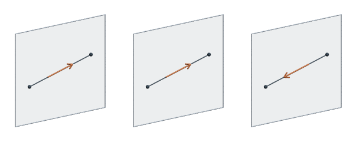
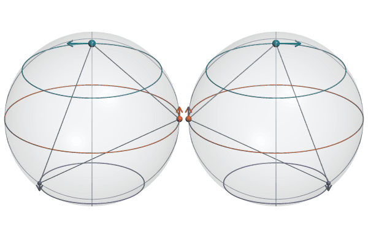

# Why orientation

This document motivates orientation in geometric algebra from two requirements, one geometric and one physical, and sets out the rules they imply. Nothing in the algebra's products asks for orientation on its own; the need comes from how elements transform and how physical quantities are read.

The geometric requirement is that transformations of space commute with constructions: transforming the ingredients of a construction and building from them gives the same result as building first and transforming the result, across every product of the algebra. The physical requirement is that mirroring a system together with its measuring apparatus leaves every scalar reading unchanged, such as kinetic energy, mechanical power or wave phase, while reversing handed quantities such as signed volumes.

## What a physical mirror does

Two pictures show what a physical mirror does to a line, and everything after them builds on these two. Here points are oriented by their weights and planes by their positive sides.

<p align="center"></p>

*Figure: a vertical mirror, the pale sheet, and a line lying in it. Top: a red point and a blue point on the line. Bottom: a red plane and a blue plane crossing in the line, each at half a right angle to the mirror. Left: the scene. Right: its mirror image.*

In the top row, the two points lie in the mirror and keep their positions and weights. In the bottom row, each plane's mirror image lies where the other plane was, so the mirror swaps them. In both rows the line stays where it is.

The same line can be built from either pair: as the join of the two points, or as the meet of the two planes. If reflecting is to commute with building, the join of the unmoved points is the join itself, so a reflection must leave the join unchanged. The meet of the swapped planes is the meet built in the opposite order, and because the meet is antisymmetric, changing sign when its two planes are exchanged, a reflection must negate the meet. The same line, built from two points or from two planes, must come out of a reflection unchanged in one case and negated in the other.

## Orientation

The join can be viewed as a direction along the line, from the one point to the other, lying within the line itself. A mirror that contains the line leaves everything within the line alone, so that direction stays as it was.

The meet can be viewed as a rotation around the line, from the one plane to the other, lying in the space around the line. A mirror that contains the line flips the space around it side for side, so that rotation is reversed.

The terms ***intrinsic orientation*** and ***extrinsic orientation*** here mean an orientation within an element itself and an orientation in the space around it, following [[1]](#references). An element's orientation is which of the two it has; type comments mark extrinsic with `+` and intrinsic with `-`.

## The unoriented sandwich

In projective three-space, where vectors are planes and antivectors are points, the outer product `^` of two planes is their meet and the regressive product `&` of two points is their join. Both lines have grade two and the same coefficients up to scale.

Reflecting every element `x` in a mirror plane `mirror` with the grade-involuted sandwich, `mirror * x.involute() * mirror.inverse()`, swaps `red` and `blue` and commutes with the geometric and outer products, so it negates the meet `red ^ blue` as it should. Because it commutes with `^` while reversing the space's unit volume, it anti-commutes with the regressive product in every dimension and at every grade, turning around the joined line `ends[0] & ends[1]` that lies in the mirror:

<p align="center"></p>

*Figure: two points lying in a mirror, the pale sheet, and the line through them, with an arrow for its intrinsic orientation. Left: the line. Middle: its mirror image, with its direction unchanged. Right: the result of reflecting with the unoriented sandwich; the line is turned around.*

```python
# The mirror is the plane x = 0; two planes cross in the z axis, and two points lie on it.
mirror = mv.x                                          # [] Vector+
red, blue = mv.x + mv.y, mv.y - mv.x                   # [] Vector+, [] Vector+
ends = mv.point([[0.0, 0.0, -0.5], [0.0, 0.0, 0.5]])   # [points] Antivector-

def reflect(x):
    return mirror * x.involute() * mirror.inverse()

# Minus the meet, matching blue ^ red, the meet of the mirrored planes.
reflect(red ^ blue)                                    # [] Bivector+
# Minus the join, turned around instead of unchanged.
reflect(ends[0] & ends[1])                             # [] Antibivector-
```

Putting an overall minus sign in front, `-mirror * x.involute() * mirror.inverse()`, leaves intrinsic points in the mirror and their joins unchanged, while negating planes that lie in the mirror and leaving `red ^ blue` unflipped instead of negated. Applied uniformly to every element, no single sandwich rule has the geometric action of a mirror.

## An orientation-aware reflection

An orientation-aware reflection negates the grade-involuted sandwich for intrinsic elements and leaves it as is for extrinsic ones; written `>>`, it reads the orientation from the element's type. Reflection then commutes with the join just as it commutes with every other product:

```python
# The join, unchanged.
mirror >> (ends[0] & ends[1])                          # [] Antibivector-
# Minus the meet.
mirror >> (red ^ blue)                                 # [] Bivector+
```

## Observables

Mirroring a system together with its measuring apparatus must also preserve every physical reading. Kinetic energy gives a direct test: a spinning body and its mirror image turn opposite ways and carry the same positive kinetic energy:

<p align="center"></p>

*Figure: a body of three masses turns, and its mirror image turns the other way. Colours identify matching masses, marker sizes show the masses, and arrows show their velocities.*

The body's rate of turning is an extrinsic line (`Bivector+`), oriented around its axis, while the mass points are intrinsic (`Antivector-`). Joining each mass point with its velocity under that rate gives an intrinsic angular momentum (`Antibivector-`), oriented along its line, and the kinetic energy is half the regressive pairing of the rate with the momentum. Reflected with orientation, the mirrored body has the same positive kinetic energy. Reflected uniformly with `reflect`, with or without an overall minus sign, both factors preserve their outer product while the unit volume reverses, so `rate & momentum` changes sign in every dimension and the mirrored body's kinetic energy comes out negative:

```python
points = mv.point([[1.0, 0.0, 0.0], [0.0, 1.0, 0.5], [-0.5, 0.0, 1.0]])     # [points] Antivector-
masses = np.array([1.0, 1.5, 0.5])                                          # [points] float
inertia = points.regressive(points.commutator(Rate) * masses).sum()         # [] Antibivector- <- Bivector+
rate = mv.xy + 0.3 * mv.yz                                                  # [] Bivector+
momentum = inertia(rate)                                                    # [] Antibivector-

# 1.494.
(rate & momentum) / 2                                                       # [] Scalar+
# 1.494: the same energy.
((mirror >> rate) & (mirror >> momentum)) / 2                               # [] Scalar+
# -1.494: negative energy.
(reflect(rate) & reflect(momentum)) / 2                                     # [] Scalar+
```

An [energy in a mirror](../examples/orientation/mirror_energy/mirror_energy.ipynb) example animates the body, and a [mechanical work](../examples/orientation/mechanical_work/mechanical_work.ipynb) example shows the same contrast for the power a push delivers to a crank.

Every such reading pairs an extrinsic value with an intrinsic one by the regressive product, such as `rate & momentum` above, `field & spin`, or `force & displacement`. As [Complementarity](complementarity.md) develops, that pairing uses no metric and remains unchanged across dimensions, signatures and general linear maps as well as in a mirror.

## Every element has an orientation

The line is one grade among the rest. Every element of the algebra can carry either orientation, intrinsic or extrinsic, and a mirror treats the two differently at every grade. A triangle shows the distinction on planes:

<p align="center"></p>

*Figure: a triangle lying in a horizontal plane, and its mirror image in a vertical mirror. Left: the plane's positive side, which stays above both triangles. Right: the order of the corners, which the mirror reverses.*

The plane equation of the triangle's plane orients it by which side is positive in the space outside it, an extrinsic orientation, and the vertical mirror keeps the positive side up. Joining the triangle's three corners in order gives the same plane oriented by its corners going round within it, an intrinsic orientation, and in the mirror image the corners go round the other way. A [surface normals](../examples/orientation/normals/normals.ipynb) example draws both:

```python
corners = mv.point([[0.0, 0.0, 0.0], [1.0, 0.0, 0.0], [0.0, 1.0, 0.0]])     # [corners] Antivector-
# The plane z = 0, positive above.
side = mv.z                                                                 # [] Vector+
# The same plane, its corners going round.
winding = corners[0] & corners[1] & corners[2]                              # [] Antitrivector-
                                                                            
# +z: the positive side still points up.
mirror >> side                                                              # [] Vector+
# -z: the corners go round the other way.
mirror >> winding                                                           # [] Antitrivector-
```

In a plane, a point can likewise be oriented by its weight, as a mass is, or by a turn around it, as a pivot is. A [circle constructed twice](../examples/orientation/conformal_circle/conformal_circle.ipynb) example shows the same split for a circle in the conformal algebra of space.

## From the plane to space

Stepping from a plane into three-space shows why orientation and grade separate. A mass at a point on a sheet of paper remains a mass at a point when the room around the sheet is included. A wheel turning in the sheet turns about a point in the sheet, and about an axis in the room. From the projective plane to projective three-space, the weighted point stays an antivector while the turn stays a bivector:

```python
# plane_mv in the projective plane, space_mv in projective three-space.
point_2d = plane_mv.point([0.0, 0.0])                  # [] Antivector- (grade 2 in the plane)
point_3d = space_mv.point([0.0, 0.0, 0.0])             # [] Antivector- (grade 3 in space)
pivot = plane_mv.x ^ plane_mv.y                        # [] Bivector+   (grade 2 in the plane)
axis = space_mv.x ^ space_mv.y                         # [] Bivector+   (grade 2 in space)
```

The two crossing lines that locate the pivot in the sheet extend to two crossing planes in the room, and their meeting point becomes their meeting line with the same sense of turning around it. Restricting back to the sheet recovers the pivot.

Constructing an extrinsic point in three-space requires meeting that axis with a third plane, and the chosen side of that plane becomes part of the orientation:

```python
extrinsic_point = axis ^ space_mv.z                    # [] Trivector+
opposite_point = axis ^ (-space_mv.z)                  # [] Trivector+
```

A turn in the sheet does not choose which side of the sheet is positive. Choosing the opposite side reverses the extrinsic point's orientation while keeping its location and the turn in the sheet unchanged: in three-space, an extrinsic point carries a handedness of its surroundings. An intrinsic point needs no choice along the added direction because its orientation stays within the point itself.

## How orientation spreads, and what it rules out

Once the orientations of the inputs are chosen, each operation fixes the orientation of its result. The dual exchanges the two kinds: it takes an element to its complement, and what lay within the element lies around the complement, so an intrinsic element's dual is extrinsic and an extrinsic element's dual is intrinsic. Because the regressive product is the outer product taken on complements and brought back by the inverse complement, it carries one exchange more than the outer product, which is why joining two intrinsic points gives an intrinsic line.

Orientation also rules out expressions whose terms transform in incompatible ways. In the spinning body above, `rate` (`Bivector+`) and `momentum` (`Antibivector-`) have opposite orientations, so `rate + momentum` has no single transformation law under reflection. Raising an intrinsic element to an exponential mixes orientations in the same way, since its even powers are extrinsic and its odd powers are intrinsic, whereas `rate.exp()` is extrinsic throughout and generates a motion.

In matrix notation a plane's side transforms with the inverse transpose of a linear map and a triangle's area normal with its cofactor matrix, which differs by the sign of the determinant, $-1$ for a mirror. In exterior calculus the two kinds correspond to outer and inner orientation, represented by untwisted and twisted differential forms [[2, §§1–2]](#references), and in projective geometry the two kinds of line correspond to Study's spears and axes [[3, §2.2]](#references), [[4, §8.6.1]](#references).

## The rules

Together with two conventions, that expressions keep the same form and signs across dimensions and signatures and that each operation uses a single symbol wherever the requirements allow, the geometric and physical requirements leave six rules:

1. **Types go by orientation, not by grade.** An intrinsic plane, the join of three points, follows the intrinsic rules as a point does; an extrinsic point, the meet of three planes, follows the extrinsic ones.
2. **A reflection acts by orientation.** It takes an extrinsic value to `m * x.involute() * m.inverse()` and an intrinsic one to the negative of that; a rotation, an even number of reflections, carries no sign.
3. **Readings pair an extrinsic value with an intrinsic one, the extrinsic first**, and the adjugate, the map read backwards across a pairing, and the trace read their pairings the same way, so that no sign depends on the dimension.
4. **A metric measures one orientation at a time**, intrinsic values through their duals, so that a spatial direction's length squared is positive in every algebra; an extrinsic value and an intrinsic one are paired, never measured against each other.
5. **The primitive products stay plain.** The geometric, outer and regressive products and the commutators act on the coefficients as the algebra defines them, and their results' orientations follow from their inputs'.
6. **An intrinsic value has two sizes**, its norm, of a projective point its weight, and its antinorm, of a direction its length.

## Companion documents

* [The regressive product](regressive_product.md): how `&` pairs orientations, joins points, contracts fields and builds linear maps and their adjugates.
* [Complementarity](complementarity.md): how complementary pairings and physical representations extend across geometry, mechanics and physics.
* [Orientation in numga](../docs/orientation.md): the orientation rules for every constructor and operation in `numga`.

## References

1. [*Projective Duality Encodes Complementary Orientations in Geometric Algebras*](https://pure.uva.nl/ws/files/189200508/Projective_duality_encodes_complementary_orientations_in_geometric_algebras.pdf) (Leo Dorst, *Mathematical Methods in the Applied Sciences*, 2024).
2. [*Applied Differential Geometry (A compendium)*](https://people.math.ethz.ch/~hiptmair/Courses/CEM/BOS02c.pdf) (Alain Bossavit, 2002).
3. [*On the Homogeneous Model of Euclidean Geometry*](https://arxiv.org/pdf/1101.4542) (Charles Gunn, in *Guide to Geometric Algebra in Practice*, Leo Dorst and Joan Lasenby, eds., Springer, 2011; extended preprint of AGACSE 2010).
4. [*A Bit Better: Variants of Duality in Geometric Algebras with Degenerate Metrics*](https://arxiv.org/pdf/2206.02459) (Charles Gunn, 2022).
