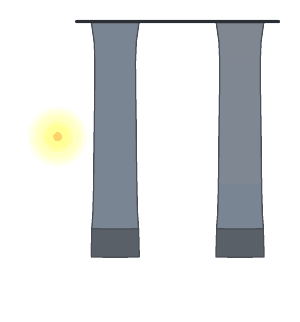
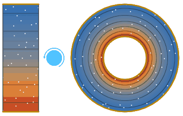

# Geometry and quantities

Geometric algebra can describe space, time and motion, and exterior algebra can describe the state spaces of thermodynamics. This document explores what happens when those two descriptions are joined into one algebra.

That algebra represents how a material's variables couple to one another, both in equilibrium and in transport. Maxwell's relations in equilibrium and Onsager's reciprocal relations in transport take the same form, and in transport by mobile carriers the construction carries spatial mobility symmetry into Onsager's relations.

## Introduction

Extending an algebra by a dimension can unify what were separate descriptions. When space is extended with a time dimension to spacetime, the electric and magnetic fields can be modelled together as a single spacetime bivector. When geometry is extended with a projective dimension, rotation and translation can be modelled as one rigid motion, and one inertia relates its rate to its momentum. Extending the algebra once more, with, for instance, a direction for entropy, is a step of the same kind.

Each extension allows separate elements to be modelled as one, and laws that carry separate names to be written as one statement:

| The spatial algebra is extended with | Elements that can be modelled as one | Laws that can be written as one |
| --- | --- | --- |
| time | the electric and the magnetic field, as one bivector | Gauss, Faraday, Ampère and Maxwell, as one equation |
| a projective dimension | a rotation and a translation, as one motion | Newton, Euler and Steiner, as one equation of motion with one inertia |
| thermodynamic quantities | the electric field and the slopes of temperature, pressure and chemical potential, as one bivector | Ohm, Fourier, Fick and Darcy, with Seebeck, Peltier and the other effects between them, as one map |

In spacetime, the electromagnetic field (F) is a bivector, the fall of the potential (A), minus the gradient wedged with it, and it acts on charge. A moving charge is a current, its velocity joined with its charge, and the field does work on the current at the rate given by their pairing, the power that heats a resistor:

```python
field = -gradient ^ potential   # [] Bivector+
current = velocity & charge     # [] Antibivector-
power = field & current         # [] Scalar+
```

Thermodynamics already pairs temperature with entropy as electromagnetism pairs the electric potential with charge. Adding entropy to a material takes heat in proportion to its temperature, just as adding charge takes work in proportion to the electric potential, and temperature is therefore called the potential conjugate to entropy. A model with a direction for entropy places the temperature in the potentials along that direction, beside the electromagnetic potential. The term ***drive*** here means the fall of these potentials, formed as the field above is: one element that holds both the electromagnetic field and the fall of temperature across space.

A thermocouple is a material in which the two parts of this drive act together. A temperature difference across the junction of two metals drives an electric current through it, and an electric current through the junction carries heat, because the electrons that carry the current hold entropy as well as charge.

The term ***carrier*** here means anything that moves through a material and carries something along with it, such as an electron in a metal or a small piece of a flowing fluid. The term ***parcel*** here means a carrier's contents, modelled as a single element of the algebra, here the sum of its charge and its entropy. Because the parcel holds everything at once, the carrier's velocity joined with its parcel is the flux of all of it together, charge and entropy alike, and the drive does work on that flux at the rate given by their pairing:

```python
drive = -gradient ^ potentials   # [] Bivector+
flux = velocity & parcel         # [] Antibivector-
power = drive & flux             # [] Scalar+
```

The same kind of coupling occurs in equilibrium. A rubber band warms when it is stretched, and it pulls harder when it is warmed. In continuum mechanics, the forces on a material's points do work on their displacements. With entropy in the algebra, the band's temperature joins its forces in one element, its potentials, and a stretch together with a change of entropy is one change of its state. Their pairing is the work done on the band, heat included:

```python
work = potentials & change   # [] Scalar+
```

In both materials a change of one variable causes a response in another, and the coupling runs both ways: the thermocouple's temperature difference drives a current and its current carries heat, and the band's stretch warms it while its warmth makes it pull harder. In each pair, the sizes of the two effects are tied to each other, partly by the algebra and partly by what the material is.

## Equilibrium

The rubber band's two effects are tied because the band stores energy. Quantities carried with the material are intrinsic (`-`) while quantities that measure or act on them are extrinsic (`+`) ([Why orientation](orientation.md), [Complementarity](complementarity.md)). The band's state is intrinsic, combining the positions of its points with its entropy, and its potentials are extrinsic, combining the forces on its points with its temperature. Their regressive pairing `potentials & change` uses no metric, which matters here because nothing measures an entropy against a length.

The band's potentials are the derivative of its energy with respect to its state, and the derivative of the potentials in turn is a map, from a change of state to the change of potentials that it causes. The term ***material map*** here means a map of this kind, which says how a material responds; in mechanics alone it is the stiffness. Because the band's material map is the second derivative of one energy, it is symmetric, which in the algebra reads as the map being equal to its [adjugate](complementarity.md#claims):

```python
material == material.adjugate()   # [] Vector+ <- Antivector-
```

The material map has four readings, the change of each potential that each change of state causes:

| | a stretch | added entropy |
| --- | --- | --- |
| **change of pull** | Hooke's stiffness | pulls harder when warmed |
| **change of temperature** | warms when stretched | temperature over heat capacity |

The two cells off the diagonal are the band's two effects, and the symmetry of the material map makes them equal: added entropy changes the band's pull by as much as a stretch changes its temperature. That symmetry is the tie between the band's warming and its pull, as a [rubber band](../examples/thermodynamics/rubber_band/rubber_band.ipynb) example computes it. Symmetries of this kind are known as Maxwell's relations.

<p align="center"></p>

*Figure: two hanging rubber bands on a shared timeline, coloured by temperature. On the left, heat from a lamp warms the band, raising its tension and lifting the weight; on the right, pulling the unlit band down warms it slightly at fixed entropy and releasing it cools it back.*

Where the coupled variables occupy different grades, the state and the potentials become mixed-grade elements and the material map remains a single symmetric extensor. In a [paramagnetic salt](../examples/thermodynamics/paramagnetic_salt/paramagnetic_salt.ipynb) example, magnetization is an intrinsic patch of the spin plane and entropy is the dual of its basis vector, paired with the magnetic field's bivector and temperature's vector: magnetizing the salt warms it, removing the field cools it, and inverting that mixed-grade material map gives the change of magnetization and entropy for a given change of field and temperature.

## Transport

The thermocouple's two effects are tied for a different reason. In fluid dynamics, the transport of a quantity by the motion of a fluid is called advection. The term ***advection*** here means the map from a carrier's velocity to the flux that it makes, the regressive product of the velocity with the parcel. Its adjugate runs the other way. It takes a drive to the force on the carrier, the electric part acting on the electron's charge and the thermal part on its entropy, so that the force paired with a velocity equals the power that the drive delivers to the flux:

```python
# Spatial, the type of a velocity through space, is the identity map on such velocities.
advection = Spatial & parcel                      # [] Antibivector- <- Antivector-
force = advection.adjugate()(drive)               # [] Vector+
drive & advection(velocity) == force & velocity   # [] Scalar+
```

The force on a carrier and the flux that the carrier makes are therefore one map, read backwards and forwards, with no metric used on either sector. A mobility, which is a property of the material and carries the metric of space, turns the force into a velocity, and the three maps together are the material map of transport, the response:

```python
response = advection(mobility(advection.adjugate()))   # [] Antibivector- <- Bivector+
flux = response(drive)                                 # [] Antibivector-
dissipation = drive & flux                             # [] Scalar+
```

The dissipation equals `force & mobility(force)`, so a positive mobility gives a positive dissipation. A symmetric mobility gives a symmetric response, `response == response.adjugate()`: an electric drive causes as large a flux of entropy as a thermal drive causes a flux of charge. That is the thermocouple's tie, as a [thermocouple](../examples/thermodynamics/thermocouple/thermocouple.ipynb) example computes it. Symmetries of this kind are Onsager's reciprocal relations. Heat is the temperature times the entropy carried, which puts a factor of the temperature between the thermocouple's two coefficients, Kelvin's relation.

With one kind of carrier, no current flows once a voltage balances the temperature difference, and that voltage, for each degree of the difference, is the parcel's entropy for each unit of its charge. This ratio is the Seebeck coefficient, which thermoelectricity reads in the same way, as the entropy that the carriers take along for each unit of charge.

## Quantities and the joined algebra

### The quantity sector and parcels

Every extensive variable that a model tracks, such as mass, volume or the amount of a chemical species, can be modelled the way entropy was, by an added basis vector that squares to zero. Its potential joins the potentials, a carrier's share of it joins the parcel, and the drive, the flux and the power are formed in the same way.

The term ***quantities*** here means these added variables, as against the geometry. The terms ***geometric sector*** and ***quantity sector*** here mean the two groups of basis vectors, those of space, time and the projective dimension, and those added for the quantities. A planar algebra with all of them has the basis vectors `x+ y+ t- w0` in its geometric sector and `v0 m0 s0 n0` in its quantity sector, for volume, mass, entropy and the amount of a species, where the mark after each letter is the sign of its square. Charge already sits in the geometric sector along spacetime's time direction `-t.dual()`, while the units of volume and entropy are the duals of their basis vectors[^volume] as written below:

```python
time = -t.dual()        # [] Antivector-
volume = v.dual()       # [] Antivector-
entropy = s.dual()      # [] Antivector-
```

In the joined algebra a parcel is the sum of `time`, `volume`, `entropy` and the other quantity units, each weighted by the amount that its carrier carries, and the regressive product reads non-degenerate `t-` and degenerate `v0 m0 s0 n0` in the same way.[^current-worldsheet] A piece of material at a place is `place + parcel`, where w reads the weight of the place, as in projective geometry. The parcel's entropy is `s & parcel`, and its density is `(m & parcel) / (v & parcel)`.

### Equilibrium state spaces and reactions

Because every basis vector of the quantity sector squares to zero, the subalgebra they generate is an exterior algebra whose geometric product reduces to the outer product, paired by the regressive product on complements. On its own, that subalgebra models an equilibrium state space without spatial geometry. In the plane `s0 v0` of entropy and volume, holding a potential or variable fixed constrains allowed steps to `constraint & step == 0`, as when heating a gas at fixed volume or at fixed pressure in a [constrained heat capacity](../examples/thermodynamics/state_space/state_space.ipynb) example. Wedging each potential's state gradient with its direction forms the heat and work area bivectors, `temperature_slope ^ s` and `pressure_slope ^ v`, which pair with an oriented patch of state changes `entropy & volume` in a [heat cycles](../examples/thermodynamics/heat_cycles/heat_cycles.ipynb) example. When temperature and minus pressure come from one internal energy, their mixed slopes cancel and the two bivectors coincide, equating the heat absorbed around a closed cycle with the mechanical work enclosed.

Doubling that exterior space so states and potentials vary independently connects a material map's symmetry directly to symplectic geometry ([Complementarity](complementarity.md#state-changes-and-conjugate-potentials)). On two independent variations `(state_a, potential_a)` and `(state_b, potential_b)`, the cross-pairing splits into the alternating symplectic two-form `(potential_b & state_a) - (potential_a & state_b)` and the symmetric average `((potential_b & state_a) + (potential_a & state_b)) / 2`.[^symmetric-affine] Restricting both to the equilibrium surface where potential changes follow `material(state)` separates reciprocity from stability. The condition `material == material.adjugate()` makes the alternating form vanish on that surface, restating Maxwell's relation, while the symmetric average restricts to `material(state_a) & state_b`, which stays positive semidefinite for a convex energy. In the entropy representation, the corresponding second-derivative material map gives the fluctuation cost `metric(variation) & variation`, whose scalar curvature diverges at a liquid–gas critical point in a [critical fluctuations](../examples/thermodynamics/ruppeiner/ruppeiner.ipynb) example.

Adjoining a further null direction `u0` for internal energy lifts that doubled space to an odd-dimensional contact space `u0 s0 v0 t0 p0`, as in a [Legendre transformation](../examples/thermodynamics/contact_geometry/contact_geometry.ipynb) example. Along an equilibrium surface, the contact hyperplane `u - temperature * s + pressure * v` pairs to zero with every tangent step because a change of internal energy equals heat added less mechanical work done. In the Helmholtz transformation, replacing internal energy with `energy - temperature * entropy` while exchanging entropy and temperature up to sign pulls that contact hyperplane back to itself through the adjugate of the transformation's pushforward. Reversible and dissipative brackets on the same state variables combine in a [damping as heating](../examples/thermodynamics/generic/generic.ipynb) example.

Conversions between quantities, such as burning or freezing, also act among the quantity basis vectors alone. A conversion is a direction among the quantities, and a quantity that it conserves is a plane that pairs with that direction to zero, `energy & reaction == 0`, as energy does with burning in a [flame](../examples/thermodynamics/flame/flame.ipynb) example and with freezing in a [snowflake](../examples/thermodynamics/snowflake/snowflake.ipynb) example.

<p align="center"></p>

*Figure: a seed of ice growing into a six-armed dendrite in undercooled water, with latent heat released along the freezing direction glowing into the liquid around the tips.*

### Planes of the joined algebra

When the two algebras are joined, a plane spanned by two basis vectors `a ^ b` and its intrinsic complement `a.dual() & b.dual()` fall into three groups by sector:

| A plane spanned by | The extrinsic plane can model | Its intrinsic complement can model |
| --- | --- | --- |
| two basis vectors of the geometry | a magnetic field, an electric drive (x∧t) or a rotation | a magnetic moment or a charge current |
| a direction of space and a quantity | the slope of that quantity's potential, a part of the drive | a flux of that quantity |
| two thermodynamic directions | a cycle or contact plane | an oriented patch of state changes |

Each extrinsic plane pairs with its complement, pairing a magnetic field with a magnetic moment, a slope of temperature with a flux of entropy, and a heat or work plane with a cycle's patch of state changes. The first and third rows belong to the geometric and thermodynamic algebras on their own; the middle row appears when the two are joined, alongside the electric drives in x∧t and y∧t.

## Coupled transport

In this model, a drive of one variable moves another variable only through a carrier that carries both. In an [electrokinetics](../examples/fluids/electrokinetics/electrokinetics.ipynb) example, pressure pushes the fluid's volume and the electric field pushes its charge, while the dissolved ions, modelled with charge and no volume, are not pushed by the pressure at all. In a [superfluid helium](../examples/fluids/superfluid/superfluid.ipynb) example, the normal fluid carries entropy and the superfluid carries none, so a temperature difference pushes only the normal fluid, and second sound is the temperature wave that results.

The familiar effects of coupled transport each sit in one entry of the response. The drive on a variable is the fall of its potential, meaning the electromagnetic field for charge, and the fall of pressure for volume, of the gravitational potential for mass, of temperature for entropy, and of its chemical potential for a species. Each cell of the table below is `row & response(column)`, the flux of its row's variable that the drive on its column's variable causes:

| | drive on charge | drive on volume | drive on mass | drive on entropy | drive on a species |
| --- | --- | --- | --- | --- | --- |
| **flux of charge** | Ohm, Hall | streaming current | sedimentation potential | Seebeck, Nernst | diffusion potential |
| **flux of volume** | electro-osmosis | Darcy, Poiseuille | Archimedes | thermo-osmosis | osmosis |
| **flux of mass** | electrophoresis | Archimedes | Stokes | thermophoresis | mass diffusion |
| **flux of entropy** | Peltier, Ettingshausen | mechanocaloric effect | heat carried by settling | Fourier, Righi–Leduc | Dufour |
| **flux of a species** | electromigration | reverse osmosis | sedimentation | Soret | Fick |

The diagonal has each variable's own conductance, and each pair of [cells mirrored across it](#appendix-the-effects-of-coupled-transport) is one coupling read both ways through a carrier that carries both variables, as Seebeck and Peltier are for charge and entropy and as both of Archimedes' cells are for volume and mass. For a symmetric mobility the two readings of a pair are equal. The magnetic part of the electromagnetic field turns the motion of charged carriers, giving their cells a second name for the flux across the drive (Hall beside Ohm, Nernst beside Seebeck, Ettingshausen beside Peltier, and Righi–Leduc beside Fourier). The mobility is then not symmetric, and the two readings of a pair are equal once the field is reversed. The names locate families of effects across different materials; a measured coefficient combines several entries under its boundary conditions.

## A conductor in a magnetic field

The transport of charge and heat through a conductor in a magnetic field is called magnetotransport. A [magnetotransport](../examples/thermodynamics/magnetotransport/magnetotransport.ipynb) example computes it for a planar conductor, in which electrons and holes carry charge and entropy. The electric drives lie in the planes x∧t and y∧t, and the thermal drives in x∧s and y∧s. Because the magnetic field is a plane of space that exerts no force on a carrier at rest and does no work, the example takes it as given apart from the drive. Using the Euclidean metric of the conductor's plane, the spatial dual of the force `advection.adjugate()(drive)` is a push in the plane, and one commutator combines that push with the magnetic field's turning of a moving carrier:

```python
push_and_power = (magnetic + drive).commutator(parcel + valence * velocity)   # [] Antivector-
```

The spatial part of that commutator is the push on the carrier's charge and entropy, together with the field's turning of its motion. Its temporal part is the electrical power, to which the magnetic field adds nothing. A carrier drifts where the drag of its collisions balances the push, and that balance is solved by inverting one element, a scalar plus a bivector. Each kind of carrier takes its own parcel along, and the response is the sum over the kinds, weighted by their densities, with the lattice's conduction:

```python
parcels = valences * (time + entropies_per_charge * entropy)                      # [kinds] Antivector-
push = Drive.commutator(parcels)                                                  # [kinds] Antivector- <- Bivector+
hall = 1 - valences * mobilities * magnetic                                       # [kinds] Even+
drifting = hall.inverse() * (mobilities * push)                                   # [kinds] Antivector- <- Bivector+
response = (densities * drifting.regressive(parcels)).sum(axis=-1) + conducting   # [] Antibivector- <- Bivector+
```

The inverse turns the push through the carrier's Hall angle and shortens it by that angle's cosine, and opposite charges turn in opposite senses. The electrical responses, the thermal ones and those that couple the two are all readings of this one map, `row & response(column)`:

| | electric drive along x | electric drive along y | thermal drive along x | thermal drive along y |
| --- | --- | --- | --- | --- |
| **flux of charge along x** | Ohm | Hall | Seebeck | Nernst |
| **flux of charge along y** | Hall | Ohm | Nernst | Seebeck |
| **flux of entropy along x** | Peltier | Ettingshausen | Fourier | Righi–Leduc |
| **flux of entropy along y** | Ettingshausen | Peltier | Righi–Leduc | Fourier |

The top left block reads the charge that an electric drive moves, and the bottom right block the entropy that a thermal drive moves. The other two blocks read the entropy that an electric drive moves and the charge that a thermal drive moves. In each block the flux along the drive is on the diagonal, and the flux across it, which the magnetic field adds, is off it. Reversing the magnetic field gives `response.adjugate()`, so the part of the response that is even in the field is symmetric and dissipative, while the part that is odd in it is antisymmetric and dissipates no power. This is the Onsager–Casimir form of the reciprocal relations; coupled-transport reviews state the microreversibility assumptions behind it for electric, thermal and spin transport [[1, §I]](#references).

A measured Hall resistance, Seebeck coefficient or Nernst signal follows from the response once the conditions at the conductor's boundary are imposed. In the interior of a long bar those conditions hold at every place alike, and the coefficients follow from the response at one place, as a [transport coefficients in a magnetic field](../examples/thermodynamics/magnetotransport/magnetotransport_one_place.ipynb) example computes them. For the matched electron and hole mobilities and entropies per carrier in that example, the Hall resistance vanishes where their densities balance and the Nernst signal peaks there. A bar builds up voltages across its insulating sides, and a Corbino ring lets its currents circulate; the magnetotransport example computes both over the whole conductor.

<p align="center"></p>

*Figure: a Hall bar on the left and a Corbino ring on the right, warmed at one gold contact in the perpendicular magnetic field marked between them as the carrier balance sweeps from electrons to holes. Background colour shows temperature from blue to red, dark lines trace electrochemical equipotentials, and white and black streaks show the two carrier drifts.*

## Conclusion

In the joined algebra, the rubber band's tie and the thermocouple's tie are the same statement about a material map, that it equals its adjugate, whether mapping a change of state to a change of potentials or a drive to a flux. The two symmetries have different sources.

For the rubber band, the algebra says how the band's temperature and its forces read a stretch and a change of entropy. It does not tie the warming to the extra pull. That tie holds because both come from one energy, which the algebra allows and does not require. It is an assumption about the band, though one that almost every model of a material makes.

For the thermocouple, an electron carries charge and entropy together, so anything that acts on it, a temperature difference through its entropy or an electric field through its charge, moves both. Because the force on the electron and the flux that it makes are one map and its adjugate, the algebra reduces the coupling between the two variables to the electron's mobility. Once that mobility is symmetric, the current that a temperature difference drives and the heat that a current carries share one coefficient. A mobility relates a force to a velocity, both in space, and neither charge nor entropy enters it, so the tie between the two variables comes down to the symmetry of an ordinary conductivity, which microscopic reversibility ensures.

Writing every pairing as a [complementary](complementarity.md) one, an extrinsic element with an intrinsic one by the regressive product, is what allows the geometry and the quantities to be joined without friction. Just as a degenerate projective algebra [requires the complementary form](complementarity.md#conclusion), so do the degenerate basis vectors of the quantities, which combine through the regressive product. Because that pairing uses no metric, maps across the quantity directions still have an adjugate where no inner-product transpose exists, while the metric of space enters only through the mobility.

Combined with [discrete differential geometric algebra](ddga.md), the same maps assemble into structure-preserving discrete representations over whole bodies in which the potentials vary from place to place. On a simplicial topology, the drive is minus the simplex gradient wedged with the potentials, and pulling the local response back through `gradient.adjugate()(response(gradient))` preserves symmetry, reciprocity and positive dissipation on the topology itself, while the equilibrium material map at each place and the assembled transport map between places act on the same state and potentials.

## Related work

Equilibrium state spaces have established exterior, symplectic and contact formulations. On the cotangent space of states and conjugate potentials, the canonical symplectic two-form vanishes on the half-dimensional graph of a one-form if and only if that one-form is closed, so potentials generated by an internal energy define a Lagrangian submanifold whose tangent symmetry is Maxwell's relation [[2, §§2.2–2.3, 3.2]](#references). Adjoining the thermodynamic potential itself gives an odd-dimensional contact manifold on which equilibrium states form Legendre submanifolds preserved by Legendre transformations [[3, §2]](#references), while in extensive coordinates the negative entropy Hessian defines a Riemannian line element for equilibrium fluctuations [[4, §3.1]](#references). Here the exterior algebra of those null thermodynamic directions is embedded directly as a subalgebra alongside space and time, so the same regressive pairing and map adjugate act on state-space potentials and spatial transport alike.

Carter's variational formalism for relativistic fluids treats entropy as one constituent among others, with a current of its own and a conjugate momentum whose negative projection along a chosen observer velocity is the temperature. For a conserved constituent, the force density is its current contracted with the exterior derivative of its momentum, and the electromagnetic potential enters by shifting that momentum [[5, §§14.3, 15.3, 16.6–16.7]](#references). The force `advection.adjugate()(drive)` defined in this document has that form. Those constituents are separate fields on spacetime, one current and one momentum for each, and the symmetry of the dissipative coefficients is taken there from microscopic reversibility.

In thermoelectricity it is standard to read the Seebeck coefficient as the entropy that the carriers take along for each unit of charge, with the Peltier coefficient at zero magnetic field equal to the temperature times it [[6]](#references), whose thermodynamic origin in Callen's formulation is reviewed in [[7]](#references). A parcel extends that reading to everything that a carrier takes along.

Following Luttinger, thermal vector-potential theory represents a rotationless thermal force by a vector potential coupled to the energy current alongside the electromagnetic potential as a separate field [[8]](#references). In semiclassical transport, the relaxation-time approximation to the Boltzmann equation derives the same magnetic conductivity inverse and antisymmetric Hall entries [[9, slides 8–9]](#references).

Other frameworks lay a condition on the coefficients of dissipation. The GENERIC formalism requires its friction operator to be Onsager–Casimir symmetric and positive semidefinite [[10]](#references). Port-Hamiltonian formulations pair flows with efforts, impose nonnegative dissipation, and model the thermodynamic state space through contact geometry [[3]](#references). Differential-form formulations of dissipative fluids take the advected quantities as differential forms, pair their thermodynamic affinities with fluxes by the wedge product, and state reciprocity through the wedge-product adjoints of the operators that couple the variables [[11]](#references).

In this document the thermodynamic variables are directions in one algebra with space and time, so that the electric field and the slope of temperature are parts of one drive. For carriers, the reciprocal relations between two variables follow from the force and the flux being one map and its adjugate, and what is assumed is the symmetry of a mobility in space.

Spacetime formulations of particle mechanics and electromagnetism in geometric algebra are developed in [[12, §§IV–VII]](#references), and the projective formulation of Euclidean geometry and rigid-body kinematics is outlined in [[13, §6]](#references).

## Companion documents

* [Why orientation](orientation.md): why geometric constructions and positive physical energies require intrinsic and extrinsic orientation.
* [The regressive product](regressive_product.md): how the regressive product pairs orientations, joins points, contracts fields and builds linear maps and their adjugates.
* [Complementarity](complementarity.md): how complementary pairings and physical representations extend across geometry, mechanics, estimation and physics.
* [Discrete differential geometric algebra](ddga.md): calculus and physics on simplicial topologies built from the simplex gradient.

## Appendix: the effects of coupled transport

In the [table of coupled transport](#coupled-transport), each diagonal cell is the response in which the drive on a variable moves that variable itself. For charge this is Ohm's law, for entropy Fourier's law of heat conduction, and for a species Fick's law of diffusion. For volume it is Darcy's law in a porous material and Poiseuille's law in a tube, and for mass it is the settling of a particle against Stokes' drag.

The off-diagonal couplings involving charge pair an electric drive with fluid flow, particle settling, heat or ion motion. Beside a charged wall a liquid carries a net charge, so an electric field drives fluid flow (electro-osmosis) while a slope of pressure moves that charge (the streaming current). A charged particle in a liquid moves in an electric field (electrophoresis), and when such particles settle under gravity their charge builds up a sedimentation potential. Charge and entropy give the thermocouple's Seebeck and Peltier effects, while charged ions move under an electric field (electromigration) and carry charge as they diffuse down a concentration slope (the diffusion potential).

Couplings among volume, mass, entropy and chemical species follow the same symmetry. For volume and mass, a pressure slope pushes a body's volume to move its mass while gravity pushes its mass to move its volume, and the two pushes balance at Archimedes' principle. For volume and entropy, a temperature slope across a membrane or fine channel drives fluid flow (thermo-osmosis, or the fountain effect in superfluid helium), while pressure-driven flow carries heat (the mechanocaloric effect). Across a semipermeable membrane, a solute concentration slope drives solvent flow (osmosis) while pressure reverses that flow (reverse osmosis). Small particles move down a temperature slope (thermophoresis), mirrored by the unnamed heat carried by settling matter. Gravity or rotation moves a massive species (sedimentation and centrifugation) while diffusing species carry their mass along, and in mixtures a temperature slope moves a species (the Soret effect) while a concentration slope carries heat (the Dufour effect).

A magnetic field turns the motion of a charged carrier, and each cell that charged carriers make gains a second reading for the flux across the drive beside the flux along it. In the table these are the Hall effect beside Ohm's law, the Nernst effect beside Seebeck, the Ettingshausen effect beside Peltier, and the Righi–Leduc effect beside Fourier, while the field also alters the longitudinal flux in magnetoresistance and its thermal counterpart. These four pairs are the blocks computed for [a conductor in a magnetic field](#a-conductor-in-a-magnetic-field). A magnetized conductor adds the anomalous Hall effect as a reading of the same kind, a conducting liquid in a magnetic field couples charge and volume in the electromagnetic pump and flowmeter, and in a turning frame the Coriolis effect turns the motion of a settling mass in the same way.

## References

1. [*Onsager Relations in Coupled Electric, Thermoelectric and Spin Transport: The Ten-Fold Way*](https://arxiv.org/pdf/1207.1629) (Philippe Jacquod, Robert S. Whitney, Jonathan Meair and Markus Büttiker, *Physical Review B*, 2012).
2. [*Lectures on Symplectic Geometry*](https://people.math.ethz.ch/~acannas/Papers/lsg.pdf) (Ana Cannas da Silva, Springer, 2001; corrected lecture notes, 2006).
3. [*Geometry of Thermodynamic Processes*](https://arxiv.org/pdf/1811.04227) (Arjan van der Schaft and Bernhard Maschke, *Entropy*, 2018).
4. [*Thermodynamic curvature and phase transitions in Kerr–Newman black holes*](https://arxiv.org/pdf/0802.1326) (George Ruppeiner, *Physical Review D*, 2008).
5. [*Relativistic fluid dynamics: physics for many different scales*](https://arxiv.org/pdf/2008.12069) (Nils Andersson and Gregory L. Comer, *Living Reviews in Relativity*, 2021).
6. [*Notes on Thermodynamics of Thermoelectricity*](https://www.college-de-france.fr/media/antoine-georges/UPL8893859127406534291_notes_27mars2013_AGeorges_Thermodynamics.pdf) (Antoine Georges, Collège de France lecture notes, 2013).
7. [*What is measured when measuring a thermoelectric coefficient?*](https://comptes-rendus.academie-sciences.fr/physique/item/10.5802/crphys.100.pdf) (Kamran Behnia, *Comptes Rendus Physique*, 2016).
8. [*Thermal vector potential theory of transport induced by temperature gradient*](https://arxiv.org/pdf/1502.00347) (Gen Tatara, *Physical Review Letters*, 2015).
9. [*Lectures 5, 6, 7: Boltzmann kinetic equation*](https://www.mit.edu/~levitov/8513/lec567.pdf) (Leonid Levitov, MIT 8.513 lecture slides, 2008).
10. [*GENERIC: Review of successful applications and a challenge for the future*](https://arxiv.org/pdf/1810.08470) (Hans Christian Öttinger, 2018).
11. [*Variational formulation of a general dissipative fluid system with differential forms*](https://arxiv.org/pdf/2604.03801) (B. Manach-Pérennou and F. Gay-Balmaz, 2026).
12. [*Spacetime Physics with Geometric Algebra*](https://davidhestenes.net/geocalc/pdf/SpacetimePhysics.pdf) (David Hestenes, *American Journal of Physics*, 2003).
13. [*Projective geometric algebra: A new framework for doing euclidean geometry*](https://arxiv.org/pdf/1901.05873) (Charles Gunn, 2019).

[^volume]: A model can treat a material's volume as a thermodynamic variable, with pressure as its potential, the way an equation of state does. That is a choice, and it does not always apply: the volume can also be taken from the geometry, as the space spanned by the material's points.
[^current-worldsheet]: Whereas relativistic electrodynamics ([The regressive product](regressive_product.md)) combines charge density and drift into a spacetime four-current (`Antivector-`), joining a spatial drift `velocity` (`Antivector-`) with rest-frame charge along `time` forms the spatial current worldsheet `velocity & charge` (`Antibivector-`), which pairs directly with `field` (`Bivector+`) into scalar heating power.
[^symmetric-affine]: Extending the symmetric average off the critical points onto a general curved state manifold requires a choice of connection to compare potentials at nearby states, whereas the canonical symplectic two-form is defined without a connection.
