# Definition

In mathematical terms, an extensor is a multilinear map from multivectors to a multivector. Tensors are a special case of extensors, restricted to inner products of 1-vectors.

In programming terms, extensors let us build maps directly from geometric expressions. On the blackboard one moves freely between a specific vector and the space of all vectors; extensor syntax brings that flexibility to code.

Geometrically, objects and transformations belong to the same algebra. A lens is both an object we can move and a map that acts on rays. An extensor built from geometry takes its meaning from that construction and transforms as its geometry does.

# Motivation

Geometric relationships deserve to be first-class objects alongside the objects they relate. Inertia, stiffness and material responses are maps we construct, combine, transform and solve with. Extensors keep those relationships in the same algebra as their ingredients.

# Companion documents

* [`multiple_lenses.md`](multiple_lenses.md): the three perspectives developed in detail, from maps built from expressions to their geometric meaning and multilinear structure.
* [`extensor_syntax.md`](extensor_syntax.md): the syntax and the extension methods, as a reference sheet.
* [`internals.md`](internals.md): what the library builds from an expression, and what runs when values are supplied.
* [Complete index of 155 worked examples](../examples/README.md).

# Examples

In the selected examples below, lowercase names denote values and capitalized names denote spaces: `v ^ Vector` is a map from vectors to bivectors.

---

## 1. A Scenegraph, a Robot Arm and a Camera, as One Map

**Notebook**: [`examples/geometry/scenegraph/scenegraph.ipynb`](../examples/geometry/scenegraph/scenegraph.ipynb)

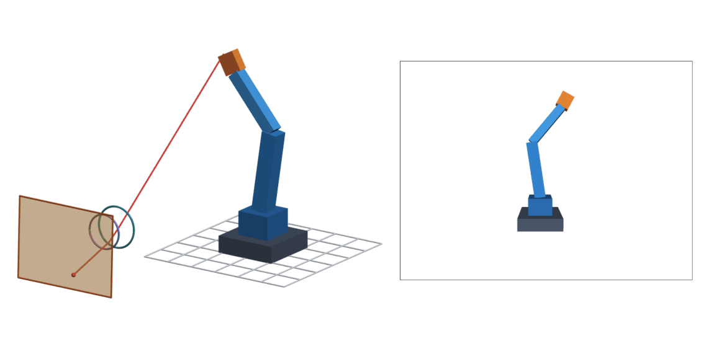

```python
lens = Line - (center & (Line ^ plane)) / focal_length                                            # [] Line <- Line
rear_lens = rear_placement >> thin_lens(origin, front_plane, focal_rear)(rear_placement << Line)   # [] Line <- Line
to_sensor = Line ^ sensor_plane                                                                   # [] Point <- Line
camera = to_sensor(rear_lens(front_lens(incoming_rays)))                                          # [] Point <- Point
local_to_pixel = world_to_pixel(bodies_to_world)                                                  # [bodies] Point <- Point
```

* A thin lens is a map from rays to rays, `Line - (center & (Line ^ plane)) / focal_length`.
* A motor moves a lens as it moves any map, `rear_placement >> lens(rear_placement << Line)`.
* Calling a map on a map composes them, so each part gets one map from points to pixels.

---

## 2. Light Past a Rotating Black Hole

**Notebook**: [`examples/relativity/kerr/kerr.ipynb`](../examples/relativity/kerr/kerr.ipynb)

<p align="center">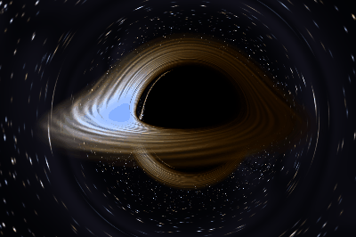</p>

```python
dyad = geometry.profile * geometry.null * (geometry.null_plane & Antivector)   # [...] Antivector <- Antivector
gauge = Antivector + dyad                                                     # [...] Antivector <- Antivector
gauge_inverse = Antivector - dyad                                             # [...] Antivector <- Antivector
momentum = -gauge_inverse(local_null).dual()                                  # [...] Vector
overlap_gradient = geometry.null_gradient.adjugate()(momentum)                # [...] Vector
```

* The geometry is a gauge field, a map from local directions to Kerr's, not a metric.
* That map is the identity plus a null dyad; the dyad squares to zero, so the inverse subtracts it.
* The force on a ray is an adjugate, `geometry.null_gradient.adjugate()(momentum)`.

---

## 3. Multi-View Reconstruction and Camera Alignment

**Notebook**: [`examples/estimation/multiview/multiview_reconstruction.ipynb`](../examples/estimation/multiview/multiview_reconstruction.ipynb)

<p align="center">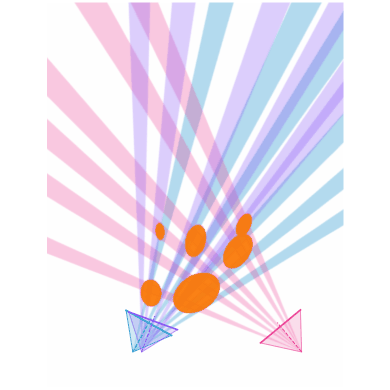</p>

```python
back_projection = camera.adjugate()                        # [] Plane <- Plane
cones = back_projection(discs(camera))                     # [landmarks, cameras] Plane <- Point
splats = (poses >> cones(poses << Point)).sum(axis=-1)     # [landmarks] Plane <- Point
motion = -Twist.commutator(seen)                           # [landmarks, cameras] Point <- Twist
curvature = (cones(motion) & motion).sum(axis=0)           # [cameras] Scalar <- (Twist, Twist)
```

* A camera has no inverse, but its adjugate maps a pixel's uncertainty disc to a cone of sight.
* Views combine by adding cones, `(poses >> cones(poses << Point)).sum(axis=-1)`.
* The cost's curvature over camera motions is `cones(motion) & motion`; no Jacobian is formed.

---

## 4. Potential Flow past a Joukowski Wing

**Notebook**: [`examples/fluids/wing/wing.ipynb`](../examples/fluids/wing/wing.ipynb)

<p align="center">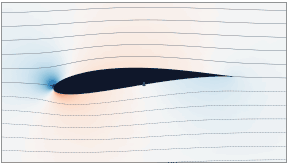</p>

```python
velocity = stream - radius_squared * (inverse * stream * inverse) - swirl * inverse / (2 * np.pi)   # [...] Point
change = -(inverse * Point * inverse)                                                               # [...] Point <- Point
gradient = -radius_squared * (change * stream * inverse + inverse * stream * change) - swirl * change / (2 * np.pi)
derivatives = (Point * gradient(Point)).contract(1, 2)                                              # [rings, angles] Even
potential_gradient = (velocity | Point)(jacobian.inverse())                                         # [...] Scalar <- Point
```

* The geometric derivative `(Point * gradient(Point)).contract(1, 2)` holds divergence and vorticity in one even multivector, and ideal flow makes it vanish.
* Summed around a loop, `velocity * step` gives circulation and flux in one even multivector.

---

## 5. Edge States of a Graphene Flake

**Notebook**: [`examples/quantum/kane_mele/kane_mele.ipynb`](../examples/quantum/kane_mele/kane_mele.ipynb)

<p align="center">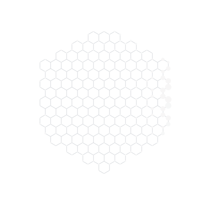</p>

```python
turns = (near - flake.between).commutator(flake.between - far).normalized()   # [pairs] Bivector+
energy = hamiltonian(flake, spin_orbit, 0.0)                                  # Up+[atoms <- atoms]
values, states = (energy * sector).eigh(unit * sector, count)                 # [count] Scalar+, [count] Even+[atoms]
amplitudes = weights * (mv.xy * (-energies * time)).exp()                     # [states] Even+
spins = (states * amplitudes).sum(axis=0) >> up_spin                          # Spin-[atoms]
```

* Spin conservation is a type: `energy * Up` is the Hamiltonian on one spin sector.
* The spin-orbit hop couples by a bivector, the plane a second-neighbour path turns in, the commutator of its two steps.
* A state evolves by a turn on its right at the rate of its energy, `(mv.xy * (-energies * time)).exp()`, with no imaginary unit.

---

## 6. Twistors and Linked Light

**Notebook**: [`examples/relativity/twistors/twistors.ipynb`](../examples/relativity/twistors/twistors.ipynb)

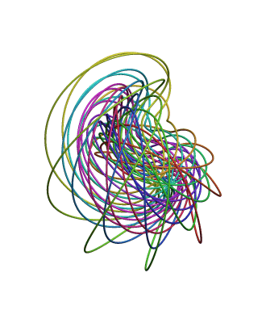

```python
representations = state_readout(Full * state_embedding)    # [] Twistor <- (Full, Twistor)
family = representations(points[0] * points[1])            # [] Twistor <- Twistor
states, _, _ = family.svd()
planes = ray_readout(twistors, twistors)                    # [cases] Bivector
```

* One extensor, `Twistor <- (Full, Twistor)`, holds the action of every multivector on twistors.
* A twistor paired with itself, `ray_readout(twistor, twistor)`, is its light ray.

---

## 7. Beltrami Fields

**Notebook**: [`examples/electromagnetism/beltrami_fields/beltrami_fields.ipynb`](../examples/electromagnetism/beltrami_fields/beltrami_fields.ipynb)

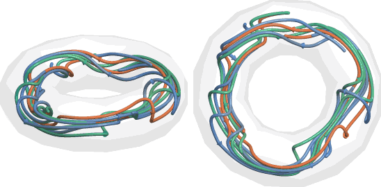

```python
curls = 2 * (corner_gradients[tails] ^ corner_gradients[heads])     # [tet_edges] Field+[tets]
curl = (spdiag(curls * Scalar) * mesh.oriented[3, 1]).sum(axis=0)   # (Field+ <- Scalar+)[tets <- edges]
vacuum = spdiag(prisms.norm() * Field.dual())                       # (Patch- <- Field+)[tets <- tets]
stiffness = curl.adjugate()(vacuum(curl))                           # (Amount- <- Scalar+)[edges <- edges]
volume_weights = spdiag(Plane ^ volumes)                            # (Patch- <- Plane+)[tets <- tets]
raw_helicity = curl.adjugate()(volume_weights(whitney1))            # (Amount- <- Scalar+)[edges <- edges]
helicity = (raw_helicity + raw_helicity.adjugate()) / 2             # (Amount- <- Scalar+)[edges <- edges]
```

* The curl of an edge field is a wedge of two corner gradients, `2 * (corner_gradients[tails] ^ corner_gradients[heads])`, with no cross product.
* Energy and helicity are both pulled back through the curl's adjugate; the energy alone uses the metric, `Field.dual()`, the helicity only a wedge and a signed volume.

---

## 8. The Rattleback

**Notebook**: [`examples/mechanics/rattleback/rattleback.ipynb`](../examples/mechanics/rattleback/rattleback.ipynb)

<p align="center">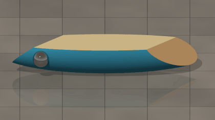</p>

```python
height = (normal & shape(normal)).square_root()                        # Scalar
support = -shape(normal) / height                                      # Direction
rolling = ((centre + support) * origin.inverse() / 2).exp() >> Spin   # Rate <- Spin
pullback = rolling.adjugate()                                          # AngularMomentum <- Forque
effective = pullback(inertia(rolling))                                 # AngularMomentum <- Spin
```

* Rolling is a spin carried to the contact point, a map `Rate <- Spin`.
* Its adjugate removes the contact reaction: `pullback(force) & spin == force & rolling(spin)`.
* The constrained inertia is the free one pulled back, `pullback(inertia(rolling))`, with no Lagrange multiplier.

---

## 9. Bending and Twisting of Thin-Walled Beams

**Notebook**: [`examples/mechanics/bending/bending.ipynb`](../examples/mechanics/bending/bending.ipynb)

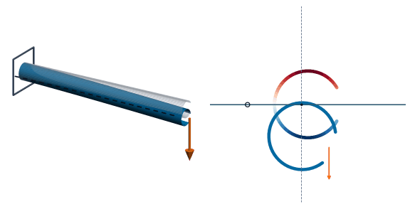

```python
fibres = beam_direction & samples(walls, thickness)                                                    # [walls, 2] Resultant
pulling = (modulus * fibres * (Twist & fibres)).sum(axis=(-2, -1))                                      # [] Resultant <- Twist
twisted = twisting(walls, thickness, shear_modulus) * couple_about_beam * (couple_about_beam & Twist)   # [] Forque <- Twist
stiffness = pulling + twisted + sliding                                                                 # [] Forque <- Twist
strains = stiffness.solve(-loads_at_stations(loads, stations))                                          # [..., pieces] Twist
```

* A section's stretch and curvatures are one twist, its force and moments one forque.
* The stiffness is one map `Forque <- Twist`, a sum of fibre dyads `modulus * fibres * (Twist & fibres)`.

---

## 10. Laplacian Eigenfunction Fluids

**Notebook**: [`examples/fluids/eigen_fluids/eigen_fluids.ipynb`](../examples/fluids/eigen_fluids/eigen_fluids.ipynb)

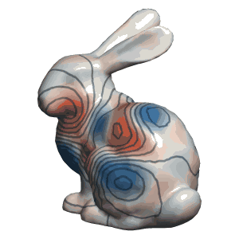

```python
gradient = (spdiag(corner_gradients * Scalar) * mesh.incidence[2, 0]).sum(axis=0)   # (Plane+ <- Scalar+)[faces <- vertices]
stiffness = gradient.adjugate()(spdiag(areas * Plane.dual())(gradient))            # (Amount- <- Scalar+)[vertices <- vertices]
eigenvalues, eigenfields = stiffness.eigh(mass, n_modes + 1)                       # [modes + 1] Scalar+, [modes + 1] Scalar+[vertices]
flows = face_gradients ^ patches                                                   # [modes] Point-[faces]
jacobians = face_gradients[:, None] & flows[None, :]                               # [modes, modes] Scalar+[faces]
structure = structure_constants(mesh, patches, gradient, modes)                    # (Scalar+ <- (Scalar+, Scalar+))[modes <- (modes, modes)]
advection = structure(stream, vorticity)                                           # Scalar+[modes]
```

* The flow along a stream function's level lines is its gradient joined with the tangent patch, `gradient ^ patch`, with no normal vector and no quarter turn.
* The Jacobian of two fields is `gradient & (gradient ^ patch)`, with no metric, so all of advection is one map of two arguments over the modes, `structure(stream, vorticity)`.

---

## 11. Quantum Process Tomography in the Projective Bloch Ball

**Notebook**: [`examples/quantum/process_tomography/process_tomography.ipynb`](../examples/quantum/process_tomography/process_tomography.ipynb)

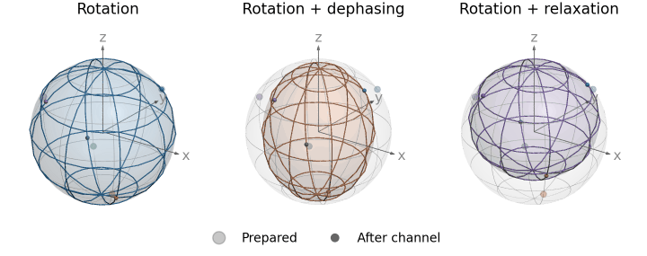

```python
effects = (mv.w + analyzers) / 4                                                                      # [outcomes] Effect+
dephasing = Point + phase_flip * ((mv.xy >> Point) - Point)                                           # [channels] Point- <- Point-
device = rotations >> damping(dephasing)                                                              # [channels] Point- <- Point-
probabilities = effects & outputs[..., None]                                                          # [channels, preparations, outcomes] Scalar+
meets = effects[other_idx[:, 0]] ^ effects[other_idx[:, 1]] ^ effects[other_idx[:, 2]]                # [outcomes] Antivector+
joins = preparations[other_idx[:, 0]] & preparations[other_idx[:, 1]] & preparations[other_idx[:, 2]]   # [preparations] Vector-
learned_channel = (recovered_outputs * (preparation_dual & Point)).sum(axis=-1)                       # [channels] Point- <- Point-
```

* A qubit's state is a point of the Bloch ball, a detector outcome a plane, and a probability their pairing, `effect & state`.
* A channel is a map from points to points, `Point- <- Point-`.
* The reciprocal frames are meets and joins: an outcome's dual is where the other three planes meet, a preparation's dual the plane through the other three. No scalar product enters.

---

## 12. Euler Elastica

**Notebook**: [`examples/mechanics/elastica/elastica.ipynb`](../examples/mechanics/elastica/elastica.ipynb)

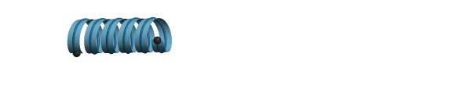

```python
turns = couples * (couples & Twist) * turning                                          # [3] Forque <- Twist
shifts = force_axes * (force_axes & Twist) * shifting                                  # [3] Forque <- Twist
stiff = (turns + shifts).sum(axis=0)                                                   # [] Forque <- Twist
deviation = (rest.reverse() * frames[..., :-1].reverse() * frames[..., 1:]).log() * 2   # [..., joints] Twist
load = stiff(deviation / step)                                                         # [..., joints] Forque
load = load - deviation.commutator(load) / 2 + deviation.commutator(deviation.commutator(load)) / 12
```

* A joint's strain is the logarithm of its neighbours' relative motor, a twist.
* The stiffness is a sum of dyads, `couples * (couples & Twist) * turning` plus the shifts.
* The load reaches the frames through the derivative of the exponential, two commutator terms.

---

## 13. Piezoelectric Bimorph

**Notebook**: [`examples/electromagnetism/piezoelectric/piezoelectric.ipynb`](../examples/electromagnetism/piezoelectric/piezoelectric.ipynb)

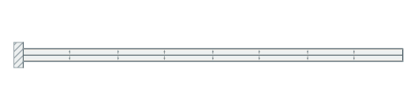

```python
stretches = (directions & Point) * (Plane & directions.dual())          # [2] Scalar+ <- (Point-, Plane+)
polarized = polarization(Point, gradients) * poling.batch()            # [corners, faces] Point- <- Point-
mixed_cells = -(polarized[:, None] & time).adjugate()(electric[None])  # [corners, corners, faces] Plane+ <- Scalar+
elastic = movement.adjugate()(mechanical(movement))                    # (Plane+ <- Point-)[free <- free]
mixed = movement.adjugate()(coupling(voltage))                         # (Plane+ <- Scalar+)[free <- voltages]
```

* The material is built from its planes' readings of stretch on a displacement and its gradient, `(directions & Point) * (Plane & directions.dual())`, with no six-by-six table.
* The converse effect is the adjugate of the same coupling map, `coupling.adjugate()(motion)`: there is no second constant to keep consistent with the first.

---

## 14. Black Polarization Sandwiches

**Notebook**: [`examples/optics/black_sandwich/black_sandwich.ipynb`](../examples/optics/black_sandwich/black_sandwich.ipynb)

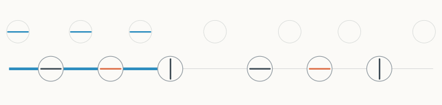

```python
field_along = (Direction & time).dual()                          # [] Field <- Direction
polarizer = field_along * ((Direction & time) & Field)           # [] Field <- (Direction, Direction, Field)

plate = 2 * polarizer(plate_axes, plate_axes) - Field            # [frames] Field <- Field
sandwich = exit(plate(entrance))                                 # [frames] Field <- Field
double_stack = sandwich(sandwich)                                # [frames] Field <- Field
```

* A polarizer reads the field by pairing it with the plane its axis sweeps in time, `Field & (axis & time)`.
* A half-wave plate is built from a polarizer, `2 * polarizer(axis, axis) - Field`.
* One stack passes light, yet `sandwich(sandwich)` is zero for every plate: the stack is a square root of zero.

---

## 15. Gravitational-Wave Antenna Patterns

**Notebook**: [`examples/relativity/ligo/ligo.ipynb`](../examples/relativity/ligo/ligo.ipynb)

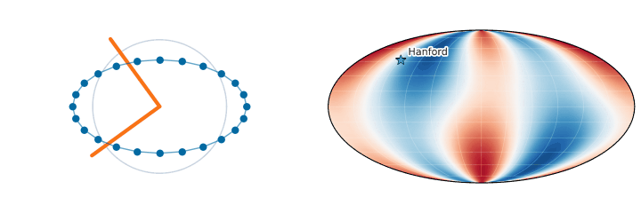

```python
plus = east * (east & Point) - north * (north & Point)                       # [...] Plane+ <- Point-
cross = east * (north & Point) + north * (east & Point)                      # [...] Plane+ <- Point-
stretches = (strain[..., None](arms) & arms) / 2                             # [..., 2] Scalar+
rings = ring + strain_shown * overhead[:, None](ring).dual()                 # [frames, masses] Point-
```

* A wave's strain is a map from points to planes, `east * (east & Point) - north * (north & Point)`.
* An arm reads its stretch by pairing, `strain(arm) & arm`, with no metric; the metric enters only to turn the plane a strain hands a mass into its motion, `.dual()`.

---

## 16. Moving Charges

**Notebook**: [`examples/electromagnetism/moving_charge/moving_charge.ipynb`](../examples/electromagnetism/moving_charge/moving_charge.ipynb)

<p align="center">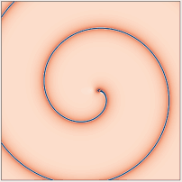</p>

```python
at_rest = weight * mv.t * (separations | Antivector)                  # [...] Vector+ <- Antivector-
gradients = charges.boost >> at_rest(charges.boost << Antivector)     # [...] Vector+ <- Antivector-
field = (Vector ^ gradients(Antivector)).trace(1, 2)                  # [...] Bivector+
```

* A moving charge is its gradient at rest, moved by its boost: `boost >> at_rest(boost << Antivector)`.
* The metric enters only through the vacuum, the map from field to excitation.

---

## 17. Magnetic Resonance

**Notebook**: [`examples/quantum/magnetic_resonance/magnetic_resonance_space.ipynb`](../examples/quantum/magnetic_resonance/magnetic_resonance_space.ipynb)

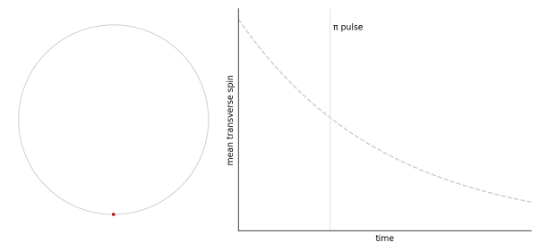

```python
back = process.reverse().symmetric_reverse_product()           # [] State
relaxation = (process >> State) - back.anticommutator(State)   # [] State <- State
echo = waiting(turn(waiting(tip)))                             # [delays, spins] State <- State
sample_echo = echo.mean(axis=-1)                               # [delays] State <- State
```

* Relaxation is a map on states written as its formula, a sandwich minus an anticommutator.
* A pulse sequence is a composition: `waiting(turn(waiting(tip)))` is the spin echo.

---

## 18. As Rigid As Possible

**Notebook**: [`examples/surfaces/arap/arap.ipynb`](../examples/surfaces/arap/arap.ipynb)

<p align="center">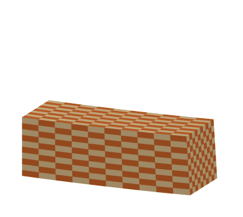</p>

```python
edges = T10 * vertices                                                         # Point[E]
forms = ~A10 * H1 * edges.dot(Even >> rest)                                    # Scalar[V] <- (Even, Even)
rotors = forms.batch().eigh()[1][..., -1].field()                              # Even[V]
turned_rest = (A10 * (rotors >> Point))(rest)                                  # Point[E]
vertices = handle_laplacian.solve(~T10 * H1 * turned_rest + P * targets)       # Point[V]
```

* How well a rotor fits a vertex's edges is a form on rotors; the best rotor is its top eigenvector.
* `rotors >> Point` turns rotors into maps, which carry the rest edges.

---

## 19. Jeffery Orbits

**Notebook**: [`examples/fluids/jeffery/jeffery.ipynb`](../examples/fluids/jeffery/jeffery.ipynb)

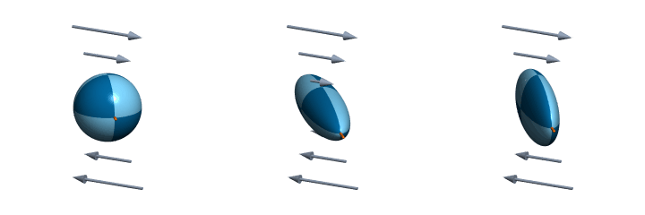

```python
sphere = Plane.dual()                                                                            # [] Point <- Plane
shape = stretch(sphere(stretch.adjugate()))                                                      # [...] Point <- Plane
flow_rate = gradient(shape) - shape(gradient.adjugate())                                         # [...] Point <- Plane
turning_rate = Point.commutator(Bivector)(shape) + shape(Plane.commutator(Bivector))             # [...] Point <- (Plane, Bivector)
spin = (Point & turning_rate(Plane)).trace(1, 2).solve((Point & flow_rate(Plane)).trace(1, 2))   # [...] Bivector
```

* A body is its shape, a map from planes to points, `stretch(sphere(stretch.adjugate()))`.
* The flow acts on the shape from both sides, `gradient(shape) - shape(gradient.adjugate())`.

---

## 20. Slip in Metal Crystals

**Notebook**: [`examples/mechanics/slip_systems/slip_systems.ipynb`](../examples/mechanics/slip_systems/slip_systems.ipynb)

<p align="center">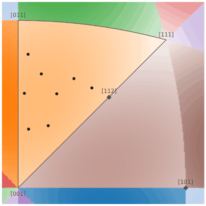</p>

```python
directions = (planes[:, None] ^ planes[others]).normalized()                 # [planes, directions] Line
tension = axis * (Plane & axis)                                               # [...] Direction <- Plane
factors = directions.dot(tension(axis[..., None, None])(planes[:, None]))    # [..., planes, directions] Scalar
moves = amounts * directions * (planes[:, None] & axis[..., None, None])     # [..., planes, directions] Direction
axis = (axis.commutator(move) / 2).exp() >> axis                              # [...] Direction
```

* A pull is a stress, a map from planes to tractions, `axis * (Plane & axis)`.
* Slip directions are where dense planes meet, `plane ^ other`.

---

## 21. Boiling at Fixed Pressure

**Notebook**: [`examples/thermodynamics/phase_change/phase_change.ipynb`](../examples/thermodynamics/phase_change/phase_change.ipynb)

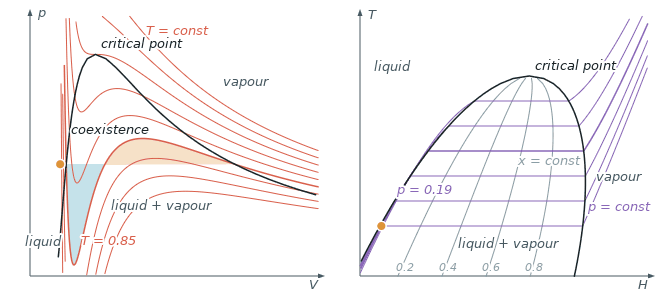

```python
liquid_volume = mv.l & State                                                                       # [] Scalar+ <- State-
vapour_volume = mv.g & State                                                                       # [] Scalar+ <- State-
liquid, vapour = liquid_volume(state), vapour_volume(state)                                        # [...] Scalar+, Scalar+
pressure_gap = pressure(liquid, temperature) - pressure(vapour, temperature)                       # [...] Scalar+
chemical_gap = chemical_potential(liquid, temperature) - chemical_potential(vapour, temperature)   # [...] Scalar+
state = state - derivative(gap)(state).solve(gap(state))                                           # [...] State-
```

* The state space is an exterior algebra with no metric, and the volumes are read by the regressive product alone, `mv.l & State`.
* The derivative of the mismatch is a map `State- <- State-`, and a Newton step solves it.
* Coexistence is a common tangent of the Helmholtz energy, and a chemical potential is that tangent's intercept at zero volume.

---

## 22. Vibration Modes of a Suspended Plate

**Notebook**: [`examples/mechanics/modes/modes.ipynb`](../examples/mechanics/modes/modes.ipynb)

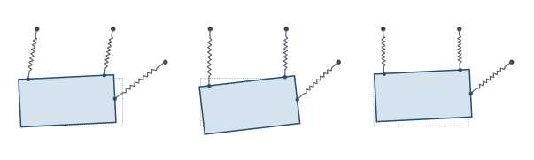

```python
extension = Twist & lines                                        # [springs] Scalar <- Twist
stiffness = (lines * extension * spring_constants).sum(axis=0)   # [] Forque <- Twist
velocities = body.commutator(Twist)                              # [corners] Point <- Twist
inertia = ((body & velocities) * masses).sum(axis=0)             # [] Forque <- Twist
values, modes = (Twist & stiffness).eigh(Twist & inertia)        # [modes] Scalar, [modes] Twist
```

* Stiffness and inertia are sums over springs and mass points, maps `Forque <- Twist` with no origin to choose.
* `(Twist & stiffness).eigh(Twist & inertia)` solves one energy form against the other; the modes are twists.

---

## 23. The Most Likely Trajectory from Odometry

**Notebook**: [`examples/estimation/odometry/odometry.ipynb`](../examples/estimation/odometry/odometry.ipynb)

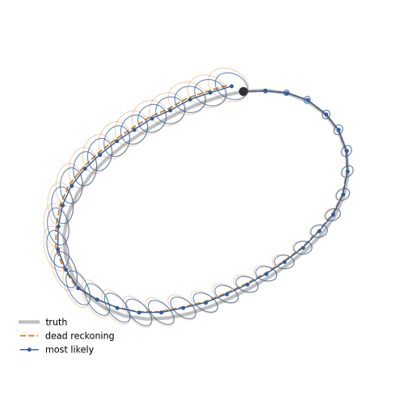

```python
weights = noises.inverse()                                            # [readings] Forque <- Twist
step = (aligned / (pushed & direction).sum(axis=-1))[..., None]       # [..., 1] Scalar
correction = correction + direction * step                            # [..., poses] Twist
residual = residual - pushed * step                                   # [..., poses] Forque
```

* A covariance is a map from forques to twists; its inverse weighs motion errors.
* Conjugate gradients pair residual forques with correction twists by `&`; no inner product on motions is needed.

---

## 24. Area Transport through a Collapse

**Notebook**: [`examples/mechanics/area_transport/area_transport.ipynb`](../examples/mechanics/area_transport/area_transport.ipynb)

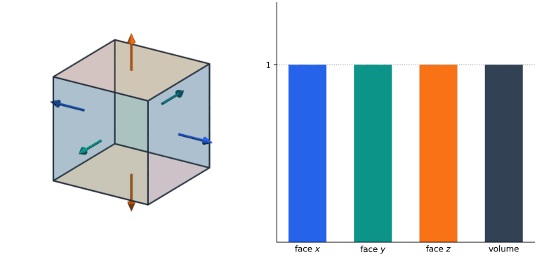

```python
areas = deformation.outermorphism(Patch)   # [frames] Patch <- Patch
volume = deformation.det()                 # [frames] Scalar
adjugate = areas.adjugate()                # [frames] Flux <- Flux
```

* One point map gives patches by its outermorphism and volumes by its determinant.
* The adjugate carries flux back with no inverse, `adjugate(flux) & patch == flux & areas(patch)`, through the collapse to zero volume.

---

## 25. Radar Ranging in Projective Spacetime

**Notebook**: [`examples/relativity/radar/radar.ipynb`](../examples/relativity/radar/radar.ipynb)

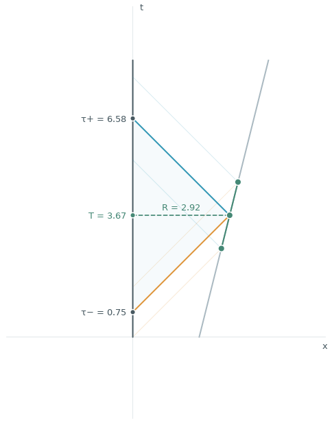

```python
reflection = (Event & outward) ^ reflector                    # [] Event <- Event
returning = (Event & inward) ^ receiver                       # [] Event <- Event
reflection = reflection / (mv.w & reflection(reference))      # [] Event <- Event
returning = returning / (mv.w & returning(reference))          # [] Event <- Event
echo = returning(reflection)                                 # [] Event <- Event
received = echo(emitted)                                     # [pulses] Event
```

* Joining an emission to a light direction and intersecting the target gives its reflection event.
* A motor carries events and their clock together through boosts and translations; `clock & event` keeps its reading.

# References

* <a id="ref-ca-to-gc"></a>**[ca-to-gc]** D. Hestenes and G. Sobczyk, *Clifford Algebra to Geometric Calculus: A Unified Language for Mathematics and Physics*, Reidel, 1984. Extensors are defined in Section 3-10, "Tensors"; extensor fields and their differentials in Section 4-1. [Link](https://math.mit.edu/~dunkel/Teach/18.S996_2022S/books/Hestenes-Sobczyk1984_Book_CliffordAlgebraToGeometricCalc.pdf)
