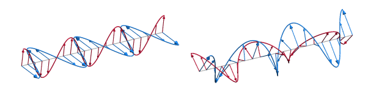
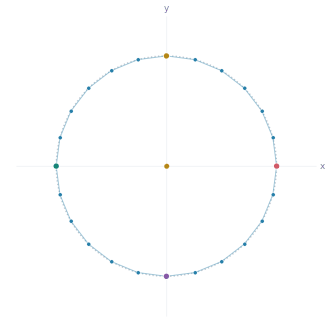
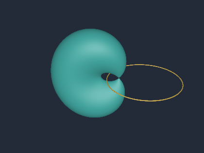

# Definition

An extensor is a multilinear map from multivectors to a multivector: an expression whose arguments are bound later. On the blackboard one moves freely between a specific vector and the space of all vectors; extensors bring that to code. The definition is Hestenes and Sobczyk's [[ca-to-gc](#ref-ca-to-gc)], for whom extensors are what tensors become when their arguments are multivectors. Built from the algebra's products, they transform as the geometry they are built from.

# Motivation

Inertia, stiffness and material responses are maps we construct, combine, transform and solve with. Extensors make them first-class, written with the same products as the geometry they relate.

Extensors include matrices and tensors. A matrix is an extensor that takes a vector and returns a vector, and a tensor is an extensor that takes only vectors. Extensors take any kind of multivector, such as a plane, a line or a rotor, and can be built from any product of the algebra.

# Companion documents

* [`multiple_lenses.md`](multiple_lenses.md): the definition read three ways, as partial application, as objects and transformations in one algebra, and as multilinear maps.
* [`extensor_syntax.md`](extensor_syntax.md): the syntax and the extension methods, as a reference sheet.
* [`internals.md`](internals.md): what the library builds from an expression, and what runs when values are supplied.
* [`examples/README.md`](../examples/README.md): the complete index of examples.

# Examples

A selection of examples follows, covering a range of extensor concepts. In the code below, capitalized names stand for whole spaces of multivectors and lower case names for specific ones. So `v ^ V` is a specific vector wedged with every vector: an extensor that takes a vector and returns a bivector.

---

## 1. Scenegraph, Forward Kinematics & Camera Optics (PGA3D)

**Notebook**: [`examples/geometry/scenegraph/scenegraph.ipynb`](../examples/geometry/scenegraph/scenegraph.ipynb)


```python
body = pose >> scale                                           # [] Point <- Point: a unit box, stretched and placed
lens = Line - (center & (Line ^ plane)) / focal_length         # [] Line <- Line: a thin lens
rear_lens = rear_placement >> lens(rear_placement << Line)      # [] Line <- Line: the lens, moved down the axis
camera = to_sensor(rear_lens(front_lens(Point & pupil)))        # [] Point <- Point: point to ray to sensor
local_to_pixel = viewport(camera(camera_pose << Point))(bodies_to_world)   # [bodies] Point <- Point
```

* **Scaling beside motors.** A part is a unit box, stretched by a scaling and placed by a motor: one more map, composed like any other.
* **One map per part, before any vertex.** Calling a map on a map composes them, so each vertex costs one application of one map, as in a matrix pipeline.
* **A lens is its formula,** a map from rays to rays, and a motor carries it down the axis.

---

## 2. Rigid-Body Normal Modes & Vibration (PGA2D)

**Notebook**: [`examples/mechanics/modes/modes.ipynb`](../examples/mechanics/modes/modes.ipynb)


```python
extension = Twist & lines                                        # [springs] Scalar <- Twist: each spring's stretch
stiffness = (lines * extension * spring_constants).sum(axis=0)   # [] Forque <- Twist
velocities = mass_points.commutator(Twist)                       # [mass_points] Point <- Twist
inertia = ((mass_points & velocities) * masses).sum(axis=0)      # [] Forque <- Twist
values, modes = (Twist & stiffness).eigh(Twist & inertia)        # [modes] Scalar, [modes] Twist
```

* **Stiffness and inertia are sums.** One term per spring and per mass point, with no origin chosen and no parallel-axis shift.
* **An eigenproblem on two forms.** `Twist & stiffness` and `Twist & inertia` are the two energies as forms, and `eigh` solves one against the other, returning the modes as twists.

---

## 3. As Rigid As Possible (VGA3D)

**Notebook**: [`examples/surfaces/arap/arap.ipynb`](../examples/surfaces/arap/arap.ipynb)

<p align="center"></p>

```python
forms = ~A10 * H1 * edges.dot(Even >> rest)                 # Scalar[V] <- (Even, Even): each vertex's form on rotors
rotors = forms.batch().eigh()[1][..., -1].field()            # Even[V]: every vertex's best rotor
turned = (A10 * (rotors >> Point))(rest)                     # Point[E]: each rest edge, turned by its ends' rotors
vertices = held.solve(~T10 * H1 * turned + P * targets)      # Point[V]
```

* **The best rotor is an eigenvector.** `edges.dot(Even >> rest)` measures how well any rotor turns each rest edge onto its edge; summed at each vertex it is a form on rotors, and its top eigenvector is the vertex's best rotor, with no singular value decomposition and no correction for reflections.
* **A rotor becomes a map.** `rotors >> Point` is each rotor as the turn it makes; averaged over each edge's ends, the turns carry the rest edges, and one sparse solve places the vertices.
* **The mesh's operators are maps between fields.** `T10` takes vertex fields to edge fields, and `~T10 * H1 * T10` is the cotangent Laplacian.

---

## 4. Lift without Vorticity (VGA2D)

**Notebook**: [`examples/fluids/wing/wing.ipynb`](../examples/fluids/wing/wing.ipynb)

<p align="center">
  
</p>

```python
velocity = stream - radius_squared * (inverse * stream * inverse) - swirl * inverse / (2 * np.pi)   # [rings, angles] Point
change = -(inverse * Point * inverse)                                      # [rings, angles] Point <- Point
gradient = -radius_squared * (change * stream * inverse + inverse * stream * change) - swirl * change / (2 * np.pi)
derivative = (Point * gradient(Point)).contract(1, 2)                      # [rings, angles] Even: zero
carried = (velocity | Point)(jacobian.inverse())                           # [rings, angles] Scalar <- Point: at the wing
loops = (velocity * steps).sum(axis=-1)                                    # [rings] Even: circulation, no flux
```

* **Ideal flow is one equation.** The velocity's geometric derivative, its gradient multiplied by `Point` and contracted, holds its divergence and its vorticity, and vanishes everywhere.
* **Carried by a map that keeps angles.** The potential's gradient, composed with the inverse Jacobian, is the wing's.
* **The lift lives in the loop.** Around every ring, the velocity times each step sums to the circulation, with no flux.

---

## 5. Moving Charges & Maxwell's Equations (STA)

**Notebook**: [`examples/electromagnetism/moving_charge/moving_charge.ipynb`](../examples/electromagnetism/moving_charge/moving_charge.ipynb)

<p align="center">
  
</p>

```python
at_rest = weight * mv.t * (separations | Antivector)                   # [charges, ...] Vector <- Antivector: each charge's potential gradient, at rest
gradients = charges.boost >> at_rest(charges.boost << Antivector)      # [charges, ...] Vector <- Antivector: the charge, moving
field = (Vector ^ gradients.sum(axis=-1)(Antivector)).trace(1, 2)      # [...] Bivector: the charges' gradients, added
vacuum = Bivector.dual()                                               # [] Antibivector <- Bivector: from field to excitation
current = (Vector ^ vacuum(field_gradients(Antivector))).trace(1, 2)   # [...] Antivector: Maxwell's equation with sources
```

* **The field is never written down.** Each charge's potential gradient, a map from a step in spacetime to the change in potential, is its gradient at rest moved by its boost; the gradients add, and their derivative is the field.
* **Maxwell's equations are pairings by incidence.** Steps are intrinsic and fields extrinsic, so each derivative wedges a vector with the change along the step it pairs with and traces, with no metric. The metric enters only through the vacuum, the map from field to excitation, and the current comes out an antivector, carried by geometry like the steps.

---

## 6. Multi-View Scene Reconstruction & Camera Alignment (PGA2D)

**Notebook**: [`examples/estimation/multiview/multiview_reconstruction.ipynb`](../examples/estimation/multiview/multiview_reconstruction.ipynb)

<p align="center">
  
</p>

```python
cones = camera.adjugate()(discs(camera))                  # [landmarks, cameras] Plane <- Point: sight cones
splats = (poses >> cones(poses << Point)).sum(axis=-1)    # [landmarks] Plane <- Point
centres = (splats + w * (w & Point)).solve(w)             # [landmarks] Point
motion = -Twist.commutator(seen)                          # [landmarks, cameras] Point <- Twist
curvature = (cones(motion) & motion).sum(axis=0)          # [cameras] Scalar <- (Twist, Twist)
slope = (cones(seen) & motion).sum(axis=0)                # [cameras] Scalar <- Twist
```

* **The adjugate carries a pixel's uncertainty into the scene.** The camera has no inverse, but its adjugate keeps incidence and turns a pixel's cost disc into a cone of sight.
* **Combining views is addition.** The cones, moved to the world, sum into a splat, and one solve finds its centre.
* **The cone is the cost.** How a landmark moves under a step of its camera is one commutator; the cone's polar of that motion, joined with the motion, is the curvature over pairs of steps, and the landmark's polar joined with it the slope. No residual and no Jacobian are formed.

---

## 7. Odometry: The Most Likely Trajectory (PGA2D)

**Notebook**: [`examples/estimation/odometry/odometry.ipynb`](../examples/estimation/odometry/odometry.ipynb)


```python
weights = noises.inverse()                             # [readings] Forque <- Twist
pushed = curvature(poses, direction)                   # [poses] Forque: the pull a trial correction makes
step = aligned / (pushed & direction).sum(axis=-1)     # [] Scalar: pulls paired with motions
correction = correction + direction * step             # [poses] Twist
residual = residual - pushed * step                    # [poses] Forque
preconditioned = alone.solve(residual)                 # [poses] Twist: each pose's pull, back to a motion
```

* **An uncertainty is a map.** A pose's covariance takes a forque to a twist, `Twist <- Forque`, and its inverse, the information, weighs a motion error against itself.
* **Conjugate gradients in geometric types.** The correction is a motion of each pose and the residual a pull on it; the solver pairs the two by their regressive product, needing no inner product on motions, and each pose's own curvature turns a pull back into a motion.

---

## 8. Area Transport through a Collapse (VGA3D)

**Notebook**: [`examples/mechanics/area_transport/area_transport.ipynb`](../examples/mechanics/area_transport/area_transport.ipynb)


```python
deformation = Point + (thickness - 1) * mv.z.dual() * (mv.z & Point) + shear * mv.x.dual() * (mv.z & Point)   # [cases] Point <- Point
areas = deformation.outermorphism(Patch)       # [cases] Patch <- Patch: patches moved by their edges
volume = deformation.det()                     # [cases] Scalar
adjugate = areas.adjugate()                    # [cases] Flux <- Flux: flux densities carried back
plane_map = placement.adjugate()               # [] ProjectivePlane <- ProjectivePlane: planes moved with the points
```

* **One map moves points, patches and volumes.** Its outermorphism moves a patch, the meet of two edges, by moving both edges, and its determinant scales volumes.
* **The adjugate needs no inverse.** It carries a flux density back so that it gives the same flux through an undeformed patch, `adjugate(flux) & patch == flux & areas(patch)`, even when the volume collapses to zero.
* **Incidence, not the metric.** In projective space the adjugate of a placement moves planes with their position, keeping every incidence with the moved points, where the adjoint does not exist.

---

## 9. Spacetime Constitutive Relations, Dispersion & Relativistic Fresnel Drag (STA)

**Notebook**: [`examples/electromagnetism/constitutive/constitutive.ipynb`](../examples/electromagnetism/constitutive/constitutive.ipynb)



```python
electric_projectors = electric_planes * (electric_planes | Bivector)   # [3] Bivector <- Bivector
media = ((permittivities * electric_projectors).sum(axis=-1)
         + (inverse_permeabilities * magnetic_projectors).sum(axis=-1)).dual()   # [media] Antibivector <- Bivector
moving_glass = boosts >> glass(boosts << Bivector)                     # [drags] Antibivector <- Bivector: the glass, moving
wave = (wavevectors ^ Bivector) + (wavevectors ^ media).dual()         # [speeds, media] Odd <- Bivector
wave.svdvals()                                                         # near zero where light can travel
stress_map = negative_lagrangian * Antivector - ((Antivector & field) ^ excitation)   # [] Antivector <- Antivector
```

* **A material is a map.** It takes the field to its excitation: glass weights the observer's electric and magnetic planes alike, a crystal weights its electric planes apart, and a ferrite its magnetic planes.
* **Moving a material moves a map.** A boost moves the glass as it moves a vector, and Fresnel drag follows.
* **Wave speeds from an SVD.** With the field as the input, Maxwell's equations for a trial wave are one map, singular where light can travel.
* **Stress-energy pairs in the open.** The stress-energy map takes a direction in spacetime to the current of energy and momentum along it, reading the field along the direction by their pairing, `direction & field`; only the constitutive map knows the metric.

---

## 10. Gravitational Wave Curvature & Tidal Forces (STA)

**Notebook**: [`examples/relativity/curvature/curvature.ipynb`](../examples/relativity/curvature/curvature.ipynb)

<p align="center"></p>

```python
nx, ny = wave_vector ^ x, wave_vector ^ y                        # [] Bivector: two null planes along the wave
plus = nx * (nx & Antibivector) - ny * (ny & Antibivector)       # [] Bivector <- Antibivector
cross = eighth_turn >> plus(eighth_turn << Antibivector)         # [] Bivector <- Antibivector: plus, turned across the wave
tidal = observer & plus(observer & Antivector)                   # [] Vector <- Antivector: from separation to tidal force
accelerations = -tidal.dual()                                    # [] Antivector <- Antivector: no trace, in vacuum
```

* **Curvature is a map from areas to planes,** built from two null planes along the wave, with no metric. The cross polarization is the plus turned an eighth of a turn across the wave, and a quarter turn reverses the pattern: spin two.
* **An observer binds in twice.** The observer and a separation span a ribbon of spacetime, the curvature turns it into a plane, and the observer reads the plane as a force: the tidal map that stretches a ring of beads.
* **Vacuum needs the metric.** Turned into accelerations, every observer's tides stretch as much as they squeeze.

---

## 11. Twistors & Linked Light (Conformal Spacetime)

**Notebook**: [`examples/relativity/twistors/twistors.ipynb`](../examples/relativity/twistors/twistors.ipynb)


```python
representations = state_readout(Full * state_embedding)    # [] Twistor <- (Full, Twistor): every multivector's action
family = representations(points[0] * points[1])            # [] Twistor <- Twistor: into both events' kernels
states, _, _ = family.svd()                                # states[0]: a twistor both events send to zero
planes = ray_readout(twistors, twistors)                   # [cases] Bivector: their light rays, at rest and boosted
selected = representations(point(event), fixed_twistor)    # [...] Twistor: one ray through every event
```

* **Twistors from one extensor.** `representations` holds every multivector's action on twistors, a map `Twistor <- (Full, Twistor)`.
* **A light ray is a form in the twistor.** A twistor in both arguments of `ray_readout` gives back its ray.

---

## 12. Magnetic Resonance & Spin Echoes (VGA3D)

**Notebook**: [`examples/quantum/magnetic_resonance/magnetic_resonance_space.ipynb`](../examples/quantum/magnetic_resonance/magnetic_resonance_space.ipynb)


```python
back = process.reverse().symmetric_reverse_product()          # [] State
relaxing = (process >> State) - back.anticommutator(State)    # [] State <- State
twice = span(span)                                            # [spins] State <- State: the same span, twice as long
turn = pulse(np.pi) >> State                                  # [] State <- State
echo = waiting(turn(waiting(tip))).mean(axis=-1)              # [delays] State <- State: tip, wait, turn, wait
```

* **Relaxation is its formula,** a map on states acting on both sides of each term: no density matrix flattened into a vector, no Kronecker products.
* **An experiment is a composition.** Spans of evolution, pulses and the average over spins compose into one map for the sample.

---

## 13. Dupin Cyclides on the 3-Sphere (Conformal Model)

**Notebook**: [`examples/quadrics/cyclides/cyclides.ipynb`](../examples/quadrics/cyclides/cyclides.ipynb)



```python
form = Point & surfaces                                  # [surfaces] Scalar <- (Point, Point): zero on the surface
quartic = form(ray_bend, ray_bend)                       # [surfaces] Scalar <- (Direction, Direction, Direction, Direction)
cyclide = inversion >> hyperboloid(inversion << Point)   # [] Sphere <- Point: a hyperboloid, inverted
flow = (circle * (phases / 2)).exp()                     # [frames] Motor: around a circle
carried = flow >> cyclide(flow << Point)                 # [frames] Sphere <- Point
```

* **A quartic in the ray's direction.** The ray, a map from directions to points, fed into both arguments of the surface's form gives a form on four directions: every pixel's intersection equation at once.
* **Surfaces move like points.** `inversion >> hyperboloid(inversion << Point)` moves the whole surface form, and a circle's exponential carries it around.

# References

* <a id="ref-ca-to-gc"></a>**[ca-to-gc]** D. Hestenes and G. Sobczyk, *Clifford Algebra to Geometric Calculus: A Unified Language for Mathematics and Physics*, Reidel, 1984. Extensors are defined in Section 3-10, "Tensors"; extensor fields and their differentials in Section 4-1. [Link](https://math.mit.edu/~dunkel/Teach/18.S996_2022S/books/Hestenes-Sobczyk1984_Book_CliffordAlgebraToGeometricCalc.pdf)
