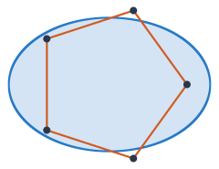

# WebGPU shaders and rendering

This document introduces WebGPU shaders and scene rendering in numga. Algebraic expressions compile directly into GPU shaders, and cameras read geometric objects in their own algebra, so figures and 3D scenes render without unpacking coordinates in Python.

```python
import numpy as np

from numga import NumpyContext
from numga.algebras import PGA2D
from numga.wgsl import Shader

mv = NumpyContext(PGA2D).multivector
Plane, Point = PGA2D.gatype.vector(), PGA2D.gatype.antivector()          # Plane+, Point-
Motor = PGA2D.gatype.rotor()                                             # Motor+
Quadric = PGA2D.gatype((Plane, Point))                                   # Plane+ <- Point-

source = """
var<uniform> motor: Motor;
var<uniform> disk: Quadric;
var<storage, read> points: array<Point>;
var<storage, read_write> moved: array<Point>;
var<storage, read_write> values: array<f32>;

@compute @workgroup_size(64)
fn step(@builtin(global_invocation_id) id: vec3<u32>) {
    if (id.x >= arrayLength(&points)) { return; }
    let p = motor >> points[id.x];
    moved[id.x] = p;
    values[id.x] = disk(p) & p;
}
"""

shader = Shader(source, PGA2D, dict(Point=Point, Motor=Motor, Quadric=Quadric), {})
turn = (0.4 * mv.xy + 0.2 * mv.xw).exp()                                 # [] Motor+
unit_disk = mv.x * (mv.x & Point) + mv.y * (mv.y & Point) - mv.w * (mv.w & Point)  # [] Plane+ <- Point-
pts = mv.point([[0.0, 0.0], [1.0, 0.0], [0.0, 2.0]])                     # [3] Point-

out = shader((len(pts),), motor=turn, disk=unit_disk, points=pts)
print(out["moved"])
print(np.round(out["values"].ravel(), 3))
```

```text
Extensor(intrinsic bivector, shape=(3,))
[-0.848  0.869  3.758]
```

## The numga WGSL dialect

`Shader(source, algebra, types, constants)` maps each entry in `types` to a generated WGSL struct holding that `GAType`'s blade coefficients in `float32`, checking orientations and grades at compile time under numga's own rules ([Orientation in numga](orientation.md)). Products (`*`, `^`, `&`, `|`, `>>`, `<<`), map calls (`disk(p)`), `~`, `.involute()`, `.dual()`, `.adjugate()`, `.inverse()`, `.norm()`, `.antinorm()` and `.exp()` lower into exact polynomial functions (`shader.code` inspects the emitted WGSL).

Calling `shader(shape, ...)` packs `Extensor` uniforms and input storage arrays, allocates and zero-clears any omitted `read_write` storage arrays to `shape`, and dispatches every `@compute` entry point. Non-scalar `GAType` outputs unpack back into `float64` `Extensor` batches, while `f32` and vector outputs return NumPy arrays.

For multi-frame simulations and interactive pages, `Resident` keeps buffers on the GPU across frames without host round trips, and `numga.wgsl.page` bundles compiled WGSL and packed buffers into standalone browser `.html` applications such as [Kerr black-hole ray tracing](../examples/relativity/kerr/kerr_webgpu.html) and [gravitational waves](../examples/relativity/gravitational_waves/gravitational_waves_webgpu.html).

## Cameras pair in the scene's own algebra

Values pass to `numga.render` in their own algebra, at their own grade and orientation. A `Camera` declares the planes (`across`, `up`, `toward`) and affine weight (`weight`, `unit`) that read scene elements through the regressive product `&` with the extrinsic factor placed first, evaluating `(across & point) / (weight & point + unit)`.

Because `&` uses no metric, the same shaders draw projective points (`weight=mv.w, unit=0.0`), vector offsets (`weight=0 * mv.x, unit=1.0`), spin bivectors (`across=mv.yz, up=mv.zx`), or states in an algebra extended with null thermodynamic directions (`x+ y+ w0 i0 h0`), without converting elements into points or unpacking coordinates first. Callers name `weight` explicitly because metric signature alone does not distinguish the projective plane `w` from a null extensive quantity such as entropy.

## 2D marks and `Draw` passes

Rendering separates into two layers. Marks (`quadrics`, `simplices`, `contours`, `flow`) take algebraic geometry, a `Camera` and visual styling and return GPU `Draw` passes; `composited` rasterizes them at subpixel resolution into a straight-RGBA `[rows, columns, 4]` image, so pixel arrays appear only at the final output:

```python
from numga.render import Camera, composited, quadrics, simplices
from numga.topology import Topology

blue, copper, slate, sand = np.array([
    [0.15, 0.48, 0.78], [0.78, 0.32, 0.16], [0.24, 0.30, 0.38], [0.86, 0.78, 0.64],
])
camera = Camera(
    across=mv.x, up=mv.y, toward=0 * mv.x, weight=mv.w, unit=0.0,
    middle=np.zeros(2), half=np.array([1.3, 1.0]), pixels=240,
)
ellipse = 0.7 * mv.x * (mv.x & Point) + 1.6 * mv.y * (mv.y & Point) - mv.w * (mv.w & Point)  # [] Plane+ <- Point-
turns = (mv.xy * np.linspace(0, np.pi, 5, endpoint=False)).exp()         # [5] Motor+
pentagon = turns >> mv.point([0.92, 0.0])                                # [5] Point-

rgba = composited([
    quadrics.regions(ellipse[None, None], blue[None], camera, opacity=0.20),
    quadrics.curves(ellipse[None], 2.0, blue[None], camera),
    simplices.strokes(pentagon, Topology.loops([5]), copper, 2.2, camera),
    simplices.markers(pentagon, slate, 4.0, camera),
])
print(rgba.shape)
```

```text
(185, 240, 4)
```

<p align="center"></p>

| Mark module | What it draws |
| --- | --- |
| `quadrics.regions` | intersections where every bounding quadric satisfies `quadric(point) & point < 0` |
| `quadrics.curves`, `quadrics.flats` | zero contours anti-aliased to uniform pixel width via screen-space derivatives `fwidth` |
| `simplices.strokes`, `simplices.markers` | polygonal curves, edges and vertex markers over a `Topology` |
| `contours.picture` | shaded scalar fields and level lines across a `Topology` ([Simplicial topologies](topology.md)) |
| `flow.layer` | line-integral convolution streaks along vector or alignment fields |

In Matplotlib figures (`examples/util/panels.py`), `panel(ax, mv.x, mv.y, mv.w)` and `offset_panel(ax, ...)` size a `Camera` to an `Axes`, and `overlay` pins the composited image onto whole canvas pixels without resampling.

## 3D scenes

In `PGA3D`, 3D scenes combine analytic quadric ray tracing with rasterized surfaces and curves under one `Scene` compositor:

| Component | Role |
| --- | --- |
| `solids` (`ball`, `ellipsoid`, `rods`, `boxes`, `plates`, `polyhedra`) | ray-traces intersections of quadrics and oriented half-spaces analytically per subpixel |
| `meshes.samples`, `simplices.tubes` | rasterizes triangulated surfaces and 3D curves into per-sample colour and depth buffers |
| `Scene` | caches static surface samples on the GPU across animation frames and composites moving and static solids, surface inks (`Ink`) and triangulated surfaces in depth order |

```python
from numga.render import meshes, solids
from numga.render.scene import Scene

sm = solids.mv
torus = Topology.torus(32, 16)
major = (sm.xy * np.linspace(0, np.pi, 32, endpoint=False)).exp()        # [32] Motor+
minor = (sm.xz * np.linspace(0, np.pi, 16, endpoint=False)).exp()        # [16] Motor+
ring = (sm.xw * 0.35).exp() >> (minor >> sm.point([0.24, 0, 0]))         # [16] Point-
surface_points = (major[:, None] >> ring).reshape(-1)                    # [512] Point-

ends = sm.point([[0, -0.55, -0.48], [0, 0.55, 0.48]])                    # [2] Point-
rod = solids.rods(ends[0], ends[1], 0.055)[None]                         # [1, 3] Plane+ <- Point-
balls = solids.ball(ends, 0.14)[:, None]                                 # [2, 1] Plane+ <- Point-

view = solids.view([surface_points, ends], reach=0.18, elevation=0.5, azimuth=0.55, margin=0.10, pixels=260)
surface = meshes.samples(surface_points, torus.elements[2], sand,
                         meshes.smooth(surface_points, torus), view, np.zeros(1), meshes.plain, gloss=0.28)
scene = Scene(view, np.ones(3), [(rod, slate), (balls, copper)], [(surface, 1.0)], inks=[], translucent=[])
rgb = scene.draw([], [], [], [])
print(rgb.shape)
```

```text
(198, 260, 3)
```

<p align="center"></p>

`meshes.smooth` sums the joined tangent planes (`a & b & c`) of incident triangles around each vertex so lighting operates directly on intrinsic tangent planes paired against the camera's screen frame. Analytic quadrics and triangulated surfaces therefore share identical key-lamp, sky-ground fill, headlight and specular shading.
