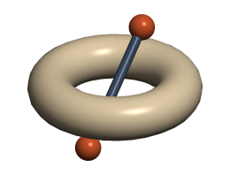

# WebGPU shaders and rendering

This document introduces WebGPU shaders and scene rendering in numga. Algebraic expressions compile directly into GPU shaders, and cameras read geometric objects in their own algebra, so the examples draw 2D figures and 3D scenes without unpacking coordinates in Python.

```python
import numpy as np

from numga import NumpyContext
from numga.algebras import PGA2D
from numga.wgsl import Shader

mv = NumpyContext(PGA2D).multivector
Plane, Point = PGA2D.gatype.vector(), PGA2D.gatype.antivector()
Motor = PGA2D.gatype.rotor()
Quadric = PGA2D.gatype((Plane, Point))                                   # Plane+ <- Point-

source = """
var<uniform> motor: Motor;
var<uniform> disk: Quadric;
var<storage, read> points: array<Point>;
var<storage, read_write> moved: array<Point>;
var<storage, read_write> values: array<f32>;

@compute @workgroup_size(64)
fn step(@builtin(global_invocation_id) id: vec3<u32>) {
    if (id.x >= arrayLength(&points)) { return; }
    let p = motor >> points[id.x];
    moved[id.x] = p;
    values[id.x] = disk(p) & p;
}
"""

shader = Shader(source, PGA2D, dict(Point=Point, Motor=Motor, Quadric=Quadric), {})
turn = (0.4 * mv.xy + 0.2 * mv.xw).exp()                                 # [] Motor+
unit_disk = mv.x * (mv.x & Point) + mv.y * (mv.y & Point) - mv.w * (mv.w & Point)
pts = mv.point([[0.0, 0.0], [1.0, 0.0], [0.0, 2.0]])                     # [3] Point-

out = shader((len(pts),), motor=turn, disk=unit_disk, points=pts)
print(out["moved"])
print(np.round(out["values"].ravel(), 3))
```

```text
Extensor(intrinsic bivector, shape=(3,))
[-0.848  0.869  3.758]
```

## The `numga` WGSL dialect

`Shader(source, algebra, types, constants)` maps each entry in `types` to a generated `WGSL` struct holding that `GAType`'s blade coefficients in `float32`, checks orientations and grades at compile time under numga's own rules ([Orientation](orientation.md)), and lowers products (`*`, `^`, `&`, `|`, `>>`, `<<`), map calls (`disk(p)`), `~`, `.involute()`, `.dual()`, `.adjugate()`, `.inverse()`, `.norm()`, `.antinorm()` and `.exp()` into exact polynomial functions (`shader.code` inspects the emitted `WGSL`).

Calling `shader(shape, ...)` packs `Extensor` uniforms and input storage arrays, allocates and zero-clears any unprovided `read_write` storage arrays to `shape`, dispatches all `@compute` entry points, and unpacks non-scalar `GAType` outputs back into `float64` `Extensor` batches (`f32` and vector outputs return NumPy arrays). `Resident` keeps buffers on the GPU across frames without host round trips, and `numga.wgsl.page` bundles compiled `WGSL` and packed buffers into standalone browser `.html` applications such as [Kerr black-hole ray tracing](../examples/relativity/kerr/kerr_webgpu.html) and [gravitational waves](../examples/relativity/gravitational_waves/gravitational_waves_webgpu.html).

## Cameras pair in the scene's own algebra

In the examples, values cross into `render.py` in their own algebra, at their own grade and orientation. A `Camera` declares the planes (`across`, `up`, `toward`) and affine weight (`weight`, `unit`) that read scene elements through the regressive product `&` with the extrinsic factor placed first, evaluating `(across & point) / (weight & point + unit)`.

Because `&` uses no metric, the same shaders draw projective points (`weight=mv.w, unit=0.0`), vector offsets (`weight=0 * mv.x, unit=1.0`), spin bivectors (`across=mv.yz, up=mv.zx`), or states in an algebra extended with null thermodynamic directions (`x+ y+ w0 i0 h0`), without converting elements into points or unpacking coordinates first. Callers name `weight` explicitly because metric signature alone does not distinguish the projective plane `w` from a null extensive quantity such as entropy.

## 2D marks and `Draw` passes

Rendering separates into two layers. Marks (`quadrics`, `simplices`, `contours`, `flow`) take algebraic geometry, a `Camera` and visual styling and return GPU `Draw` passes; `drawing.composited` rasterizes them at subpixel resolution and returns a straight-RGBA `[rows, columns, 4]` image, so pixel arrays appear only at the final output:

```python
from numga.render import Camera, composited, quadrics, simplices
from numga.topology import Topology

camera = Camera(
    across=mv.x, up=mv.y, toward=0 * mv.x, weight=mv.w, unit=0.0,
    middle=np.array([0.0, 0.0]), half=np.array([1.3, 1.0]), pixels=240,
)
ellipse = 0.7 * mv.x * (mv.x & Point) + 1.6 * mv.y * (mv.y & Point) - mv.w * (mv.w & Point)
turns = (mv.xy * np.linspace(0, np.pi, 5, endpoint=False)).exp()         # [5] Motor+
pentagon = turns >> mv.point([0.92, 0.0])                                # [5] Point-
loop = Topology.loops([5])

rgba = composited([
    quadrics.regions(ellipse[None, None], np.array([[0.15, 0.48, 0.78]]), camera, opacity=0.20),
    quadrics.curves(ellipse[None], 2.0, np.array([[0.15, 0.48, 0.78]]), camera),
    simplices.strokes(pentagon, loop, np.array([0.82, 0.36, 0.14]), 2.2, camera),
    simplices.markers(pentagon, np.array([0.16, 0.22, 0.30]), 4.0, camera),
])
print(rgba.shape)
```

```text
(185, 240, 4)
```

<p align="center"></p>

`quadrics.regions` shades intersections where every bounding quadric satisfies `quadric(point) & point < 0`, while `quadrics.curves` and `quadrics.flats` anti-alias zero contours to uniform pixel width via screen-space derivatives `fwidth`. `contours.picture` shades scalar fields and level lines across a `Topology` ([Simplicial topologies](topology.md)), and `flow.layer` traces line-integral convolution streaks along vector or alignment fields. In example figures (`examples/util/panels.py`), `panel(ax, mv.x, mv.y, mv.w)` and `offset_panel(ax, ...)` size a `Camera` to a Matplotlib `Axes` and `overlay` pins the composited image onto whole canvas pixels without resampling.

## 3D scenes

In `PGA3D`, `solids` ray-traces intersections of quadrics and oriented half-spaces analytically per subpixel (`solids.ball`, `solids.ellipsoid`, `solids.rods`, `solids.boxes`, `solids.plates`, `solids.polyhedra`), while `meshes.samples` and `simplices.tubes` rasterize triangulated surfaces and 3D curves into per-sample colour and depth slots. `Scene` caches static surface slots on the GPU across animation frames and composites moving and static solids, surface inks (`Ink`) and triangulated surfaces in depth order:

```python
from numga.render import meshes, solids
from numga.render.scene import Scene

sm = solids.mv
sheet = Topology.grid(3, 3).loop_subdivided(np.zeros(9, dtype=bool), n_steps=3)
control = sm.point([
    [-1, -1, -0.35], [0, -1, 0.25], [1, -1, -0.35],
    [-1,  0,  0.25], [0,  0, 0.00], [1,  0,  0.25],
    [-1,  1, -0.35], [0,  1, 0.25], [1,  1, -0.35],
]).field()                                                               # Point-[9]
surface_points = (sheet.subdivision * control).batch()                   # [289] Point-

ends = sm.point([[-0.85, 0.0, 0.42], [0.85, 0.0, 0.42]])                 # [2] Point-
rod = solids.rods(ends[0], ends[1], 0.045)[None]                         # [1, 3] Plane+ <- Point-
balls = solids.ball(ends, 0.13)[:, None]                                 # [2, 1] Plane+ <- Point-

view = solids.view([surface_points, ends], reach=0.2, elevation=np.radians(28),
                   azimuth=np.radians(34), margin=0.12, pixels=260)
surface = meshes.samples(surface_points, sheet.elements[2], np.array([0.86, 0.78, 0.64]),
                         meshes.smooth(surface_points, sheet), view, np.zeros(1), meshes.plain, gloss=0.25)
scene = Scene(view, np.ones(3), [(rod, np.array([0.28, 0.34, 0.42])), (balls, np.array([0.78, 0.32, 0.16]))],
              [(surface, 1.0)], inks=[], translucent=[])
rgb = scene.draw([], [], [], [])
print(rgb.shape)
```

```text
(170, 260, 3)
```

<p align="center"></p>

`meshes.smooth` sums the joined tangent planes (`a & b & c`) of incident triangles around each vertex so lighting operates directly on intrinsic `Patch-` planes paired against the camera's screen frame, sharing identical key-lamp, sky-ground fill, headlight and specular shading across analytic quadrics and triangulated surfaces.
