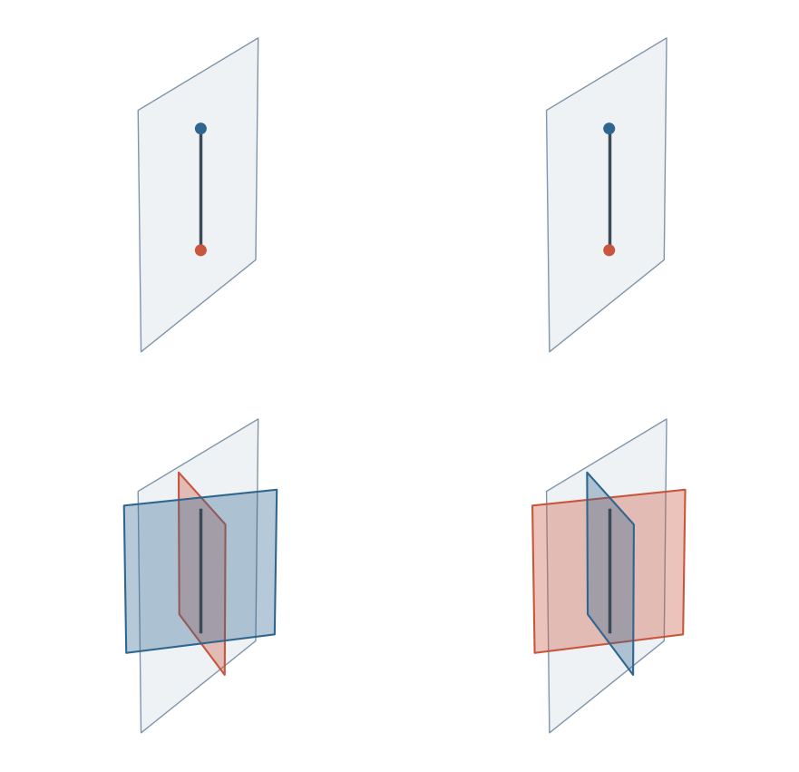
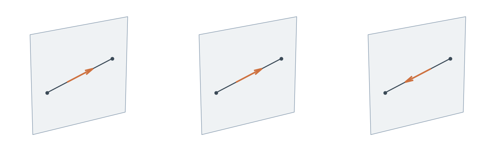
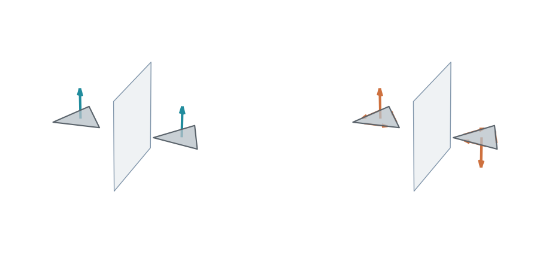
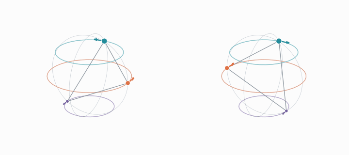

# Why orientation

This document motivates the notion of orientation in geometric algebra. It starts from a requirement on transformations of space: a transformation should commute with the constructions of the algebra, so that transforming the ingredients of a construction and building from them gives the same result as building first and transforming the result. In particular, it investigates the case of a reflection, the transformation that produces a mirror image. For a reflection `reflect`, the requirement applies to every product of the algebra, the geometric, outer, inner and regressive products alike:

```python
reflect(a * b) == reflect(a) * reflect(b)
reflect(a ^ b) == reflect(a) ^ reflect(b)
reflect(a | b) == reflect(a) | reflect(b)
reflect(a & b) == reflect(a) & reflect(b)
```

Meeting that requirement requires an operation that has a notion of 'orientation', a term this document sets out to define. The examples are written in numga, whose rules for orientation are listed in [Orientation in numga](orientation.md).

## What a physical mirror does

Two pictures show what a physical mirror does to a line, and everything after them builds on these two.



*Figure: a vertical mirror, the pale sheet, and a line lying in it. Top: a red point and a blue point on the line. Bottom: a red plane and a blue plane crossing in the line, each at half a right angle to the mirror. Left: the scene. Right: its mirror image.*

In the top row, the mirror does not move the two points: a point lying in a mirror is its own mirror image. In the bottom row, the mirror does move the planes: each plane's mirror image lies where the other plane was, so the mirror swaps them. In both rows the line stays where it is.

The same line can be built from either pair: as the join of the two points, or as the meet of the two planes. If reflecting is to commute with building, the join of the unmoved points is the join itself, so a reflection must leave the join unchanged. The meet of the swapped planes is the meet built in the opposite order, and the meet is antisymmetric, changing sign when its two planes are exchanged, so a reflection must negate the meet. The same line, built from two points or from two planes, must come out of a reflection unchanged in one case and negated in the other.

## Orientation

The join can be viewed as a direction along the line, from the one point to the other. That direction lies within the line itself, and is called an intrinsic orientation. A mirror that contains the line leaves everything within the line alone, so the direction stays as it was.

The meet can be viewed as a rotation around the line, from the one plane to the other. That rotation lies outside the line, in the space around it, and is called an extrinsic orientation. A mirror that contains the line flips the space around it, side for side, so the rotation is reversed.

An element's orientation is which of the two it carries: a sense within the element itself, or a sense in the space around it.

## In the algebra

The examples use the projective geometric algebra of space. In it, vectors are planes and `mv.point` builds points. The regressive product `&` of two points is their join, and the outer product `^` of two planes is their meet. The requirement from the opening, for the mirror, says that building from the mirror images gives the mirror image of what was built. The join of the unmoved points is the join itself. The meet of the swapped planes is the meet taken in the opposite order, which the antisymmetry of the outer product makes minus the meet:

```python
mirror = mv.x                                           # the mirror, the plane x = 0
red, blue = mv.x + mv.y, mv.y - mv.x                    # two planes crossing in the z axis, which lies in the mirror
ends = mv.point([[0.0, 0.0, -0.5], [0.0, 0.0, 0.5]])    # two points on the z axis

red ^ blue                                              # the z axis, built from the planes
blue ^ red                                              # built from their mirror images: minus the above
ends[0] & ends[1]                                       # the z axis, built from the points, and from their mirror images
```

The meet and the join have the same grade and the same coefficients up to scale, and the mirror must negate one and keep the other.

## The plain sandwich

Geometric algebra reflects an element `x` in a mirror plane `m` with the sandwich product `m * x * m.inverse()`, applied to every element in the same way. The sandwich commutes with the geometric product, and with the outer and inner products built from it, so it negates the meet as it should. It does not commute with the regressive product: the sandwich of a join is minus the join of the sandwiches, so it negates the join as well, which a mirror containing the line must leave unchanged:



*Figure: two points lying in a mirror, the pale sheet, and the line through them, with an arrow for its direction. Anything lying in a mirror is its own mirror image. Left: the line. Middle: its mirror image, which is the line itself. Right: the result of reflecting with the sandwich product directly; the points are unchanged, but the line is turned around.*

```python
def sandwich(x):
    return mirror * x * mirror.inverse()

sandwich(red ^ blue)                                    # minus the meet, as it should be
sandwich(ends)                                          # the two points, unchanged
sandwich(ends[0]) & sandwich(ends[1])                   # their join, unchanged
sandwich(ends[0] & ends[1])                             # minus the join, which should be unchanged
```

The variant that involutes odd elements before sandwiching them, `m * x.involute() * m.inverse()`, fails the same way. The plain sandwich does not geometrically have the action of a mirror.

## An orientation-aware reflection

An orientation-aware reflection negates the sandwich for one kind and not for the other; in numga it is `>>`, which reads the orientation from the element's type. With that, reflection commutes with the join as it does with every other product:

```python
mirror >> (ends[0] & ends[1])                           # the join, unchanged
mirror >> (red ^ blue)                                  # minus the meet
```

## Every element has an orientation

The line is one example. Every element of the algebra can carry either orientation, intrinsic or extrinsic, and a mirror treats the two differently whatever the element is. A triangle shows it for a plane:



*Figure: a triangle lying in a horizontal plane, and its mirror image in a vertical mirror. Left: the plane's positive side, which stays above both triangles. Right: the order of the corners, which the mirror reverses.*

The plane equation of the triangle's plane orients the plane by which side is positive, the space outside it: an extrinsic orientation, and the mirror keeps the positive side up. Joining the triangle's corners in order gives the same plane, oriented by the corners going round within it: an intrinsic orientation, and in the mirror image the corners go round the other way. The [surface normals](../examples/orientation/normals/normals.ipynb) example draws both:

```python
corners = mv.point([[0.0, 0.0, 0.0], [1.0, 0.0, 0.0], [0.0, 1.0, 0.0]])
side = mv.z                                             # the plane z = 0, positive above
winding = corners[0] & corners[1] & corners[2]          # the same plane, its corners going round

mirror >> side                                          # +z: the positive side still points up
mirror >> winding                                       # -z: the corners go round the other way
```

A point, likewise, can be oriented by its weight, as a mass is, or by a turn around it, as a pivot is, and the [circle constructed twice](../examples/orientation/conformal_circle/conformal_circle.ipynb) example does the same for a circle in the conformal algebra of space.

## How orientation spreads

Which orientation an element has is fixed by what it is built from. Planes are extrinsic, oriented by a positive side. Meeting planes with the outer product combines what lies outside them, so the lines and points where planes meet are extrinsic too, and so are the motions built from products of planes. Points are intrinsic, oriented by a weight. Joining points with the regressive product combines what lies within them, so the lines and planes through points are intrinsic. A product of an element of one kind with one of the other is intrinsic, and a product of two of the same kind extrinsic, as signs multiply.

The dual exchanges the two kinds. It takes an element to its complement, and what lay within the element lies around the complement: an intrinsic element's dual is extrinsic, and the other way round. The regressive product is the outer product taken on the duals and dualized back, so it carries one exchange more than the outer product, which is why joining two intrinsic points gives an intrinsic line. [Orientation in numga](orientation.md) lists the rule for every product.

In 3D vector notation the same distinction appears as polar and axial vectors: a velocity or a force is a polar vector, an angular velocity or a torque an axial one, and the cross product, by the right-hand rule, turns polar vectors into axial ones. In matrix notation a plane's side transforms with the inverse transpose of a linear map and a triangle's area normal with its cofactor matrix, which differs by the sign of the determinant, $-1$ for a mirror. In exterior calculus the two kinds are called outer and inner orientation (Tonti, Bossavit, Schouten), corresponding to untwisted and twisted differential forms.

## Observables

What can be measured must not change in a mirror, and a reflection that ignores orientation breaks that too. A spinning body and its mirror image turn opposite ways and have the same kinetic energy:



*Figure: a body of three masses turns, and its mirror image turns the other way. Colours identify matching masses, marker sizes show the masses, and arrows show their velocities.*

The body's rate of turning is a line oriented around itself, extrinsic. Its momentum joins the masses' points with their velocities, a line oriented along itself, intrinsic. The kinetic energy is half the regressive product of the two. Reflected with orientation, the mirrored body has the same energy; with the plain sandwich, its energy comes out negative:

```python
Line = ga.gatype.bivector()                                      # the type of lines, written where the rate of turning goes
points = mv.point([[1.0, 0.0, 0.0], [0.0, 1.0, 0.5], [-0.5, 0.0, 1.0]])
masses = np.array([1.0, 1.5, 0.5])
inertia = (points & points.commutator(Line) * masses).sum()     # momentum <- rate of turning
spin = (mv.x ^ mv.y) + 0.3 * (mv.y ^ mv.z)                       # turning about z, and a little about x
momentum = inertia(spin)

(momentum & spin) / 2                                            # 1.494
((mirror >> momentum) & (mirror >> spin)) / 2                    # 1.494: the same energy
(sandwich(momentum) & sandwich(spin)) / 2                        # -1.494: negative energy
```

The [energy in a mirror](../examples/orientation/mirror_energy/mirror_energy.ipynb) example animates the body, and the [mechanical work](../examples/orientation/mechanical_work/mechanical_work.ipynb) example does the same for the power a push delivers to a crank.

## What orientation rules out

Two elements of the same grade and different orientation are different kinds of thing, and orientation keeps them apart. A rate of turning and a momentum are both lines, and adding them is meaningless. Only an extrinsic element generates a motion: exponentiating a rate of turning gives a rigid motion, while a momentum, or a force, has no exponential. numga refuses both:

```python
spin + momentum          # ValueError: cannot add in bivector and intrinsic bivector: their orientations differ
momentum.exp()           # LookupError: 'exp' takes extrinsic elements; got intrinsic bivector
```

## Further reading

The names `extrinsic` and `intrinsic`, and the reading of projective duality as the conversion between them, are Leo Dorst's: *Projective Duality Encodes Complementary Orientations in Geometric Algebras*, Mathematical Methods in the Applied Sciences (2024). Charles Gunn develops the distinction between axes and spears in projective geometric algebra, after Study: *A Bit Better: Variants of Duality in Geometric Algebras with Degenerate Metrics*, arXiv:2206.02459 (2022).
